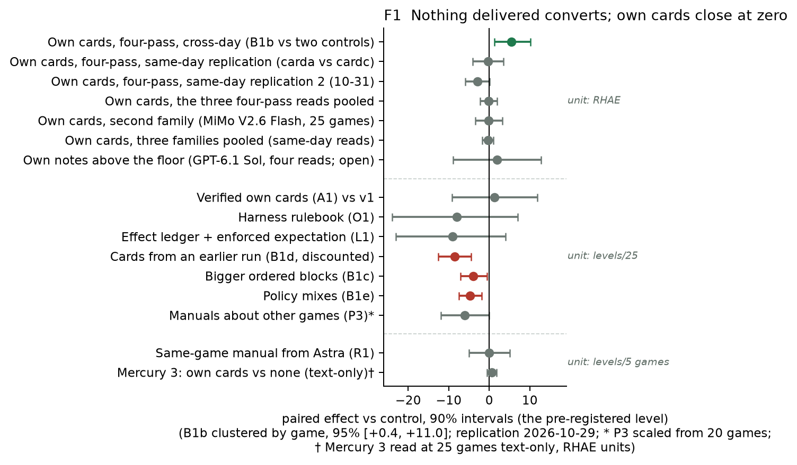
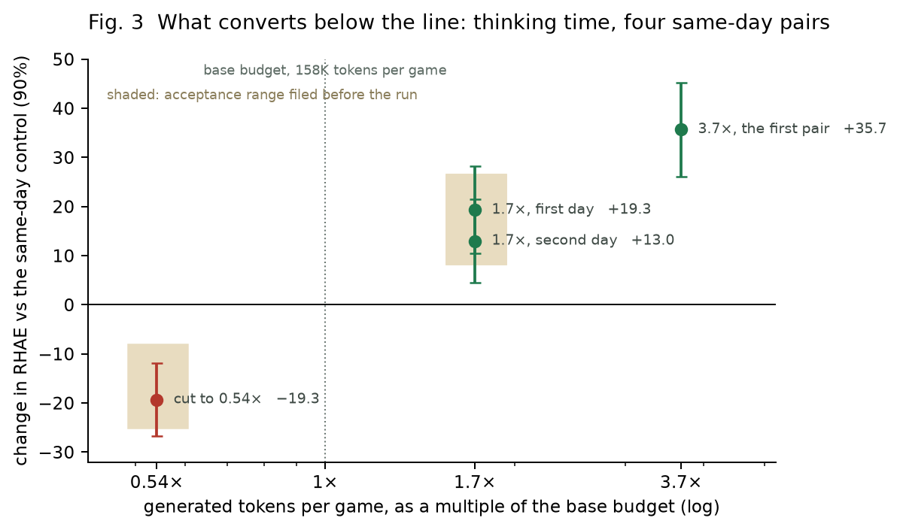
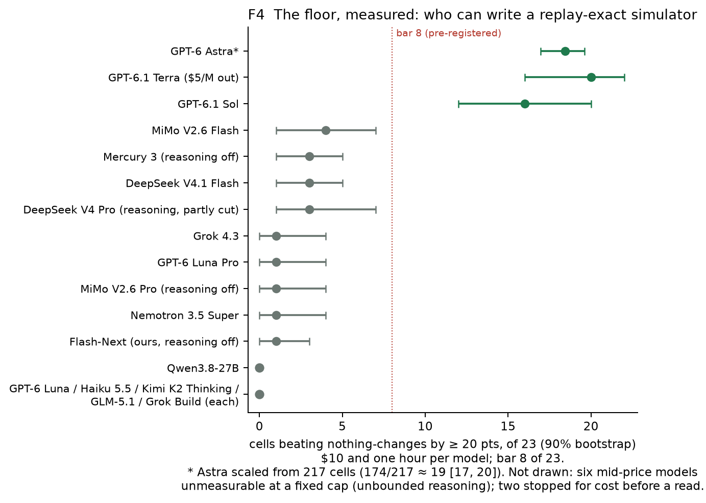
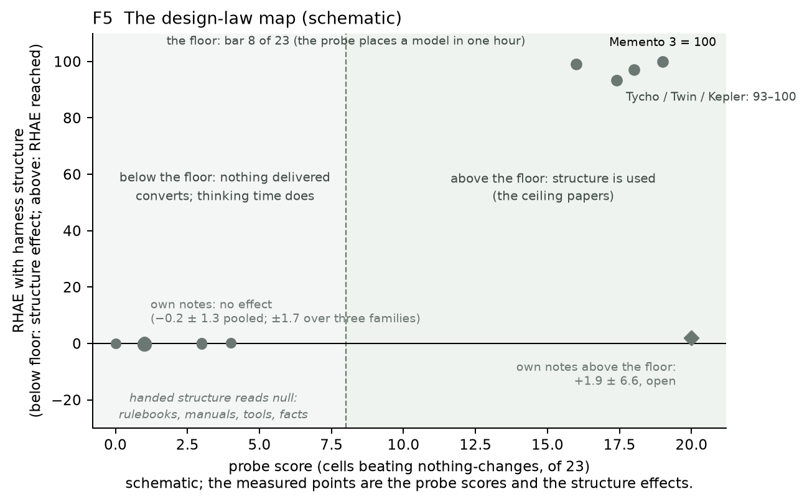

# What a Frozen Model Takes From Its Harness
## Companion document to the ARC Prize 2026 Paper Track entry (assembled 2026-11-08 10:38Z)
*Part I is the Kaggle writeup (≤ 1,500 words). Part II is the long form. Appendices A to H are the campaign record: every number in Parts I and II traces to a row, a section or a mirror listed there. Licence: MIT for code, CC BY 4.0 for documents, data and figures.*

# Part I. The writeup

## Abstract
We present a way to improve a frozen model's in-context learning that needs no human in the loop and cannot overfit. Systems that learn from their own notes (Reflexion, ExpeL, AutoGuide, ACE) assume two things: that the note is worth reading and that the reader can use it. Our loop tests both before anything is trusted. After each game the model writes a six-line note; a selector chooses which notes return; a deliverer places them in the next prompt; a meter reads their effect against a control run the same day, the acceptance criterion filed first; a certifier asks in one hour whether a model can use what it reads; a writer test asks for the same note twice and compares. Every note is written at test time on the game being played, so the loop cannot overfit the public set; every read is pre-registered and every miss published (179 experiments, 158 read), so the audit cannot overfit its result. We ran it for twelve weeks on Qwen3.8-Flash-Next (125B MoE, W4A16) in the public Duck/Franzen harness, offline on one 96 GB GPU, the Kaggle setting. Whether notes reach behaviour is gated by the reader: below the capability line the model's own notes are delivered and read, yet across three families change the score by less than ±1.7 RHAE at 90%; above the line the channel is open (+1.9 ± 6.6, four reads). The reason is measurable without ground truth. The open model's notes for one level, written in separate runs, are 1.1 to 1.4× as alike as its notes for other levels, with or without its writer thinking; a top model's are 2.6 to 3.7×. What converts below the line is the token budget: elasticity 0.83 [0.63, 1.01] at 1.7× tokens and 0.53 [0.37, 0.75] at 3.7×, replicated (+13.0 ± 5.2) and 1.0 on a same-day cut to 0.54× (−19.3 ± 4.5), the three later reads inside bands filed first; on two models that clear one level per game, doubling the budget buys nothing. Notes carried from earlier runs, other games or a stronger model read within ±5 or negative; the flown submission carries none.

## 1. The loop, and where it ran
Handed structure (structure written for the model) multiplies a frontier model's ARC-AGI-3 score: capability and effort dominate (Rodionov 2026b); a stronger writer's manuals transfer within a game (Agno); every ceiling result has a model writing a replay-verified executable (Memento 3 (2026), 100 RHAE with a frozen Opus 5; Tycho, Twin, Kepler). Self-written harnesses gain +2.8 held-out RHAE, interval through zero (Lehmann and Vahdati 2026). Concurrently, Engram (2026) reports a stronger writer's fixed notes helping small readers on knowledge-work lookups, and reinforcement learning on the reader adding more: there notes carry facts to retrieve and the reader is trained; here guidance must become action and the reader stays frozen, so the loop measures whether it can. The loop's parts: a writer (the model's own notes; a guidebook; verified facts), a selector (which notes, how fresh), a deliverer (where, when, in what form), a meter (a 25-game pass at the cap against a same-day control, bar filed first), a certifier (§4), a writer test (§2) and an allocator (§3). Bracketed tags cite rows of the released register.

| | public LB (best entry) | form mean | training |
|---|---|---|---|
| Yi-Chia Chen (top, 43 entries) | 75.56 | undisclosed | undisclosed |
| Franzen | 38.85 | ≈ 26 | none |
| this submission | 30.07 | 27.3 | none flown |

The model is served W4A16 on one RTX PRO 6000 (10 streams, 158K tokens per game) in Franzen's Milestone 2 Duck, unchanged but for the declared change.

## 2. Does the loop reach behaviour? Adoption against outcome (F1)
By delivery channel:

- **The model's own cards about games just played in this run, shown early in the user turn:** +5.5 ± 2.7 RHAE per 25 games, four-pass means against two controls two days earlier [B1b]. Two pre-registered same-day four-pass replications, cards verified in every arm opener: −0.3 ± 2.3, levels identical [cards-same-day], and −2.9 ± 1.8 [cards-same-day-3]. Pooled −0.2 ± 1.3, 90% [−2.3, +1.9]: no effect, +2 excluded. Above the line, Sol re-reading its own notes: on five games it clears, 36 vs 36 levels, −5.9 ± 8.9 [sol-samegame]; on eight hard games, three arms, the pairs are zero (+1.7 ± 19.0; −3.7 ± 10.7) [sol-headroom]; two one-pass movements dissolved on replication (ten runs, all won); above the line pooled +1.9 ± 6.6, unresolved [sol-rep]. A fourth family, MiMo V2.6 Flash: −0.1 ± 2.1 over 25 games [mimo-cards].
- **A harness-written rulebook (Memento 3's language half):** adoption lift 1.54 against an acceptance criterion of 2.0; levels −8 [−24, +7] [O1].
- **Cards from earlier runs:** 218 vs 219 levels [B1d]; bigger blocks −3.95, policy mixes −4.69 [B1c, B1e].
- **Manuals from a stronger player:** other games 149 vs 155, cited in 0 of 1,236 turns [P3]; the same game (Agno's cell), 10 vs 10 [R1].
- **Tools and ledgers:** a verifying tool used 0 of 8,087 calls [simulator-door]; an effect ledger acted on (37%), −9 [−23, +4] [L1].
The writer, measured without ground truth: same-level agreement 1.1 to 1.4× over 11,828 notes, 1.0 to 1.2× with thinking [writer-consistency, writer-thinking-consistency]; Sol 2.6 to 3.7×. The loop delivers and the model reads; below the line, what it reads barely distinguishes one level from another.

## 3. What converts below the line: the budget (F2)
Cutting reasoning length 47% cuts clears 52%, elasticity 1.1 [E1-low]; cutting the token budget to 0.54× on a same-day pair costs −19.3 ± 4.5 RHAE, elasticity 1.0, inside its pre-filed band [budget-half-sameday]. In RHAE, same-day pairs give 0.83 [0.63, 1.01] at 1.7× tokens (+19.3 ± 5.4) [budget-2x], replicated on a second day (+13.0 ± 5.2, 0.48) [budget-2x-rep], and 0.53 [0.37, 0.75] at 3.7× (+35.7 ± 5.8) [budget-pair], the first read; the three later reads landed inside bands filed first: steep below the base budget, diminishing above. On Mercury 3 (27 vs 27 levels) [budget-mercury] and MiMo V2.6 Flash (−1.6 ± 4.2; 40 vs 48 levels) [mimo-budget] 2× tokens bought nothing: the law needs a model that converts tokens into levels.

## 4. The gate: the reader's capability, read in an hour (the floor of F3, F4)
On five games at the same cap Sol clears 31 levels to the open model's 23 on a twentieth of the tokens [teachers]; Astra passes 174 of 217 probe cells [astra-corpus]. On the replay probe (a program from 20 shown transitions scored on 20 held-out against the nothing-changes baseline, criterion 20 points) Sol beats it on 16 of 23 cells [12, 20], the open model on 0 to 1. With reasoning off, seven open models write programs on 18 to 23 cells and generalise on 0 to 4 against the acceptance criterion of 8 [screen23]; handing them the cell's rulebook does not help (1 and 2 beats [R2]); ten samples per step lift Mercury to 8 of 23 at 14× tokens [economy] (10-27; not reproduced 11-06 [mercury-line-bo10-control]). The line is executable-writing, and the screen sorts classes, not models within one (MiMo 4 of 23 plays 6 levels, Flash-Next 1 plays 23); the line replicates on a diffusion architecture (Mercury 3: 3 of 23; 3 levels), where own cards read +0.6 ± 1.2 over 25 games [mercury3, mercury3-cards-25].

## 5. The meter: not overfitting the result (F3)
Seven capped stock controls over five days spread sd 2.9 RHAE [day-effect]: a one-pass pair's s.e. is 5 to 7 RHAE, a four-pass pair's 2.3 [cards-same-day]. Every experiment is a falsifiable prediction: the criterion is filed before the run, which resolves it (Appendix B); the three budget bands resolved inside; misses stay in the register. Leaderboard values are best-of-N (Singh et al., 2025), top-20 public bests 6 to 11 points above form means; a private-board forecast is filed before the reveal [board-forecast].

## 6. The flown submission: nothing carried
franzen-b1b v1 (draw 1, 30.07): Franzen's Milestone 2 notebook with its loop unchanged (the board rendered as text each turn, the action read from the reply, the oldest messages evicted at the context cap; 110 hidden games under a 9.5-hour wall), plus the model's own cards, written on the hidden games as they are played and read at session start and at context drains, and rerun-detection fixes; no note from any public game is carried in. Serve deltas that read +7.85 ± 3.65 on a pod gave no healthy draw in three flights on the box. The last slots fly the stock serve with cards: seven healthy draws, mean 25.7.

## 7. Scope and release
Scope: one frozen MoE model, one harness, one benchmark; one to four passes per arm; 14 hidden draws; the card effect reads as no effect (pooled −0.2 ± 1.3, +2 excluded). Arms that missed their criteria stay in the register with number and criterion. Register (179 rows), pre-registration log, patches, instruments, notes corpus, notebook released (MIT, CC BY 4.0).

## References (not counted)
- Shinn, N., et al. Reflexion: Language Agents with Verbal Reinforcement Learning. arXiv:2303.11366 (2023).
- Zhao, A., et al. ExpeL: LLM Agents Are Experiential Learners. arXiv:2308.10144 (2023).
- Fu, Y., et al. AutoGuide: Automated Generation and Selection of Context-Aware Guidelines for Large Language Model Agents. arXiv:2403.08978 (2024).
- Zhang, Q., et al. Agentic Context Engineering: Evolving Contexts for Self-Improving Language Models. arXiv:2510.04618 (2025).
- ARC Prize Foundation. ARC-AGI-3: A New Challenge for Frontier Agentic Intelligence. arXiv:2603.24621 (2026). The benchmark and the RHAE score.
- ARC Prize Foundation. Verified results, standard vs provider-adapter harness (X posts and results page, Sep–Oct 2026): GPT-6 Astra 62.7 vs 99.9; GPT-6.1 Sol 52.7 vs 96.4; Gemini 4 Argon 49.8 vs 97.3.
- Rodionov, S. (2026a). Executable World Models for ARC-AGI-3 in the Era of Coding Agents. arXiv:2605.05138. [EWM]
- Rodionov, S. (2026b). Do Coding Agents Need Executable World Models, Simplification, and Verification to Solve ARC-AGI-3? arXiv:2607.15439 (rev. 27 Aug).
- Model cards: Qwen3.8-Flash-Next (Qwen, 2026); Mercury 3 (Inception, 2026); MiMo V2.6 Flash (Xiaomi, 2026); DeepSeek V4.1 Flash (DeepSeek, 2026), all via OpenRouter.
- Zhao, H., Yu, Z., He, Z., Fang, M., Tutunov, R., Bou-Ammar, H., Luo, W., Wang, J. Memento 3: Model-Based Recursive Self-Improvement through Reflective Rulebooks. arXiv:2610.11794 (2026).
- Lehmann, J., Aioanei, A., Vahdati, S. Tycho: Active Abstraction with Programmatic World Models for ARC-AGI-3. arXiv:2607.28287 (2026).
- Skoutnev, A., Acharya, K., Longhitano, G., Udell, M., Ellis, K., Drori, I. Twin: Playing an Unknown Game with a Test-Time Digital Twin. arXiv:2608.14490 (2026).
- Kepler: Auditable World Models for ARC-AGI-3. arXiv:2610.00834 (2026).
- Lehmann, J., Vahdati, S. Can LLMs Improve Their Own Harness? A Controlled Study on ARC-AGI-3. arXiv:2610.30499 (2026).
- Agno. arc-agi-arcade. https://github.com/agno-agi/arc-agi-arcade and https://www.agno.com/blog/arc-agi-arcade (2026).
- Tufa Labs. The Duck harness. https://www.tufalabs.ai/research/duck-harness/ and https://github.com/Tufalabs/duck-harness (2026).
- Franzen, D. ARC-AGI-3 Milestone 2: Building on the Duck Harness (write-up and notebook, 2026). The frozen-model baseline this audit runs on.
- Singh, S., et al. The Leaderboard Illusion. arXiv:2504.20879 (2025).
- Engram. Learning in a world of notes (blog post, 4 Nov 2026). https://engram.com/blog/learning-in-a-world-of-notes. Fixed notes written by a stronger model; a small reader (Qwen 3.8 27B, GLM-5.3-Flash) trained by RL with LoRA; no intervals reported.

# Part II. The long form
# The conditions of adoption: how a frozen model's in-context learning becomes behaviour on ARC-AGI-3, and where it stops

Long form (composer; built from draft 5 of 2026-10-22, the theory section T1 to T6, the campaign map, and the 10-21 sweep). Numbers are the register's; every external number carries its source in §2.

## Abstract
A frozen open-weight model (Qwen3.8-Flash-Next) in the Duck/Franzen harness scores 26 ± 2.5 on the ARC-AGI-3 hidden set. We ask how its in-context learning becomes behaviour and where it stops. The register's paired reads (Appendix A) over twelve weeks measure six conditions of adoption; no in-context lever converts (cross-game cards: pooled −0.2 ± 1.3 over three four-pass reads; hidden +1.5, s.e. 2.3); every mechanism that hands the model structure (rules, plans, verified claims, ledgers) is read and not used. A capability probe and a play screen of eleven models in the same harness locate the floor in the model: it cannot form an executable rule from shown data, while GPT-6.1 Sol clears more levels at forty times the levels per token and GPT-6 Astra clears 37 of 38 at twenty. Frontier-written executables do not transfer past the level that introduced a mechanic. Three independent campaigns (ours, OpenAI's two settings, Agno's manuals) agree on the load-bearing joints, memory retention and fact-shaped delivery, and ours adds the boundary: the facts must be about this game, written above the floor.

## 1. The question
How does a frozen small model's in-context learning become behaviour on unseen interactive tasks, and what remains when it
cannot? ARC-AGI-3 (2603.24621) scores action efficiency against humans on games whose private mechanics are deliberately
disjoint from the public ones; the official leaderboard excludes agents trained on public or look-alike environments. Our
object of study is the Duck harness family (Tufa Labs; Franzen's Milestone-2 form) on Qwen3.8-Flash-Next, the form the
pack flies: public 45 ± 3, hidden 26 ± 2.5 (our six clean draws).

## 2. Prior work
- The open Milestone-2 write-ups attribute every step to inference: FP8 KV + longer kept history (+8 from 14.5, rellik13),
  ≤10 streams (14 streams: 29.9 vs 47.3 controlled, thread 750885), blockwise trims, prefix-cache state retention,
  priority admission (Franzen WRITEUP; COMPARISON.md). Summaries/advice blocks cost −2 to −4; ending stalled levels −9;
  expert pruning "worse play"; temperature 1.0 nothing. Noise: same code twice 47.3 vs 48.9 public; run-mean SE ±4.8.
- Our register (55 reads, paired by game, ±3.5): cards +1 to +3 public (the one in-context lever that converted, +2.3 on
  clean hidden means); rulebook adoption lift 1.54 vs chance, levels −8; verified rules at the null; context cut −36
  levels; every serving lever inside the floor. The pattern: adoption without outcome (A3).
- The capability probe: given 20 recorded transitions, write an executable rule and replay 20 held-out ones: Sol 16/23,
  Flash-Next 0/23 with thinking (no stated rule inside 16K of reasoning), 1/23 without; eleven open models ≤ 1/5.
- The floor read in play, same harness, same games, 55-min cap: open models ≤ 13 levels, Flash-Next 23 (3.6M generated
  tokens), Sol 31 (126K), Argon 28 (cut), Astra 37/38 (292K). Economy: 0.6 vs 24 levels per 100K tokens (40×).
  Independent text-only transfer exists at the frontier (Agno manuals: Gemini 3.7 Flash 37 → 96 RHAE on public); the
  teacher's knowledge in the user turn moves a model that can execute it; it did not move ours (cards, rulebook).

Same-game handed knowledge lifts frozen models by large factors on the public set: Agno's manuals (Gemini 3.7 Flash
37.33 → 96.42; Grok 4.6 37.40 → 89.31; GLM-5.2, open weights, 7.92 → 83.46; tokens per game 195K → 65K). Within-game
cross-level memory is used by the pack (rellik13's M85; lalalia9's cache-safe variant at 31.46 public) with transcript
evidence and no controlled delta. Reasoning retention plus compaction: OpenAI 13.3 → 38.3 on the public set at 6× fewer
tokens, no ablation separating the two; ARC Prize's board now labels Standard vs Provider-Adapter harnesses; no open-
weight reproduction. Controlled open-weight context experiments on the Franzen stack are negative (14 streams −17; a
110K stall cutoff −9.1; run-mean s.e. ±4.8). No public result reports knowledge written on one game applied to another.
Ours does: weak-writer seeds across games −8.6 (B1d) and the strong-writer cell (P3, pre-registered).

## 3. Method
The form (Franzen's Milestone-2 Duck: Qwen3.8-Flash-Next W4A16 on Pennyroyal SGLang, 10 streams, 139K context, cards on); paired reads by game on one pod (25 public games + 5 held-out families; resolution ±3.5 levels); the operating point (158K generated tokens per game, Franzen's competition-budget run); the replay-verification probe (20 shown / 20 held-out transitions, exact replay, counterexample feedback); hosted play screens (five games, 55-minute cap); the training ladder (validate → load → train → merge → smoke → pair). Retractions are dated in Appendix B.

## 4. Results
### 4.1 The six conditions

### A1. Channel: learning reaches action only as user-turn text delivered early

Support: the harness's untried-action ledger line was followed on 9 of 10 sampled level-1 turns and 0 of 6 later-level turns (16 hand-sampled turns: a level effect; withdrawn as placement evidence 2026-10-29); a drain notice in the user turn made the model read its history 2.4 times more often, a placebo did not. Boundary: the same content as a documented tool argument was never used in 8,087 turns; as a model-written memory section, in 8% of turns; as a prior assistant turn, less often than as a user turn (0.24 vs 0.38). Two verification tools offered to the model were used once and never, because the model already verifies its own way (a frame diff after every action) and a second interface is redundant to it.

### A2. Unit size: the model learns one object's rule, never a board's

Support: per-colour predictors, each written from that colour's events alone and verified on its own cells, reach exact replay of 11 to 20 of 20 on the hardest easy level; structured state (objects, no raw grid) with a short reasoning budget lifts the single-object hit rate from 8% to 29% per cell-run and reproduces two one-object levels exactly. Boundary: whole-board models are never written exactly (0 of 23 with reasoning, 1 of 23 without, across 78 cell-runs of budget × representation, a tool, and best-of-4); composed wholes are bounded by their weakest part (sp80: parts 11 to 20 of 20, whole 5 of 20; the product law holds on 8 of 8 cell × regime points), and the weakest parts are the counters, markers and gates; repair, symbolic fitting of five rule families, from-scratch rewriting and selection depth move nothing, on the five multi-object cells and on seven deep levels (all 0 of 20 held-out). The model learns each thing that moves and not what the moves do to the rest of the board.

### A3. External verification: measured facts are acted on; the model's own early judgement is defended

Support: the prober's measured-fact cards over nine games, 23 cards: 10 acted on, 12 cited and re-measured, 1 misread, 0 ignored. An enforced expectation (the harness checks the model's stated prediction every turn) changed 37% of the following actions. Boundary: the dominant failure of a playing agent is an early judgement defended; 83% of stuck sessions had already taken the decisive action, and retractions arrive 20 to 30 turns late (the failure anatomy of 10-04). Two corrections to the naive reading: the enforced expectation moved levels per token by 0.1% (adoption without content), and the model's WRITTEN rulebook is not what it defends: nine claims in ten are rewritten at the next version, falsified or not, so the rulebook is a fresh guess each time and does not serve as a memory (version-level survival of falsified claims 0.09 against a base rate of 0.10). What is defended is the working judgement; the written one is not.

### A4. Vocabulary: knowledge must be stated in the actuator's language

Support: cross-game cards, six lines of actionable text (what the board shows, the goal, the controls, the rule that cleared it, one trap, when it does not apply), delivered per A1, are the one module that transferred to score: +5.4 public levels on one job, +1 to +3 honestly, +1.5 ± 2.3 on hidden; every variant (formats, orderings, seeds, selection, the assistant channel) read at or below it. Boundary: the actuator gap. Of 39 faithfully reconstructed stalls, 28 carry a genuine, specific goal stated by the model (72%); 22 of those are manipulation goals ("move X to Y") with no target grid ever printed; conversion by a planner given the model's goal is 1 of 28, by a mechanical goal distance 1 of 39, by object-space subgoals 0 of 39, and one subgoal was reached without the level clearing. The model knows its goal at a stall and cannot express it in any form an actuator can take.

### A5. Selection: a free verifier makes a weak generator usable, and cannot lift a plateau

Support: best-of-N by replay turns the model's one-in-five per-part hit rate into a delivered part (3 of 5 easy cells under selection where single runs replicate at 1 of 5); the cards are selected and re-verified at every write. Boundary: on sp80's binding colour, 48 samples never exceeded 17 of 20, bimodal at 15 and 17: a capability plateau; sampling depth does not move it. Selection buys the variance; the ceiling stays.

### A6. Substrate: the loop's gain scales with the exactness of the dynamics it plans on

Support: on the real engine (deep-copied), blind search converts perfectly on the levels it can reach: tu93 9 of 9 at every level under the human baseline, a median of 0.43× human actions over the local levels it solved. On a frontier model's written simulator, the same loop is the field's +59 points. Boundary: on this model's written simulator, 0 of 23; and the real engine is not available for unseen games, where blind search cannot open a level (hidden draws of a standalone planner: about 1.3). For a small model the consequence is to plan on the environment it holds, after the model has opened the game; the planner rides only behind the model.

### The operating point (the conditions' setting)

Kaggle runs at the 1x point of the budget curve (158K generated tokens per game; public 46.5 at 1x, 58 at 1.7x, 62 at 2.6x), where tokens per game are the binding lever: more streams at a cut context generated 52% more tokens and cleared 25% fewer levels; the FP8 table served 12 to 16% slower for the same levels; reasoning effort cut by half halved clears on the same wall (downward elasticity 1.1, upward 0.2). The public board's best entries equal the expected maximum of their teams' own draws; our form's mean is 26 ± 2, best draw 30.07.

### 4.2 The loop, step by step
Write the executable: 0/23 joint, 1/23 without thinking; per-object parts 11 to 20 of 20, composed 0 of 20. Verify by replay: a
harness step, works. Plan on an executable: works on the true engine (29 public levels at 0.43× human) and is not reachable on
hidden (no fork). Execute a handed plan: search/execute tools used 1 in 8,087 calls; verified verdicts adopted 37% for
+0.1% levels; stalled goals are manipulation goals the agent cannot actuate (22/28). Observe transitions: re-derives from
raw boards (45K chars of bookkeeping, no stated rule). Revise on error: 9/10 claims rewritten per version. The loop fails
at every step that asks the model to hold or produce structure; the one load-bearing joint is fact-shaped delivery in
the user turn, early (cards +5.5 ± 2.7 cross-day, then −0.3 ± 2.3 and −2.9 ± 1.8 same-day, pooled −0.2 ± 1.3; hidden +1.5, s.e. 2.3; no effect). Executables written at the frontier do not transfer past the level that
introduced the mechanic (library S0: 2/8 beyond the nothing-changes baseline; cross-game 0). The contrast that completes
the claim: when a stronger model writes a per-game manual, the same student class executes it (Agno: Gemini 3.7 Flash
37 → 96 RHAE on public); the hidden set forbids that writer at test time.

### 4.3 Why in-context transfer fails below the floor
A frozen model adopts a written rule only if it can hold and execute it; Flash-Next writes rules it does not play by and
rewrites 9/10 claims before testing them (O1), and cannot form an executable rule from shown data (the probe). The
"verified world model still loses" literature (2607.14169; 2605.05138 "premature commitment"; 2607.15439 "gains from
model/effort > gains from harness") says the same of models above ours. Memento 3 (2610.11794) reaches 100 RHAE on the
public set with a frozen Opus 5 and a rulebook compiled to code: the loop needs a model that writes executable rules.

## 5. The boundary claim
OpenAI (July 2026): retained reasoning + compaction took GPT-5.6 Sol from 13.3 to 38.3 on the public set at 6× fewer
tokens; the official harness discards reasoning each turn. Our form keeps it; stripping it read 17.53 on hidden (§185).
Agno arcade (MIT): per-game manuals written in play by a strong model, verified facts, level-boundary distillation; seeded
weaker models score far above their cold runs on the SAME games (Gemini 3.7 Flash 96.42, Grok 4.6 89.31, GLM-5.2 84.80,
DeepSeek-V4 50.10). Our read of the same mechanism across games: seeds from 55 seen games on unseen games −8.6 hidden
(B1d). Citation facts (read 10-21): OpenAI's post is dated July 29 2026; the 13.3 → 38.3 is on the PUBLIC set in OpenAI's own
harness with Responses-API settings ("retained reasoning" keeps the chain of thought between steps; "compaction"
summarises old context instead of truncating); ARC Prize's verified score for the same model is 7.8 (semi-private,
standard harness) and ARC Prize's stated position is that official scores use no provider-specific settings. Agno's
table (MIT; public 25 games, 183 levels, RHAE; human aggregate 95.4): GPT-5.6 Sol cold 96.15, warm 100.0; seeded by
GPT-5.6's manuals: Gemini 3.7 Flash 96.42 / 88.78, Grok 4.6 89.31, GLM-5.2 84.80 (still playing), Claude Opus 5 60.02,
DeepSeek-V4 Flash 50.10. The page gives NO cold-run scores for the seeded models, so "far above its own cold run" is not
on the page (our comparison uses ARC Prize's verified cold numbers: Gemini 3.8 Flash 35, Opus 5 30, DeepSeek 3.3);
seeded-1 for Gemini and Grok EXCLUDE sp80 (its manual was written by an agent that had read the game's source); no
unseen-game result is reported. Three campaigns agree on the joints, memory retention and fact-shaped delivery, and
ours adds the boundary: the facts must be about THIS game, and below the floor the model cannot write them itself.

## 6. What the conditions say to a builder

What the six conditions describe is adoption, not outcome: for written structure to reach a frozen small model's behaviour at all it must be small (A2), verified outside the model (A3), delivered early in the user turn (A1), stated in the actuator's vocabulary (A4), selected with a free checker (A5), and planned on the real environment behind the model (A6). On the deployed form the model's own notes meet A1, A3 and A4 and are read; their effect on the score is inside ±1.7 RHAE across three families (Part IIb). The seam meets A6 where the dynamics are exact. The boundary of A2 and A6 is the capability floor: where the model cannot write the dynamics of what it sees, the harness can verify, select and compose, and cannot supply the rule; and the same probe places every open-weight model we can serve on our side of that line. Above it the harness is the lever and its conditions are these six; below it, the lever this audit measured is the token budget (Part I §3).

## 7. Limits
Public set leaky (Liew 2605.25931: solvable by non-intelligent strategies; private mechanics deliberately disjoint); one form family; single-run reads at the ±3.5 floor; closed-teacher data provenance is a terms-of-service and eligibility question we state rather than resolve.

## 8. Conclusion
Claims: the adoption conditions (A1 to A6) as measured; the capability floor as a property of the model, read across
eleven models in one harness; the economy gap. Not claimed: transfer to unseen mechanics unless a hidden draw shows it; any
inference lever beyond the form the pack already flies.

# Part IIb. The notes channel as a pre-registered equivalence study
*Written 2026-11-02 after the last read of the notes channel (register rows through sol-tn36-ls20-replication). Every number below is a register row; the pooling is inverse-variance over independent reads and is stated with its inputs so it can be redone.*

## 1. The claim, stated as an equivalence question

The question the campaign asked of the notes channel is not "do notes help" but "is the effect of a model's own notes on its score inside a band we can name, and on which side of the capability line". Stated that way it has a research-grade answer in one regime and an honest non-answer in the other.

**Design.** The unit is a same-day pair: the same frozen model, harness and 25 public games, one declared change (notes on vs off, or a second attempt with vs without the first attempt's notes), the control run the same day, read as the paired difference in RHAE (the competition's human-relative action-efficiency score) over games, with its standard error from the per-game differences (game-clustered bootstrap where passes are pooled). Acceptance criteria were filed before every run (Appendix B); a read that misses its bar is reported with the number. A delivery check precedes every read: the notes present in the openers of the arm (log line per game); a reading check where the design allows (levels the model clears half the time, citations, the model's own words).

## 2. Below the capability line: settled

| read | design | estimate (RHAE, arm − control) | row |
|---|---|---|---|
| own notes, first read | 4 passes × 25 games vs two controls two days earlier | +5.53 ± 2.67 (cross-day) | B1b-real-cards |
| own notes, replication 1 | 4 passes × 25 games, same-day control | −0.30 ± 2.34 | cards-same-day-pair |
| own notes, replication 2 | 4 passes × 25 games, same-day control | −2.86 ± 1.83 | cards-same-day-pair-3 |
| own notes, second family (Mercury 3) | 1 pass × 25, same hour | +0.61 ± 1.16 | mercury3-cards-25 |
| own notes, third family (MiMo V2.6 Flash) | 1 pass × 25, same hour | −0.14 ± 2.06 | mimo-cards-pair-25 |
| same game, a stronger writer's manual (Flash-Next) | 5 games, same day | 10 vs 10 levels | r1-samegame-seeding-below-floor |
| same game, the model's OWN notes (Flash-Next) | not run; the one cell of the protocol map below the line still empty (Reflexion's own protocol); filed as pod-samegame-own-notes with a null prediction | — | pod-samegame-own-notes |

Pooled, Flash-Next same-day only: **−1.89 ± 1.44**, 90% interval [−4.3, +0.5]. With the cross-day first read included: −0.21 ± 1.27, [−2.3, +1.9]. Across the three families at the floor: **+0.18 ± 0.79**, [−1.1, +1.5]; with the cross-day read left out (Flash-Next same-day only, Mercury, MiMo): **−0.33 ± 0.83**, [−1.7, +1.0], the version a reviewer who distrusts the day effect would compute. Equivalence statement: below the line, a model's own notes change its score by less than ±1.7 RHAE across three families at 90% confidence from same-day reads alone (±1.5 with the cross-day read included), and by less than ±4.3 on the workhorse model alone. The filed bar for "converts" was +4; it is excluded in every pooling. The cross-day first read sits 2.4 standard errors above the same-day pair of the same design; that gap is the day effect measured in the instrument chapter (seven capped stock controls over five days, sd 2.9), and it is why the campaign's law is same-day pairs.

Delivery and reading checks in this regime: notes in every arm opener (log lines per game, all reads); on the 85 levels the model clears about half the time, it cleared 62% with notes against 51% and 49% in the two controls (B1b); a stronger writer's manual for the same game was shown and cited in 0 of 1,236 turns (P3); Mercury saw notes in 479 openers and clears one level per game either way. The channel delivers and is read; it does not move the score.

## 2b. The writer, measured without ground truth (post hoc)

The channel has a writer as well as a reader, and the corpus the campaign left behind lets the writer be measured without knowing what a level's true rule is: if the same model writes a note for the same level in independent runs, how alike are the notes, compared with its notes for different levels of the same game? A reliable writer describes the same level the same way; an unreliable one describes it differently each time, and at most one of its descriptions can be true. No acceptance criterion was filed before this read; it is a post-hoc analysis over existing files (runs/field/pod-mirror/*/cross_game_cards.jsonl; runs/field/local-reads/*sol*/cross_game_cards.jsonl), and it is labelled so.

| writer | notes | same-level / different-level similarity, Jaccard [90%] | tf-idf cosine [90%] |
|---|---|---|---|
| Qwen3.8-Flash-Next, all 255 game-levels | 11,828 | 1.14 [1.13, 1.16] | 1.36 [1.31, 1.41] |
| Flash-Next, the 86 levels Sol also played | subset | 1.16 [1.13, 1.20] | 1.39 [1.30, 1.49] |
| GPT-6.1 Sol | 333 | 2.60 [2.32, 2.83] | 3.65 [3.30, 4.08] |

*Re-read 2026-11-08 with the released instrument on the released corpus (instruments/writer_consistency_paper.sh): excerpt fallbacks excluded (a note must carry GOAL), the student arms and the thinking-on arms out of the open model's set, Sol = the seven hosted reads. The 11-02 read (1.12/1.34 over 11,877; 2.18/2.36 over 407) ran before that filter; the direction is unchanged and the gap larger.*

Same-level pairs are always from different runs; 2,000-sample bootstrap on the pair sets. Per game, Sol's ratio exceeds Flash-Next's on 12 of 12 shared games (sk48 4.37 vs 1.00, su15 5.00 vs 1.16, bp35 2.55 vs 1.05). Within one run, across its four passes on the same day and form, the open model's ratio is 1.08 to 1.18 on all sixteen four-pass mirrors (mean 1.15): the disagreement is not a day effect or a form effect. An example, sk48 level 1, 56 open-model runs: two notes read "align three blocks in a row by extending and retracting the rod" and "stack all three blocks in one slot, ordered red, blue, black"; Sol's three runs all read "pick up the red, green and blue pieces in the shown order; up and down move the head along the rail, right extends the arm, left pulls it back".

What it says: below the line the notes the next game reads are, on average, not about the game, so the null in §2 has a mechanism on the writer's side as well as the reader's (the reader was tested separately with a stronger writer's accurate manual and did not use it either, r1 and P3). Above the line the writer is consistent. Agreement is not accuracy, but disagreement bounds it. The one confound, closed on 11-03: the open model's side-call writer had run with thinking off and Sol's with thinking on. Two pod passes with the open model's writer allowed to think (8192-token cap, 229 notes, excerpt fallbacks 7%) agree with each other at 1.04 [0.98, 1.10] Jaccard and 1.24 [1.08, 1.45] tf-idf, against 1.12 and 1.22 for the thinking-off notes measured the same way (writer-thinking-consistency); MiMo V2.6 Flash, hosted, the same change: 1.17 [1.04, 1.31] against 1.21 (mimo-writer-thinking-consistency, 33 pairs). Letting the writer think did not make its notes agree. The gap to Sol is the model, not the writer's budget. The original read stays labelled post hoc; these two were filed with bars before launch. For a guidance product the measure is a note-reliability screen that needs no ground truth: write twice, compare.

## 3. Above the capability line: not settled, and why

| read | design | estimate | row |
|---|---|---|---|
| Sol, five games it clears, own notes on a second attempt | 1 pass, same day | −5.9 ± 8.9 (36 vs 36 levels) | sol-samegame-own-notes |
| Sol, eight hard games, own notes on a second attempt | 1 pass, same day, 7 games finished | +1.7 ± 19.0 | sol-headroom-own-notes |
| Sol, tn36, the game that converted at one pass | 3 cold vs 3 noted, single-game jobs, next day | +14.4 ± 13.1 (all six won) | sol-tn36-ls20-replication |
| Sol, ls20, the game that fell at one pass | 2 cold vs 2 noted | +17.1 ± 23.9 (all four won) | sol-tn36-ls20-replication |

Pooled: **+1.9 ± 6.6**, 90% interval [−8.9, +12.8]. This is not a null: the interval holds zero and it holds +10. The minimum effect these four reads could have detected at 80% power is about 16 RHAE. The per-game replication was filed and read as pass counts (does the note turn a loss into a win); both bars missed because every run won. What it showed is the variance the one-pass cell hid: level 1 of tn36 took between 37 and 1,730 actions across nine runs with no relation to the arm (cold 1,730, 1,447, 1,310, 51; noted 1,417, 1,288, 587, 37). A one-pass per-game outcome on this model is a draw from that distribution.

What would settle the upper half: a four-pass 25-game same-day pair on Sol (minimum detectable effect ≈ 5.7 RHAE, as measured for the design below the line), about 200 game-runs at ≈ $12 each. The campaign did not have it. The companion says so rather than reading a null into a wide interval.

## 4. What this result is, against the published family

- **Reflexion** (verbal self-reflection after a failed attempt, re-attempt the same task): our same-game second-attempt cells are this protocol. Below the line: no effect within ±4.3. Above the line: unresolved within ±13.
- **ExpeL** (insights distilled across tasks, recalled on new ones): our cross-game notes are this protocol. Below the line: no effect within ±1.7 across three families (same-day reads).
- **AutoGuide** (guidelines carrying the context they apply to): our condition-bearing form. Below the line +1.2 [−9.2, +11.8] (A1); above the line one pass, not resolved.
- **ACE / Dynamic Cheatsheet** (an evolving curated playbook): our guidebook with a next-test slot. Below the line: adoption lift 1.54 against a criterion of 2.0; levels −8 [−24, +7] (O1).
- **Memento 3** (rulebook compiled to code, accepted on exact replay): not attempted; the contrast case that reaches the human score with a model above the line.
- **Engram, concurrent** ("Learning in a world of notes", 4 Nov 2026; a blog post, no intervals, one benchmark of 125 questions): fixed notes from a stronger writer, a small reader trained by RL with LoRA. Notes alone lift the untrained reader on knowledge-work lookups (Qwen 3.8 27B 60.0 → 72.3; that model is 0 of 23 on our probe), and training adds more. This bounds our claim rather than contradicting it: their notes carry facts to retrieve, ours carry procedures to execute over hundreds of actions, and the probe measures the second capability. Where the reader is weak they train it; we hold it frozen and certify first.

The family's positive results are on models above the line and on tasks whose failures are diagnosable in words. This campaign's contribution to that literature is the measured lower regime: a frozen open model that reads the same artifacts and does not convert them, with the band stated, and a one-hour screen that says in advance which regime a model is in. The upper regime is left where we found it: open, with the design and price that would close it.

## 6. The price of a reader (the screen run across the market, 2026-11-04)

To learn whether the open upper half could be bought cheaply, the capability probe (24 cells; a cell passes when the model's replay-verified program beats the nothing-changes baseline by 20 points on 20 held-out transitions; above the line = 8 of 23) was run on every OpenRouter model between the open tier and Sol that offers reasoning, with the probe's completion cap stated per row (8,000 unless noted) and every attempt in the register. Reads are clean only when the model's reasoning did not consume the cap.

| model | price per M in / out | cells of 23 | setting | read |
|---|---|---|---|---|
| GPT-6.1 Sol | 2 / 10 | 16 | effort high | above |
| GPT-6.1 Terra | 1 / 5 | 20 | effort high, 1 cap hit in 75 | above |
| DeepSeek V4 Pro | 0.10 / 4.11 | 2, 2, 3, 0 | high and low at a 24K cap, high at 48K (a third of iterations cut each time), then off | below; more room bought one cell |
| Grok Build 0.1 (code-tuned) | 1.00 / 2.00 | 0 | high, cap 24K, clean | below |
| Grok 4.3 | 1.25 / 2.50 | 1 | high, cap 24K, clean | below |
| Kimi K2 Thinking | 0.60 / 2.50 | 0 | high, cap 24K, clean | below |
| GLM-5.1 | 1.40 / 4.40 | 0 | reasoning off (with reasoning it fills any cap) | below |
| MiMo V2.6 Pro | 0.43 / 0.87 | 1 | reasoning off | below |
| GPT-6 Luna Pro | 0.10 / 0.50 | 1 | effort low, clean | below |
| GPT-6 Luna | 0.10 / 0.50 | 0 | effort low, clean | below |
| Claude Haiku 5.5 | 0.10 / 0.50 | 0 | high; first iterations cut, the rest carried code | below |
| Kimi K2.6, MiMo V2.5 Pro | 0.65 / 3.41, 0.48 / 1.80 | 0 of 6, 0 of 7 | partial, stopped for cost | not read against the bar (0 of 6 cannot place a model below 8 of 23) |
| GLM-5.3, Step 3.7 Flash, Mistral Large 4, MiniMax M3, MiniMax M3.1 Flash, Kimi K2.7 Code | 1.15 to 3.60 out | — | reasoning mandatory or unbounded; effort and budget ignored; off refused where tried | unscreenable at this cap |
| open models (DeepSeek Flash, MiMo Flash, Nemotron, Qwen3.8-27B, GLM Flash, Mercury 3, Flash-Next) | ≤ 0.50 out | 0 to 4 | reasoning off (the screen23 convention) | below |

What it says: on this probe, capability arrives with price. Nothing under Terra's $5 per million output crossed the line, and the mid-price tier split into two failure modes, models that write code that does not replay, and models whose reasoning cannot be bounded or disabled and therefore cannot be measured at a fixed cap. Both are certifier facts: the first is the line, the second is a property any deployer must know before buying guidance for a model. The reader for the open above-the-line pair is therefore Terra, at half Sol's price; the pair's cost floor is set by it.

Why the table is bimodal, and what the gap is. Three properties of the screen make the middle narrow by construction, and they are stated here so the gap is read correctly. The cell is conjunctive: a program passes only if it replays the complete transition function exactly, so one wrong rule scores as no program (DeepSeek V4 Pro's cells are one at 20 of 20 and the rest near zero; Terra fits every cell's shown transitions exactly; Kimi K2.6's best is 3 of 20). Per-cell success is a product of parsing the frames, inferring the rules and writing exact code, so a modest drop in each sends a model from Terra's zone to the floor. The budget is fixed at four iterations: Terra needs one or two; a model that would get there with ten never does. The middle is therefore not empty by nature. Mercury 3, at three of 23 on one try, reached eight of 23 under best-of-ten sampling at fourteen times the tokens (register row economy): the middle is reachable, and its price is above Terra's. What the screen measures is the line at the budget a deployer can afford, which is the line the product needs. The two cells that review left open are now read: DeepSeek V4 Pro at double the cap reached 3 of 23 with a third of its iterations still cut, so more room bought one cell; of the two code-tuned mid-price models, Grok Build read 0 of 23 cleanly and Kimi K2.7 Code could not be measured. Nothing occupies the middle at a fixed budget.

## 5. Threats to validity, named

1. One harness, one benchmark, one score. RHAE rewards action efficiency; a note that changes which levels are reached without changing efficiency would move levels, not RHAE. Levels are reported beside every RHAE read and agree in sign.
2. Reads above the line are one pass each on a hosted route; the day effect measured on pods (sd 2.9) is not measured for Sol.
3. The headroom cell's per-game split conditioned on the cold arm's own outcome; regression to the mean inflated both movements, which the replication then removed. The design flaw is recorded with the read.
4. The first read of the channel was cross-day; it is the one positive number and it is reported with its day effect, not dropped.
5. The three-family pool assumes RHAE differences are commensurable across models with different baselines (Flash-Next ≈ 26, Mercury ≈ 3, MiMo ≈ 10). The Flash-Next-only bound (±4.3) does not depend on that assumption.

# Part III. The paper in the program's frame
The lab's program (its direction-of-work and research-thesis documents) runs one loop: a frozen model learns in writing how to act, verified by what happens next, improved from its own record, portable across models, with an evaluator measured before anything optimizes against it. Its execution rule is that every experiment runs first where failure is free, on games. This paper is that first run: every stage of the loop executed on games, complete, with the place where it stops measured. Memento 3 closed the games loop on a frontier model; we ran ours on an open model below the floor and mapped the boundary. The campaign's contribution is the map: where a frozen model below the floor takes written structure and where it does not, with the budget as the lever that moves and the screen that says which regime a model is in. What follows is how each result lands on the program's bets, what it changes in the program's own text, and the one claim the paper makes beyond games.

## 1. Bet by bet

**Bet 2, continual learning in memory, not weights.** The paper's central null, now complete. The only structure that ever leaned positive for a frozen model was its own record: cards it wrote minutes earlier about the games of the same run read +5.5 ± 2.7 RHAE per 25 games in a four-pass read across days, then −0.3 ± 2.3 and −2.9 ± 1.8 in two pre-registered same-day four-pass replications (pooled −0.2 ± 1.3; +2 excluded; the cross-day read sits 2.4 s.e. from the same-day pair; hidden +1.5 s.e. 2.3): no effect at this resolution on this class of model. Everything handed to it from outside, a stronger model's manuals, a harness-written rulebook, verified facts, tools, ledgers, older seeds, showed no effect within each pair's resolution, or read negative. The provenance pair (10-28) narrowed the mechanism: labelling the same cards as another agent's changed nothing (+0.9 ± 5.1), so adoption does not run through authorship. Recency is measured (older seeds within the pair's resolution); the format half of the clause was read on 10-28: the same notes rendered as prose instead of cards cost −4.7 ± 6.2 RHAE, the predicted sign at 0.76 s.e., a lean and not a resolution (register w3-prose-format). Training the weights instead deleted the model's reasoning (median 1,766 → 171 to 222 characters) and never beat parity on play. The program's line "we do not train model weights" stands on cost, portability and the data boundary; this is one measured case in its favour, a warning from one model family; no doctrine is proved.

**Bet 4, portable behavior across models, and its floor.** The program names a capability floor under certified renderings; the paper measures it. Below the floor a model cannot write a replay-exact simulator of a level (open class 0 to 4 of 23 cells, GPT-6.1 Sol 16, GPT-6 Astra 174 of 217), and below it no handed structure converts. The floor replicated on a diffusion architecture (Mercury 3), on the strongest open models in play (MiMo, DeepSeek V4.1 Flash at 6 levels against 23), and under sampling (best-of-10 lifts Mercury 3 → 8 of 23, half of Sol's single try — measured once, 10-27; not reproducible on the same endpoint label on 11-06, 0 of 23 [mercury-line-bo10-control]). The program's own sentence "the rulebook ports as language, while compiling it to verified code needs a model above a measured floor" is this paper's boundary claim, with the floor now a screen anyone can run in an hour.

**Bet 3, the evaluator measured first.** The instrument chapter is the program's rule applied to itself: the same fixed system read five times spread 87 to 106 levels; a single pair resolves ±5; every number in the paper carries that. The best-of-N reading of the public board, with a private-board forecast filed before the reveal, is the evaluator measured against the field.

**Bet 1, a predictive model of the next state.** The replay probe is the program's bet 1 on games: predict the next state from the situation and the move, scored on held-out transitions against the marginal. Typed-decision models (Jev, Laya, Mercury Decide) sit at chance on it; frontier language models clear it; the open class does not. One implication for the state-sufficiency study, which comes first on the person side: sufficiency may be model-dependent, and a state that predicts the next turn for one reader may not for another, so the study should read its state with more than one model.

**Bet 5, the human reference.** RHAE is a human baseline on action efficiency, and the paper reads every result in it. That is the metric's property; the person loop's version differs: bet 5 is role-appropriate behavior scored by the person's outcomes over time, and nothing on games speaks to it. The row is here so the mapping is complete; it is not evidence.

## 2. What the paper corrects in the program's text
The direction document's §4 cites the campaign at an earlier state. The audited values: own-run cards +5.5 ± 2.7 cross-day, then −0.3 ± 2.3 and −2.9 ± 1.8 same-day, pooled −0.2 ± 1.3 (hidden +1.5 with s.e. 2.3): no effect, +2 excluded; pre-registered experiments 138 against the text's "sixty-plus"; the 20-of-20 frontier simulator line is now Sol 16 of 23 cells and Astra 174 of 217, the open class 0 to 4; add the provenance result (authorship-insensitive). The adherence split (37% changed course, outcome per token flat) stands as cited. The channel law does not: its "9 of 10 early, 0 of 6 late" was a level-1-versus-later count on 16 hand-sampled turns; what the record holds is a lean (user-turn text moved deliberation 1.6× more than an assistant turn, exploratory) and a tool argument never called in 8,087 turns, and the program documents now say so.

## 3. The one claim beyond games, with its condition
Below its capability floor, a frozen model converts none of the structure delivered to it at the resolution a pair buys (±2.3 RHAE at four passes); its own recent record included (pooled −0.2 ± 1.3 over three four-pass reads; the format clause measured once as a lean: prose −4.7 ± 6.2); it reads everything and uses none of it at a size a pair resolves. Above the floor, outside structure is used, and what governs is the channel law of placement (early user-turn text, never a tool argument); our own read there (Sol, eight hard games, three arms, one pass) has the pairs at zero over seven games, and the two per-game movements of that pass dissolved in a same-day replication (ten runs, all won), so the upper half is unresolved (pooled +1.9 ± 6.6 RHAE over four reads: an effect up to about +13 is not excluded); the notes were delivered and read. On games both halves are measured: the open class below the floor (0 to 4 of 23) and the frontier above it (Sol 16, Astra 174 of 217, 20 of 20 on the simulator cells). Figure 1 maps the two regimes and the probe score that places a model on one side of the floor. For the program this is the design law for the rulebook of a person (a rulebook here is a curated, evolving set of natural-language guidelines the model reads and interprets in the situation; nothing in it is compiled to code or executed as a script), and the condition is what certification per model is for: a designer's rulebook is read and used by a model above the floor, and must be rendered into the model's own format and re-entered close to the moment it governs for a model below it. Without the condition a careful reader would say the campaign refutes the Lab's conversational program; with it, the campaign says what the program's compilation step has to do. The paper does not claim the person-side loop closes; it claims the games-side run of the loop is complete, with its floor measured.

## 3a. The lane, so the next compute goes to the right place
The paper names where compute buys score and where it does not, and that is the lane. First run the screen: one hour, under ten dollars, and a model is placed above or below the floor. Above it, the structure a harness writes (rulebooks, verified models, compiled profiles) is used, and the work is the harness and its verification, the program's Bets 2 and 4. Below it, only two things move the score: tokens per progressing game at about half-elasticity, and the model's own recent notes; everything handed from outside is read and unused, so compute spent on handed structure below the floor is wasted. The research that follows is therefore ordered: the screen first, the evaluator second, the written structure third, and only on a model that passed the screen. That is the sentence a funder or a partner needs to decide where their compute goes.

## 3b. Three design constraints the record hands the product, each with its rows
- **Selection over compression.** Every arm that compressed context lost or broke: the deep drain cut prompt tokens per action 27.9% and read −4.0 [−15.5, +8] (A5), the compaction split was killed at hour one (+53.5% uncached tokens per action, B4-compaction-split), the drain notice read −10 [−20, 0] (A6), compaction at drains missed its gate (D4). Every arm that selected less, more relevant structure held or gained: card dose is flat (median 3 cards, slope −0.25 levels per card, B4-card-dose) and a bigger block read −3.95 against the smaller one (B1c). Detectors that choose what enters are the measured direction; summarisers are not.
- **Recency over completeness.** Minutes-old notes read +5.5 ± 2.7 across days and then −0.3 ± 2.3 and −2.9 ± 1.8 same-day (pooled −0.2 ± 1.3: no effect); the same notes from an earlier run showed no effect within the pair's resolution (B1d); the label on them changes nothing (provenance +0.9 ± 5.1). A rule that re-enters close to the moment it governs is the shape the record favours; a complete profile at turn zero is the "old seed" case.
- **Nothing delivered converts below the floor, the model's own record included.** Eleven channels, handed and own, showed no effect within resolution or read negative (F1). Above the floor the ceiling papers show handed structure used, and our own three-arm read there is a zero pair whose one per-game conversion did not replicate; the screen says which regime a model is in.
What the record does NOT yet hold, named: (a) placement. The lab's "placement is law" rested on a 9-of-10 count that is a level-1-versus-later effect on 16 hand-sampled turns; prompt position was never measured. What exists is an exploratory probe (user-turn text moved deliberation 1.6× more than an assistant turn, total variation distance 0.38 vs 0.24, placebo not neutral) and a tool argument never called in 8,087 turns. Placement is a lean until the person-side rendering A/B reads it. (b) Facts versus norms: the cards carried situation facts; the product's rules are behavioural directives; the transport is measured, the content type is not. (c) Triggered versus cadence: the games injected on a cadence; detectors inject on state; the closest triggered arms (stall lines) showed no effect within their resolution, so triggering is measured in the same A/B. The build order these force: the evaluator first (the instrument's own variance before any delta), the screen per deployment model, then the rendering A/B with norms, triggered, on the evaluator.

## 3c. The budget law, said at its strength
"A measured budget law on three ratios, exponent 1.0 on a same-day cut to 0.54×, 0.83 at 1.7× (replicated on a second day at 0.48) and 0.53 at 3.7× in the score's units, steep below the base budget and diminishing above it, agreeing with a 0.47 cross-day slope, with its condition measured (on a model that clears one level per game, 2× buys nothing), and the screen that tells you which side of the floor your model is on." Never "scaling law" unqualified: under two octaves, one model, one harness, one benchmark. One cheap run after the deadline makes "replicated across models" true: the same screen plus one budget pair on a second model (≈ $35 to $90 by model).

## 3d. The ladder: what more compute buys here, each rung priced
The campaign's prices are the cost function of a map, not the budget of a lab. Rung 1, done: the instrument. Any claim about written context in this setting is a 25-game same-day pair at ≈ $25 (±5 to 7 RHAE) or four passes at ≈ $60 (±2.3), with its acceptance criterion filed first. Rung 2, done: the screen. One hour and ≈ $10 places a model's class above or below the floor; eleven models and two architectures placed. The screen separates classes, not models within a class: Flash-Next (0 to 1 of 23) and Mercury 3 (3 of 23) both sit below it and differ by twenty levels in play, so within the open class play depth, not the probe, orders models, and the budget law's elasticity is a play-depth property. Rung 3, filed for 10-30 (register rows cards-same-day-pair-3, budget-pair-half, budget-pair-mercury-2x): the law's downward step in the score's units, the law on a second model and architecture (band [0.3, 0.9] = replicated; ≈ 0 = the law's condition, stated), and the third four-pass read of the cards channel (read 10-31: −2.9 ± 1.8; the channel closed at zero); ≈ $125 in all. Rung 4, proposed: the compute-allocation table. The screen plus one budget pair per model family, ≈ $70 to $140 each: which model, at which token budget, returns what score, with its interval. The paper's one-model limitation is the reason this rung exists: the findings are model-conditional and replicating one costs a pair; to our knowledge no published table of this kind exists for agentic play. Rung 5, proposed: the same loop on the conversational side, the evaluator calibrated first with the field's own battery (blind human agreement with an agreement coefficient, per-rater strictness, self-preference, threshold stress tests, a held-out conversation set quarantined from rubric work), then the rendering A/B with token-matched renderings, closing the two named links (facts to norms, cadence to triggered). What a hundred times the compute buys here is not a point further along the curve (the law is measured on under two octaves and says nothing beyond them) but coverage and resolution: the table across model families, and every interval narrowed to the decision's need. Most labs scale compute and hope; this record measured what compute buys before scaling it: the instrument prices a read, the screen prices a model, the law prices tokens, and the adoption constraints say what to write.

## 4. What the paper gives the raise (scoped implications, none a result)
- The method is the asset: research run as forecasting. Every experiment is a falsifiable prediction with a resolution event: the criterion is filed before the run, the run resolves it, and the register is the record (the loop run end to end where failure is free, retractions logged). Where a quantitative range could be stated it was: the three budget bands resolved inside (the 1.7× step twice and the cut; the first 3.7× pair measured the rate without a band), and six leaderboard predictions resolve at the reveal. A lab that grades its own numbers this way is the lab you let grade behavior. Every lab-side statement opens with the law and the floor; the nulls are the law's evidence; "one model, one harness, one benchmark" never stands without its companion clause, that the screen exists because findings are model-conditional and replicating one costs a pair (§3d).
- The instrument discipline. The game score is exact, so there is no grader to validate; the checks that apply are the ones run here: day noise decomposed to sampling, pair resolution measured, acceptance criteria filed before each run, a forecast filed before the reveal. The conversational evaluator does have a grader, and gets the standard grader battery before any delta is trusted: blind human agreement with an agreement coefficient, per-rater strictness, self-preference checks, threshold sensitivity, a held-out set quarantined from rubric work, and a multiple-comparison correction.
- The first measured design law for a written rulebook, with its condition: below the floor, delivered structure does not convert at the resolution a pair buys, the model's own recent record included (pooled −0.2 ± 1.3 over three four-pass reads); above it, the ceiling papers show it used. That is why the product screens the model first and compiles a profile per model; the nulls are the law's evidence.
- The condition that separates us from Memento 3, Kepler, Twin and Tycho without contradicting them: they reach ceiling by writing and repairing an executable model with a model above the floor; we measure what remains when that capacity is absent.
- The field converged in six weeks (Lencevicius, Wu, Lehmann & Vahdati), each on a different cell; ours is the one a deployer lives in: frozen, offline, unseen situations.
- Leaderboards are best-of-N and we said so before the reveal (+6 to +11 over form means at 10 to 200 entries), in the lineage of The Leaderboard Illusion (Singh et al., 2025).
- Off the slide: closure, Memento failing in general, the law above the floor, any score.

## 5. Citation map (quotes ≤ 15 words, verified at the source)
- §1: Rodionov 2607.15439 ("results indicate public-set saturation only"); Lehmann & Vahdati 2610.30499 (+2.80, 95% [−1.44, 7.35]); Memento 3 2610.11794 (100 RHAE, 44% of human actions); Tycho, Twin, Kepler, Prime Agent (ceilings); ARC Prize adapter table.
- §1 also: Lencevicius 2610.26632 (86% of the 63-point adapter gap recovered by summarising with a note-taking invitation); our own-notes channel sits inside the known gap.
- §2: Xiong ACL 2026 (experience-following); Wu et al. 2610.11450 (33 of 630 script references cross a task boundary; the independent non-transfer our +5.5 is the positive residual of); Agno arcade (seeded lifts, same games); the provenance pair (ours).
- §3: Lee 2607.14552 (answer-conditioned chains degrade distillation); Why2Speak 2608.20670 beside E1 only.
- §4: Liu 2609.15309 (Elo per token); cosmorin's notebook (the 35-point scheduling defect); the same-day budget pair (ours).
- §5: ARC-AGI-3 report 2603.24621 (RHAE); the screens (ours).
- §6: No Neutral Harness 2608.21382 if space allows; the day-effect reads and the board forecast (ours).
- Never verbatim: Memento 3's first sentence.

# Appendix A. The register (179 rows, bar filed before every read)
*A row counts as read when a run produced its number (a miss, null, void, pass, conversion, or a measured value); rows parked, held, filed, running, or closed without a run do not: B1f-card-v2, B1g-assistant-channel, B3-deep-drain, B7-temperature, L2-goal-ledger-switch, S5-slot-priority-dprime, S6-reap, S7a-fp8-ple-numerics, S7b-streams-at-context, Sol-economy, T-lane, board-forecast-private, cards-fourth-read-conditional, mercury3-bo30-curve, pod-samegame-own-notes, power, sol-tn36-coverage-vs-verdict, spec-steps-cell, submission-hour, terra-play-screen, training-mechanism-packing. Counted by runs/lib/update_counts.py.*
*Short tags used in the writeup map to register ids as follows: B1b → B1b-real-cards; O1 → O1-rulebook; B1d → B1d-seeds; B1c → B1c-order-cap; B1e → B1e-mix-select; P3 → P3-manuals; R1 → r1-samegame-seeding-below-floor; L1 → L1-harness-ledger-job; simulator-door → WM-simulator-door; E1-low → E1-low; budget-pair → budget-pair-same-day; teachers → teacher-comparison-astra, teacher-comparison-rest, Sol-economy; screen23 → screen23-open-models-noreason; astra-corpus → astra-corpus; R2 → r2-rules-handed; economy → mercury3-economy-bo10; mercury3-cards-25 → mercury3-cards-25; mercury3 → mercury3-replay, mercury3-play-textonly; board-forecast → board-forecast-private; day-effect → day-effect-controls; cards-same-day → cards-same-day-pair; budget-2x → budget-pair-2x; budget-half → budget-pair-half; budget-mercury → budget-pair-mercury-2x; cards-same-day-3 → cards-same-day-pair-3; sol-samegame → sol-samegame-own-notes; budget-half-sameday → budget-pair-half-sameday; budget-2x-rep → budget-pair-2x-replication; sol-headroom → sol-headroom-own-notes; mimo-cards → mimo-cards-pair-25; mimo-budget → mimo-budget-pair-2x; sol-rep → sol-tn36-ls20-replication; writer-consistency → writer-consistency; writer-thinking-consistency → writer-thinking-consistency; mercury-line-bo10-control → mercury-line-bo10-control.*

# The register, rendered (179 rows; source register/bets.json; synced 2026-11-08 10:37Z)

Every bet with its status, its number and its read, in filing order. The bar was filed before the read in every row; the pre-registration log (paper/prereg-log.md) lists the filed and read sections.

| # | id | status | bet | number | read | where |
|---|---|---|---|---|---|---|
| 1 | `clone` | flown | Franzen's form, unchanged | hidden 26.45, 26.64 (sched), 21.85; public 45.4 mean, sd 3.4 over nine runs | The base. One run of the same form ranges 36.9 to 48.3 on the public 25. Ten swing games carry 83% of that variance; the hard four carry none of it and none of the score. | runner §95, §117, §140 |
| 2 | `G` | missed | The clean form (patch v15 + GUIDE-G) | two jobs 41.5 and 45.1 (mean 43.3) against two control jobs 46.5 and 44.4 (mean 45.5): effect -2.2, 90% interval [-5.6, +1.3] | The mechanisms did what they were built for (resets 149 and 175 against 1; deaths 39 and 52 against 80 and 84; force-a-restart levels 31 and 35 against 44 and 55) and the score did not follow. Gains on cd82 +21, m0r0 +14, sp80 +14, su15 +6; losses on tu93 -24 (deaths doubled), re86, s5i5, tn36, r11l, vc33. K4 (no guide) says whether the guide is the cause; transcripts being read. | DECISION §11; runner §146 |
| 3 | `R` | missed | The retest note | R4 vs the two control jobs +2.7 [-2.0, +7.4] on 8% fewer tokens; 263 lines shown, 23 followed (9%), 6 clears within four turns of a followed line | The runner's +4.87 was against the clean-form jobs, which sit 2.2 under control. Against control the lift is inside the noise and the games that carried it are not the games where the note fired. Shown often, followed rarely. | DECISION §12; runner §151 |
| 4 | `S1` | closed | Bigger state cache | own-output cache hit 0.22 against a 0.80 bar | Hypothesis false: slots in use stay at 40 at pool 60, 120 and 200. The bigger pool shrank the KV cache and thrashed it. | DECISION §8 |
| 5 | `S2` | closed | Deeper drain | D4 vs C4 +0.18 [-3.5,+3.5]; drains 0.38x, generated +6.6% (bar +8%) | Efficiency lever, not a score lever: 62% less drain recomputation at a neutral score; first-drain proof confirmed (post-drain prompts 16-29K vs 45-48K). Closed 2026-10-06. | DECISION §8 |
| 6 | `tokens` | parked | More tokens (supply side as a whole) | +38% tokens gave +8% levels (run H, public 25) | Upward elasticity about 0.2, not the 0.8 measured downward. Worth about one hidden point. RECONCILED 10-24: run H's 0.2 (+38% → +8%) and §221's curve (1.7x → +25%, 2.6x → +33%) agree on elasticity 0.2–0.36 near 1x; a 1.6x throughput carry is worth +3 to +6 hidden, not 'one point'. §332 | DECISION §8 |
| 7 | `H8` | closed | Reseed on stall | fresh 0.37 against continue 0.41 at 2x | Tested on our own controls before any pod: a fresh context is no better than continuing. Built, switched off. | DECISION §7.2 |
| 8 | `T` | passed | Truth lines (animated verdict, click miss) | 105 levels, 44.7 (controls 94-107) | Neutral at levels, harmless; a real defect fixed (animated action reported as a no-op inside a batch). Rides the wall arm. | DECISION §7.4, §8 |
| 9 | `W` | missed | Wall arm: facts handed to the model | hard four 7 and 9 (bar 11 and 9); totals 116 and 87 levels; scores 54.4 and 38.3 | Bars missed: the walls did not move. The two replicates landed +2.6 and -2.1 sd from the nine-run mean; the second generated 12% fewer tokens than every other run, so it is not a like-for-like replicate. Transcripts: the model follows the untried-action line on level 1 (9 of 10), the indicator note when new (6 of 12), the no-solution note about half the time (it cleared cn04 level 6 for the first time by listing its solver's untested assumption); it ignores the click verdict (9 of 10). | DECISION §10; runner §141-§142 |
| 10 | `P` | parked | Live prober: the harness probes, the model reasons | 23 cards: 10 acted on, 12 cited and re-measured, 1 misread, 0 ignored; fl01 and lw02 still 0 levels | The model reads measured facts, so the question the test asked is answered yes. It opened no game. Mechanics were not the bottleneck once known: in four of five unseen games the model had a correct action model within ten turns and still could not find the win condition. Stall sweeps did harm: they spend the level's own step budget (14-27 of about 64), scramble a board mid-plan, and state facts without the precondition they were measured under (in lw02 that steered the model away from the winning click). T-B is not run. | DECISION §10; runner §143-§145 |
| 11 | `goal` | missed | The measured bottleneck: finding the win condition | 25 public games read from source: goal drawn in the board in 21, budget bar on an edge in 25 (budget only), progress shown in 6, rule fixed across levels in 22 \| K4 (no guide) vs the G jobs: +0.6 [-3.4, +4.5]: the guide adds nothing measurable | The win conditions and their on-screen tells are now a table (READ-2026-10-05-WIN-CONDITIONS). Nine lines of it are the guide in the clean form (GUIDE-G): the goal is a marker in the board paired by colour or shape; a panel or band is the target or the rules; the edge bar is the step budget; test a goal idea twice before dropping it; the rule stays the same across levels. The guide is dead weight in this form: K4 without it equals G4 with it. | DECISION §10 |
| 12 | `reset` | missed | Let the model reset a level (his own switch, off in his config) | 78 level-instances in seven runs where the model tries to force or wishes for a reset \| in the clean form the model issued 149-189 resets a job; deaths halved; the score did not follow (K4 vs control -1.6) | RESET is not offered to the model. It dies on purpose to restart ('force a RESET by burning the remaining 53 px of budget'), paying scored actions: the 49 such levels later cleared ran at 0.96 of the human action count against 0.69 overall. On a game with no step budget (fl01) a dead board stays dead: 60 turns idled. EXPOSE_RESET=on is one env key in his code; unread. Now on in the clean form; the end-to-end local game confirmed a model-issued RESET executes. | DECISION §10 |
| 13 | `power` | running | The instrument: enough replicates to see an arm | within-job replicates are roughly independent after all: C4's passes spread 4.7, G4b's 7.2 (his 0.94 was luck); eight against eight gives a 90% interval about ±3.5 | The bar for a form stays: effect >= +3 with 95% of draws above zero. The clean form's interval excludes +3; the verdict is a miss, not 'not readable'. | DECISION §10 |
| 14 | `L8-queue` | open | Queue policy: one guaranteed 2nd slot for a 0-level pass (B2) | ~+1 hidden upper bound | CORRECTED 2026-10-06: the remaining-levels table IS the control (Franzen notebook env). Slot read under it: 0-level passes get a 2nd slot 20%, the rescued ~1.7 levels each. New rule needed (code). Read: slot_read.py 0-level row 2nd-slot share >50%, job total within band. Hidden-shaped job: 14 hard games x 7 passes. | L8 queue policy (DIRECTION-2026-10-06) |
| 15 | `L9-effort-at-stall` | closed | Reasoning effort down one rung after one reference without a clear | coin-flip levels 52% clear (481 attempts); fails 1,392 tok/action vs 815 | Mechanism: tok/action past one reference and thoughts per 60 actions at the 26 coin-flip levels. Outcome: coin-flip clear rate ≥57% on a 4x25 pair, job total within band. Falsifier: tok/action falls, clear rate does not. ~$50, not a draw. \| §220: closed before building — low effort halves clears (E1-low); the stall is where the thinking is needed. | READ-2026-10-06-LEVEL-COIN.md §5 |
| 16 | `B1-cross-game` | missed | Cross-game memory within the job (B1) | +1.43 public [-0.34,+3.12] vs C4/D4; coin 0.468 vs 0.507/0.487 (bar 0.57) | Thin cards (382, two with rule text). Coin bar missed; gain on tr87/ar25. Found: system-prompt rewrite at level-ups drops the prefix cache (0.02 vs 0.97), +23M uncached. B1b: real cards by side call, block at start and drains only. | RESEARCH-2026-10-06-BIGGER-BETS §5; cross_game.py |
| 17 | `H1-long-context` | closed | 200K context, 6 streams (H1) | -8.42 [-12.2,-4.6]; generated -26%; 2nd slots 26% vs 87% | Knob live (drains 108 vs 341, slot-1 turns 43 vs 25); token gate failed; six streams starve the queue. Long context per se unreadable in this box. | §159/§160 |
| 18 | `B1b-real-cards` | passed | Cross-game memory with real cards, block in the opener (B1b) | +5.44 public [+3.76,+6.97] vs C4/D4; coin 0.624 (85) vs 0.507/0.487; tokens +1%; cache 0.934; HIDDEN DRAW 30.07 (clone 26.45/26.64/21.85) \| recomputed 2026-10-28 on the mirrors (4-pass means per game vs mean of C4/D4, 20,000 game-clustered bootstraps): +5.53; 90% [+1.22, +10.10]; 95% [+0.43, +10.96]; 99% [-0.94, +12.90] \| hidden: the three healthy B1b draws 30.07/26.54/25.32 (mean 27.3) vs the copies 25.77 = +1.5, s.e. 2.3 (§192 erratum), not established | PASS on both routes 2026-10-08. 431 levels vs 395/396; gain in levels across seven games. Cards 100% real; citation 4% by name, examples real. Not shown: dose-response (cap shows 3-4 games to every session) and hidden transfer. Earns the hidden draw (§164). \| §192: hidden +1.5 ± 2.3 vs the copies 25.77 (sd 3.93): not established on hidden. \| §362: the best of five live-card jobs (family +1.78 [−1.61, +5.38]); a high draw, not the family's estimate. | §161; PLAN-2026-10-06-CROSS-GAME-EXTENSION §2 |
| 19 | `J2-retest-executor` | open | The retest executor: the harness re-clicks once-tried cells at the stall (J2) | built 2026-10-07: patch v19, 43 tests, e2e PASS; grounding read §160(b) pending | ARC3_LIVE_PROBE=retest. Mechanism: retests per job, share that changed the board, FOLLOWED within two turns (note was 9%; bar 40%). Outcome: coin-flip >=0.57, effect vs C4/D4. Decides the judge question either way. | §162; RESEARCH-2026-10-07-JUDGE-AT-EVERY-STEP §4-5 |
| 20 | `B1c-order-cap` | missed | Cross-game: same-controls first, 6,000-char block (B1c) | vs B1b -3.95 [-7.11,-0.53]; vs controls +1.49; coin 0.582; block showed 6-10 games | Bigger ordered block sits between controls and B1b. Parked, not split: the public set has no siblings to order. B1b stays the base. | §165.2 |
| 21 | `B1d-seeds` | missed | Cross-game: seeded cards from the 55 recorded games (B1d) | vs B1b -8.61 [-12.6,-4.5]; coin 0.416; tokens -11% (gate failed); slot-1 levels 218 vs 219 | Seeds neither helped nor hurt slot 1; the deficit is after slot 1 on a job with 11% fewer turns (throughput confound, pod to be attributed). First-wave all-seed blocks -0.31/pass. No draw. Seeds out of every job until a read earns them back. DISCOUNTED 2026-10-11: stream starvation is host-correlated (host .30), so the -8.6 is the host; the seeds did nothing (slot-1 read). | §165.3 |
| 22 | `B1e-mix-select` | missed | Cross-game: selection policy mix (grounded first, seed slot, rotation) (B1e) | vs B1b -4.69 [-7.5,-1.9]; coin 0.457; tokens -4.8% (gate inside); levels 399 vs 431 | Grounded-first + rotation reads at the controls. Ordering family 0/2. Card effect re-estimated: live-card jobs mean 47.1 vs controls 44.5 (+2 to +3); B1b a high draw. | §168; DEEP-DIVE §2 |
| 23 | `B1f-card-v2` | parked | Cross-game: condition-bearing six-line cards + check-first header (B1f) | built 2026-10-08: patch v22 9e7e3e78d7e02b40, 48 tests, e2e PASS; v2 seeds generating | AutoGuide +9 (conditions), CLIN +6.2 (template + confidence). Our data: a wrong analogy costs ~0 turns; a matching card cut cd82 L1 from 29 to 16 turns. Read: six lines present, LOOKS LIKE/DOES NOT APPLY cited, coin vs best card form, gate +10%. | §169; RESEARCH-2026-10-08-CARD-PRESENTATION |
| 24 | `T1-hypothesis-probe` | closed | Tier 1: the hypothesis probe (card format v1 vs v2 vs none) on hosted Flash-Next | goal right none 0.092 / v1 0.083 / v2 0.077; controls ~0.90 all; judge agreement 0.87 | VOID by its sanity bar (v1 not above none): the first hypothesis at level entry is not where cards act (right 1 in 11 in every arm). Format question moves to the notice probe (v2-block arm). B1f not earned. | §170; PLAN-2026-10-08-CARD-TEST-TIERS |
| 25 | `T2-notice-probe` | closed | The notice probe: which harness inputs change the next decision (ablation + placebo; card channels) | 1,686 samples; 49% truncated at 4,000 tokens (29-71% by condition): first-action read VOID; channel: assistant 0.24 < user 0.38 TVD; v2 0.45 ~ placebo 0.42 | Exploratory: user-turn text changes deliberation 2-3x; assistant-turn and system-prompt text change nothing; placebo not neutral. B1g and B1f parked. Not re-run (3x cost; no decision this month depends on it). | §173; RESEARCH-2026-10-09-WHAT-GETS-NOTICED |
| 26 | `B1g-assistant-channel` | parked | Cross-game: the block as the model's own prior assistant turn (B1g) | built 2026-10-09: patch v25 897125eafe1fd99f, 51 tests, e2e PASS | Self-attribution bias (Khullar 2026): same text weighs more as a prior assistant turn than in the user turn. Gate: the notice probe's channel read (assistant TVD > user by 0.15). Then a split pod job vs no-block control, B1b as the external reference. | §174; RESEARCH-2026-10-09-WHAT-GETS-NOTICED |
| 27 | `B1b-split-replication` | closed | B1b split replication: read vs write-only halves in one pod | -1.5 levels/25 games [-10.5,+8.5]; tokens -4.8%; coin 0.457 vs 0.513; levels/M tok 28.2 vs 26.7; whole job on host .30, -10% tokens | Not resolvable in one job (pre-registered ceiling). Card effect final: +1 to +3 public; hidden draws the cleanest evidence. Pods off. | §177 |
| 28 | `B2-reasoning-diet` | held | Reasoning diet: strip the model's own reasoning older than 4 turns at drain time (split job, control inside) | -1.0 levels/25 games [-12,+11]; uncached prompt tokens/action -16.9%; levels/M tok +7%; coin 18/24 vs 22/24 | Public: level-neutral, -16.9% tokens/action (carried by the throughput rule). HIDDEN draw 5 (B1b+diet) = 17.53, 3.4 sd under the form mean; held off the Kaggle form; one confirming draw only after a healthy B1b draw and a normal run time (§185). | §179.A, §180.A, §185 |
| 29 | `M1-model-screen` | closed | Model screen: Nemotron 3 Super 120B-A12B vs Flash-Next, text-only, hosted | 25 games one pass: Flash 48 levels / 11.59 public vs Nemotron 1 level / 0.00 at equal tokens | Two orders below the bar; model question closed; no training. | §178.A, §180.A |
| 30 | `B3-deep-drain` | registered | Deep drain: arm drains 136K to ~36K (ARC3_DRAIN_SPLIT, ARM_TOKENS=100000, FRACTION=0.75), control his drain | pre-registered: uncached prompt tokens/action -10% or better with levels within the floor carries; predicted -20% | Not run yet. Patch v28 fe4a4c00f7507b3a, 54 tests. One pass ≈ $10. | §180.C |
| 31 | `S3-streams` | closed | Streams: MAXREQ 16 and 20 vs 10 on the flown form (serving arm; the only lever that converts prompt savings into budget) | R4 2026-10-14 (rellik13 recipe 16 streams @ 69,632 ctx vs flown 10 @ 139,264): tokens/wall-hour +52.2% (bar PASSED) but levels 107 vs 143, paired -36 [-49,-24], 1 up/16 down; official 39.09 vs 62.81; levels/M 4.71 vs 9.57 | Not run yet. §181.B.1. Two pods ~$25. \| §197: parked under the programme (knob search, not a theory). \| §225: MISS; cause = the context cut (arm drains 63/session at ~46K, control 15 at ~116K). Streams and context trade inside one KV pool; Franzen's point wins. | §181 |
| 32 | `B4-compaction-split` | closed | Compaction: his rolling summaries (interval 50000, drain stops at summaries, append-only) in the arm half only (ARC3_SUMMARY_SPLIT) | killed at hour 1: arm 4,928 vs control 3,211 uncached tokens/action (+53.5%); 20 arm turns with cached_tokens=0 after summaries = 1.57M of 3.43M uncached | His summary request (thinking off) moves the prefix on this template; on the hybrid model the next turn re-prefills the whole context. Not servable at any interval. §189. | §182.C, §188.2, §189 |
| 33 | `WM-simulator-door` | closed | World-model / simulator beside the model (wm lane, EWM family) | literature: capability dominates, executable hurts below GPT-5.5, frontier-only, $100-300/game; ours: Flash-Next textual agent 3.06 vs Duck 8.69, check_model 0/8087 calls | Closed for this model and box. §182.A | §182.A |
| 34 | `B5-drain-notice` | closed | History-first drain notice: one user-turn line after each drain pointing at the lossless sandbox record (ARC3_DRAIN_NOTICE, split-gated) | probe 545 samples: history refs 0.27 vs 0.12 (placebo 0.08) = 2.2x PASS; deliberation 2,748 vs 4,158; acts on the first post-drain turn 0.36 vs 0.50 | Joins L1 arm. §198.A \| §210: inside L1, levels per token unchanged; closed with the lane | §183.1 |
| 35 | `S4-serving-fp8-dense` | closed | Serving rung 1: online FP8 dense stack on (ONLINE_MXFP8=1), the kernel's own switch (off); rung 2 Pennyroyal 3.0.1 | S4 vs B3 (same shape/host): tokens per wall hour 1.42M vs 1.65M (-13.8%); levels 131 vs 137; levels/M +10.9%; accept 2.77-3.33 | FP8 dense is slower at 10 streams on this stack; bar +15% missed. Rung 2 (Pennyroyal 3.0.1) not warranted. §205 | §184.D |
| 36 | `B7-temperature` | parked | Sampling temperature 1.0 (the card's thinking-mode recommendation) vs the kernel's 0.7, split in-pod | pre-registered: +8 levels/25 games; mechanism tokens per action and stall-level action count | Built, patch v31 0af278d1d52ccc5e, 57 tests. Odds 1 in 3. One pass $10. \| §197: parked under the programme (knob search, not a theory). | §184.C.1 |
| 37 | `Q1-quantization` | closed | Model weights format (NVFP4 / AWQ / RTN vs the Intel INT4 AutoRound the kernel serves) | seven 4-bit builds on one RTX PRO 6000: ~82 tok/s C=1, ~480 C=32 for all; quality within ±1.5; Intel INT4 top on tool calling; official NVFP4 slowest | Closed by the published measurements; no newer Qwen model exists (listing read 2026-10-12). | §184.B |
| 38 | `B8-predict-then-check` | closed | Expect required: past the level reference, action() must state expect=... (the sandbox checks it; refusals otherwise) | pre-registered: +8 levels/25 games; mechanism = prediction share, mismatch rate (ref 20%), plan change within 2 turns after a mismatch; guard tokens/action <= control +5% | Built in patch v32 (75d10bd49770a4fd); flies inside L1. §190.A.2 \| §210: inside L1, levels per token unchanged; closed with the lane | §186, §190 |
| 39 | `WA-worldabduct` | closed | WorldAbduct-style between-episode rule abduction (E-Ledger, arXiv 2610.11552) | needs repeated episodes of the same world and spare actions; hidden set = one make per unseen game; cross-game cousin = seeds -8.6, family hints no transfer | Closed for the hidden set; the runtime ledger idea transfers as the mechanical effect ledger and B8. | §186.B |
| 40 | `S5-slot-priority-dprime` | parked | Scheduler slot priority D' (shiiin9): priced slots over equal shares | community claim 31.54 vs 27.6 on one submission (noise-level by the author's own account); read = tokens per hour and levels/M tokens on one pod | Not run. After S4. $10. \| §197: parked under the programme (knob search, not a theory). | §187 |
| 41 | `B6-stall-card-compaction` | withdrawn | Our side-call card as within-game compaction at the drain | same thinking-off side call at the same moment as B4 = the same re-prefill | Withdrawn before build. §189.2 | §189 |
| 42 | `B9-effect-ledger` | closed | The effect ledger: harness-counted (action, colour) -> outcomes on the current level, MIXED rows named; shown after drains and at stalls | pre-registered inside L1: +8 levels/25 games; offline read first: non-trivial rows on >= half of B2's 29 stalled sessions | §195 audit: H1 probe = actions/request +30% (pass), inspect-only unchanged (fail), NO level read; E-OBS = per-step diff line, one pair +3 levels inside noise, hidden 4.73 in band. Unread on levels; flies inside L1. \| §210: inside L1, levels per token unchanged; closed with the lane | §190 |
| 43 | `L1-harness-ledger-job` | missed | L1 = effect ledger + enforced expectation (+ drain notice if §196 PASS) vs B1b, split in-pod, 2 passes | arm 118 vs control 127 levels (-9, 90% [-23,+4]); generated -6.9%; actions -12%; levels/M generated 15.13 vs 15.14 (aggregate); FAILED 271, 37% changed course | MISS; mechanism alive; cost result: the record is read and acted on and clears the same levels per token. Memory lane closed. §210 | §190 |
| 44 | `E1-effort-medium` | closed | Reasoning effort medium vs the kernel's xhigh default, per-session split in-pod, 2 passes | pod hour-1: knob on 1,299/1,299 arm requests; gen tokens/request median 1,111 vs 1,119 (-0.7%), mean -6.5%, p90 -8.7%; bar -25% | Closed at medium. §206 | §196 |
| 45 | `M1-memory-sections-on` | dropped | The Duck's memory sections ON (his default) vs the kernel's off, per-session split, 2 passes | hosted: sections written in 0.08 of replies with the guidance (0.00 without); tokens and acting unchanged | §200.B: the model does not write the sections; dropped at $4; L2 parked behind T3.b | §196 |
| 46 | `L2-goal-ledger-switch` | parked | Goal ledger with an enforced switch: action(goal=...) required past the reference; refusal until the goal string changes at 1.5x with no progress | pre-registered: +8 levels/25; mechanism = goal changes per stalled level, levels cleared after a forced switch; Rodionov trouble prompt +7 at frontier | §210: parked for good; same channel, adds cost | §196 |
| 47 | `W1-the-wall` | closed | The hidden run's wall: does the scheduler stop games before Kaggle's 9 h? | scheduler assumes the full 9 h in submission mode: 532 min/game from t0, all 110 games admitted, no cutoff; give-ups are the only early exits | No unused wall. §199.2 | §196 |
| 48 | `T3b-stall-trouble-line` | closed | The stall trouble line: at 1.5x reference, a user-turn paragraph naming the held goal, the action count and the ledger contradictions, asking for a different goal | probe 546: new action types 0.18 vs 0.20/0.20; acts 0.38 vs ~0.5; TVD 0.16 vs placebo 0.14; reasoning doubled (8,186 vs 4,121) | MISS, harmful direction (deliberation displaces action). §202 | §197 |
| 49 | `E1-low` | closed | Reasoning effort LOW vs the default, pod hour-1 stop read (the last budget-lane question) | CLOSED 2026-10-14: arm 64 vs control 134 levels/25 (−70 paired, 90% [−86,−54]); gen tokens −47.5%; levels/M 15.59 vs 24.43; coin 0.273 vs 0.783; knob on 4,380/4,380 arm requests | On the lead's word after L1 reads. §206 \| §220: composer-validated on the same mirror; machinery clean (same wall, more actions, 0 errors, 0 truncations, cache 0.96); downward token elasticity ≈ 1.1. | §206 |
| 50 | `JV-jev-offline-reads` | closed | Jev as an offline calibrated reader (J-A plan change after FAILED; J-B false-fact class at the stall) | J-A per-window agreement with the heuristic 0.58 (band 0.75); J-B fixture 0.42 (band 0.80), two-class 0.74 | Both miss their bands; Jev stays a reported second opinion. §209a/§209b | §209b |
| 51 | `T-lane` | closed-at-proof | Training on Flash-Next: expert iteration (self-play STaR) over the 224 local game families (25 public + 199 community), merged into attention, served on the flown W4A16 + MTP form | T0c PASS (§233): documented recipe on one B300 — table on cpu 95.4 GB, cuda 73.1 GiB, experts quantised; 50/50 steps, loss 1.264 → 0.752 → 0.638; adapter sha 8630c60a…; the round not run (no read says it pays). | Not run yet. Data: v3 set built 2026-10-13 (5,632 step units, levels 5+ = 32%, ~46M tokens, sha256 631fc75f37178895; holdout 1,709). Cost ~ $120 per epoch on a B200 at 715 tok/s. inference.net dedicated route blocked on their beta switch (§217b note). §218a \| §219 (lead, 2026-10-14): machinery proof only (R2 train probe, R3 merge+serve gate); NO training round; the lane's gain stays unread by decision, not by budget. \| 2026-10-14 §229: T0c = the 2-GPU train-environment proof (FSDP2 over 2×RTX PRO 6000, the 8th place's shape; $12 cap; bars (1)-(5): box, wrap class, step-1 loss, loss50<loss1 + tok/s + peaks, adapter targets ⊂ R3a 232). T1 round 1 pre-registered behind it (+6 levels public paired, holdout families within the floor; ~$140). The decision point of the campaign. \| 2026-10-14 §229b: T0c attempt 1 (2×RTX PRO 6000, FSDP2) died at config validation — axolotl refuses ple_cpu_offload with FSDP (both releases); $0.87. The B200 OOM (§219i) was caused by our yaml's device_map {"":0}: transformers honours _no_placement_params only for a string map, so the 95 GiB table went onto the GPU. Attempt 2 registered: the recipe with device_map auto, one process, one B300 ($8.99/h, cap $25); fallback 2×6000 single process. \| 2026-10-15 §230: attempt 2 (B300, device_map auto) OOMed at 266 GiB with the load complete. ROOT CAUSE of every training OOM: no `quantize_moe_experts: true` — the documented recipe (axolotl v0.19.0 examples/qwen3.8-flash-next/qlora.yaml) marks it REQUIRED ("without this ~96% of the model stays in bf16"); README: 1x B300 ≈ 120 GiB with the PLE offload. Attempt 3 registered = the example byte for byte + dataset/paths/50 steps; rung ladder (validate → load → train) and local rung 0 (validate_cfg.py) are law. \| 2026-10-15 §231: the lead refocuses on the paper direction; the lane closes at the environment proof (no T1). Evidence: the field's SFT/RL attempts on Flash-Next report no gain (thread 742835); our arithmetic 0 to +1 hidden a round (§230b). | §214, §229, §229b, §230, §231, §233 |
| 52 | `S6-reap` | registered | REAP expert-pruned Flash-Next (288/320 of 512 experts) on the flown serving form: more tokens per wall hour | pre-registered §214.5: serving_read tokens per wall hour vs the same-shape control; levels per million generated within the floor; levels per 25 games paired | Not run yet. Son Pham's hint (M2 comparison thread); public HF prunes sh0wie/MidnightPhreaker; pod-side only, no draw | §214 |
| 53 | `D4-compaction-at-drain` | closed | Compaction at the drain: a summary of the dropped history as a user-turn block, side-call with thinking off, at the drain only (B4 where it can be served; the Provider-Adapter lever of arcprize.org/leaderboard) | P0 gate MISS 2026-10-13: paired same-game same-level after/before actions ratio 1.08 (L>=2, n=38 game-levels, share >=1.3 0.24) and 1.12 (L>=3, n=35) — corrected 2026-10-14 after the action-units fix (§221c.3); was 1.03/1.07 in request units; unpaired doubling (L2 29->58, L3 19->55, L4 16->52) was the session-speed confound; clear share after lower (0.89->0.82) = depth/budget, not the drain | runs/lib/drain_cost_read.py on c4+d4+b1b+l1 (350 sessions, 341 drained); fixture PASS at 2.00 before the read. Not built: the drain costs ~0 actions at equal game and level on this form, which already keeps reasoning in context. §217.P0 | §217a |
| 54 | `B4-card-dose` | closed | Dose-response of the cross-game cards: levels per session vs cards shown at session start (within game, pass order controlled) | FLAT 2026-10-14: cards per session median 3 max 4; within-game slope -0.25 levels/card (n 25, Spearman -0.29); demeaned Spearman -0.13 (n 100); control dLevels +0.14 (n 50) | runs/lib/card_dose_read.py on b1b + l1(control half) vs c4 + d4; fixture slope 0.56 POSITIVE first. The wider band is B1c (-3.95). No headroom in delivery. §219a | §219a |
| 55 | `T1-tool-timeout-partials` | closed | Tool-timeout partial results: on a python-tool timeout, return the actions already executed and the resulting frame to the model instead of a bare timeout; raise the 30 s code cap (harness defect sized by the §221b audit) | premise: 766 timeouts in 204/400 sessions; 7,775 actions (8.4%; 12-14% on 2x-budget sessions) executed blind; 9 deaths inside timed-out calls; retained functions wiped; timeouts rise with depth (L5-7: 174 of 297) | pre-registered §221d: timeout_read.py (fixture first) — blind actions share by arm (bar arm < 1%), deaths inside timed-out calls (arm 0), paired levels (floor ±10; +8 → draw); e1 transcripts: 291 timed-out results, 0 list executed actions (the sandbox returns action_results; the agent renders only the error) \| §221f CLOSED at the pre-proof: the next user prompt already reports the executed count and first ten names (264/291); next-turn code similarity after a timeout 0.31 vs 0.32 normal, near-copies 1% vs 6%: no re-work signal. Not built. | §221b.5 |
| 56 | `WM-replay-probe` | closed | Memento-3 loop in miniature: can Flash-Next reach an exact-replay world model from 20 recorded transitions with counterexample feedback (4 rounds), scored on 20 held-out transitions vs nothing-changes and last-diff; Opus 5 as the capability reference on 5 cells | MISS both Flash-Next regimes: with thinking 0/23 cells beat nothing-changes by 20 pts (no content in 21/23 cells, 16K reasoning cap hit every iteration; code in 2 cells = baseline); without thinking 1/23 (ft09 L2 4/6 held-out, n=6), code in 18/23, median held-out exact 0%. GPT-6.1 Sol on 5 shared cells: 4/5 beat, median held-out 45% (ar25 L2 20/20 one shot). Verdict: MODEL, not mechanism. Branch B: no verified-simulator arm for Flash-Next. FULL SOL TABLE (§233): GPT-6.1 Sol 16/23 cells beat nothing-changes by ≥20 pts, median held-out 45% vs 0%, 4 cells one-shot exact; higher than the best Flash-Next arm on 19/23, tied at 0 on 3, lower on 1 (dc22 L5, both at the 40% floor). Flash-Next 0/23 (thinking), 1/23 (no thinking). \| Sol full 23-cell read: 16/23 beats, 90% game-bootstrap [12, 20] (wm-replay-sol.jsonl; F4b) | §227b (first 12 cells + regime check), §227c (full table). Spend ≈ $7. Fixture 20/20 PASS before judging. | §224.F, §227a, §227b, §227c, §233 |
| 57 | `S7a-fp8-ple-numerics` | closed | FP8 n-gram PLE table on GPU as the ONLY change to the flown form (10 streams, 139,264 ctx, albucino draft) | §236.A: levels +4 paired (6 up/6 down, within the floor); tokens/hour −15.6%, per-action decode 43.7 vs 49.6 tok/s (−12%): the FP8 table in host RAM serves slower; no carry at the Kaggle budget point; the form keeps BF16. ≈ $72 incl. the $10 void. | Not run. Isolates R4's numerics change from its context cut. | §225a, §236 |
| 58 | `S7b-streams-at-context` | not-launched | 13 streams at 100K context (trims 85K→60K), BF16 PLE in host RAM, albucino draft, vs the flown 10 x 139K | pre-registered §225a: serving tokens/wall-hour >= 1.15 AND levels within the floor; ~$40 | Not run. The separable stream/context trade. \| §236.A: not launched — its serving premise (FP8 table frees the pool) does not hold on this card (S7a serves −14%). | §225a |
| 59 | `D5-attempt-notice` | closed | Attempt-level death notice ('attempts 1-2 died after N actions doing X') at the start of each new attempt | pre-proof 2026-10-14: 394 deaths; next attempt died again 60%; exact repeats (same length ±2 and same final action) 20 of 171 = 12% of repeat deaths ≈ 3% of deaths | §226a: closed at $0 before building; the model already varies its line; deaths are the hazards meeting the model's planning | §226a |
| 60 | `O1-rulebook` | missed (read §235 B) | The within-game rulebook (Memento 3's language half): a side call writes GOAL/THINGS/RULES/UNTESTED/NEXT TEST after 6 turns and at every level clear and stall card; shown at the top of every opener (user turn, early); split arm vs the flown form | §236a MISS both bars, corrected: adoption followed 418/867 (0.48) vs mixture chance 0.31, LIFT 1.54 (bar 2.0) — adopted partly, "at chance" withdrawn; content paired −8 [−24,+7]. Rulebooks substantive (1–8 versions/session); sb26 lost 7 levels defending a written goal guess. $22. | Not run yet. Hosted pair via run-hosted-pair.sh, N_PASSES=2, ~$22, ~9 h. Patch v39. \| READ (§235 B, 2026-10-15; row text completed 2026-10-29): hosted pair 50 sessions × 2 passes: rulebooks shown 892, next test named 867, followed 418 (0.48) vs control base rate 0.51, lift 0.95 (adoption MISS); paired levels −8.0 per 25 games [−24, +7], public 32.97 vs 31.78, tokens −1.0% (content MISS). §236a: chance level corrected to 0.31, lift 1.54, still under the 2.0 bar. CLOSED at $22. | §229a, §236, §236a |
| 61 | `TD-screen` | closed | Open-teacher screen: does a larger OPEN model play better than Flash-Next in our harness (hosted, 5 games, run-hosted-pair.sh with another OpenRouter model id)? Decides whether open-teacher distillation data is worth building | kimi-k3 13 / deepseek-v4.1-flash 5 / glm-5.3-flash 4 levels vs the flown control 23 on sp80+wa30+lf52+ka59+cn04 (bar: >= +4 AND a level the control never clears); glm-5.3 VOID (no vision endpoint) \| 10-19: deepseek-v4.1-flash-1017 10 levels at full budget (MISS) | MISS 2026-10-16: no open model on the endpoint plays deeper than Flash-Next in our harness; Kimi wall-cut but spent its budget on the three games with uncleared levels and stopped at 1/2/3. Open-teacher harvest not launched; closed-teacher route needs the lead's risk word; cards v3 have no teacher play. §245 | §245 |
| 62 | `WM-objects-I9` | closed | WM-objects-I9 | §236.C MISS: no-thinking 1/5 (ft09 L2 100% vs 0%; the rest at or below baseline), thinking 0/5 (18/20 iterations no content at 16K). The representation is not the floor; no build. $1. |  | §236 |
| 63 | `WM-context-grid` | closed | The context grid: reasoning budget x state representation on the five easy cells; Bar 2 = the winner with best-of-4 on all 23 cells | §237b–d, §240e: Bar 1 passed once (objects-only + 2K: 3/5), replicated 1/5, met under best-of-4 (3/5); Bar 2 on 23 cells: 6/23 (bar 12) MISS. Pooled: structured input lifts one-object cells (29% vs 8% per cell-run), two-object cells 0/16 at every setting. |  | §237b, §237c, §237d, §240e |
| 64 | `WM-open-model-screen` | closed | Bet 1: can any open model on the endpoint reach exact replay on the five easy cells (Sol 5/5)? | §240c–d: 11 models, two conditions; best 1/5; reasoning models burn the cap, instruct models write wrong code; none fits the card AND clears the floor. The floor is the open-weight class's. ≈ $12. |  | §240c, §240d |
| 65 | `WM-per-object` | closed | Bet 2: the harness compiles object by object (per-colour predictors verified per colour, composed) | §240b, §240e: no-thinking N=4 0/4, 2K N=4 0/2 (bar 3/5) MISS. Per-colour bests 11–20/20, composed ≤ the weakest colour (counters/markers): the interaction hole has a shape. ≈ $5. |  | §240b, §240e |
| 66 | `Sol-play-screen` | passed-clause-2 | Closed-teacher PLAY screen: GPT-6.1 Sol in our harness on five games vs the flown control (depth in play, not replay) | 24 levels vs control 23 on 12% of the budget (cut by a local DNS blip at 22 min): FOUR control-never levels cleared (lf52 L4-L6, ka59 L7 won); sp80 -1, cn04 -2; ~$14 | First arm on the register to clear levels the control never clears. +4 total unread (machinery cut). Confirming full-budget run pre-registered (~$35-50, key top-up needed); distillation priced $300-450 (40 deep families) to $1.6-2.2K (224), + T1 round $200; lead's risk word (§244.C.i) required. §246b | §246b |
| 67 | `DP-scheduler-checks` | missed | DP pod: D' priority scheduler (pod-global) + check-prompts split, Kaggle-style (§242) | check-prompts +7.0 levels/25 [-10,+24]; D' +0.6 cross-time (suggestive); $33.4 | No form change (§185.5). Closed 10-17. | §242, runner journal 10-17 |
| 68 | `T1-round1-selfplay` | void-as-recorded | T1 round 1: QLoRA on 5,632 own-play units (seq 16K, packing on, alpha 32), merged into W4A16, paired vs stock | recorded 66 vs 146 (−80) is a CRASHED arm (23/25 games ENOSPC at ~1.9 h) vs a full 8.1-h control; same-wall read 66 vs 103 (−37; up 2 / tied 6 / down 17); thinking longer (3,213 vs 2,462 chars) | Own-play SFT is behind at equal wall, by half the recorded number; depth past 2 h never read; packing untested on this data. §287 | §246(b), §249, §250 §287 |
| 69 | `knob-tool-choice-required` | closed | tool_choice=required on the stock form (the format safety net) vs auto, paired by game | auto 145 vs required 141 levels/25 (diff -4, inside the +-10 floor); the 67.78 control was day noise | Not a lever; stays in the trained form as the format net. | runner journal 10-18 |
| 70 | `Sol-mini-conversion-gate` | missed | Sol-mini: 241 Sol screen units x 3 epochs (66 steps, same recipe as r1) merged, 5-game pair vs stock+required | sola 4 vs solc 29 (-25; bar +4); interface clean 99.5% tool calls; tokens/response 1,805 vs 998 | VOID as a read of the data (§250: same contaminated objective). The gate is re-run as E.3 with packing off at the Kaggle cap. | §249, §250, §254 |
| 71 | `null-pipeline` | passed | Null-pipeline test: lr 1e-6 x 20 steps through the identical ladder, merged, 5-game pair vs solc | nulla 22 vs solc 29: sp80/ka59/cn04 exact; wa30 2 vs 7 and lf52 4 vs 6 (stock swings 2-7 on wa30); tokens/response 1,037 vs 998; accept len 2.53 | Merge + serve path clean within the instrument's resolution. No tiebreak rerun (§251). | §249, §251 |
| 72 | `training-mechanism-packing` | registered | The mechanism: axolotl sdpa packing isolates documents only in the 12 softmax layers; the 36 Gated-DeltaNet layers get no cu_seqlens -> ~half the units train under a foreign recurrent state at seq 16K | code read (modeling_qwen4_exp.py 457/535/548; axolotl config.py 1506, causal.py 276; README sdpa_varlen unsupported); EXPERIMENT PENDING = E.3 packing off + PPL gate | Also: alpha 32 vs the documented 8 (4x update scale). E.3a/E.3b in parallel; PPL gate before any merge. | §250, §254 |
| 73 | `Sol-economy` | registered | Sol's token economy as the transferable half: 31 levels on 126K generated (24.5 per 100K) vs Flash-Next 23 on 2.75M (0.84) on the same five games | the budget curve pays +15-30% levels for 2x turns; a student at half the tokens per turn ~ +4 to +8 hidden-equivalent IF competence holds | Read by the pair at the Kaggle cap (pair_cap_read.py: tokens per level). Two slope measurements disagree (Franzen 0.45 vs run H 0.2). | §252, §254 |
| 74 | `teacher-comparison-astra` | passed | Teacher comparison (inference.net credit): GPT-6 Astra on the five games | 37/38 levels: sp80 5/6, wa30 9/9 WON, lf52 10/10 WON, ka59 7/7 WON, cn04 6/6 WON; 292K completion tokens total (58K/game); control 23, Sol-6.1 31 | The first run to finish wa30 and lf52. Teacher unless Gemini 4 Argon matches at a fifth of the price. Luna 6, DeepSeek-1017 10 (missed). §259e | §259e |
| 75 | `teacher-comparison-rest` | closed | Teacher comparison, the rest (inference.net credit): Gemini 3.7 Flash, GPT-5.6 Sol, Grok 4.6, GPT-5.6 Terra, Gemini 3.1 Pro, Luna, DeepSeek-1017 on the five games | 17 / 14 / 12 / 9 / 4 / 6 / 10 levels vs control 23, Sol-6.1 31, Astra 37 (55-min cap; floors within a level or two); $270 by usage.cost | All below the control; matches ARC Prize's verified cliff (GPT-6 family, Argon, 6.1 Sol above it; everything else 2–35%). Only the three are teachers. §259d–§259e | §259e |
| 76 | `teacher-argon` | passed-floor | Gemini 4 Argon on the five games (OpenRouter, $2/M) | 28 levels (wa30 8/9, lf52 8/10, ka59 7/7 won, cn04 4/6, sp80 1/6); cut by the OpenRouter balance in four games; $27.91 | Astra-class depth on wa30/lf52 at a fifth of Astra's price; weak on sp80. Takes the bulk harvest tranches; Astra keeps the walls. §263 addendum | §263 |
| 77 | `cardfit-27b` | miss | qwen3.8-27b in image mode on the five games (card-fitting screen) | 3 levels vs s7ac 23 (sp80 1, wa30 1, lf52 1, ka59 0, cn04 0); 499 actions; 55-min cap | A fifth of Flash-Next in the same harness; not a student for the cards. | §284 |
| 78 | `cardfit-gptoss` | miss | gpt-oss-120b text-only on the five games at the 10-10 control's cap | 0 levels vs Flash-Next text-only 6; 2,815 actions; all five at the 45-min wall | Plays but clears nothing; the text-only knob does not open a cheaper student. | §284 |
| 79 | `cardfit-glm` | miss | GLM-4.5-Air text-only on the five games at the 10-10 control's cap | 0 levels vs Flash-Next text-only 6; 1,853 actions; three at the wall, two gave up | Same as gpt-oss: nothing cleared. | §284 |
| 80 | `step0-nopacka` | miss | Step 0 of the climb: packing off (nopacka) vs stock+required (solc), five Sol screen games, uncapped | 3 levels vs 29 (nopacka vs solc: wa30 0 vs 7, sp80 1 vs 4, lf52 0 vs 6, ka59 1 vs 6, cn04 1 vs 6); same 8.1-h wall on every game; ≈$21 | Packing off does not rescue the adapter; the §250 mechanism is not the whole damage. Lane closes unless the lead says the word for §282 (documented recipe, no deviations, NVFP4, ~$60). | §285 |
| 81 | `thinking-collapse` | found | Why the Sol-trained students lose: the targets carry no reasoning, the student stops thinking ($0 read of the mirrors) | thinking chars median solc 1,766 / nulla 1,660 vs sola 171 / nopacka 222 (68–76% of turns under 300 chars); Sol-mini set: reasoning_content in 0/343 assistant turns, content median 215 chars | Acquits merge, serving, packing; convicts the target shape. §282 withdrawn; next tranche = rationalised targets at the student's length, signature read first (§286 E). | §286 |
| 82 | `rationaliser-v2` | built | Rationalised Sol targets: the student's own analysis as reasoning_content, Sol's content + call verbatim | v1 hint → 58-char compliance; v2 analysis prompt → 305/9,514/14,481/2,130/784 chars (median 2,130); full 241-unit run <$1 | The target shape the §286 mechanism asks for; E1/E2 arms pre-registered in §287 D on the lead's word. | §287 |
| 83 | `P3-manuals` | missed | P3: five Astra manuals as seed cards on the 20 unseen public games (strong writer x unseen game) | arm 149 vs control 155 over 20 games x 2 passes (−6; up 8 / down 9 / tied 3); states identical; citation 0/1,236 arm turns; ≈$41 | Null. Knowledge about other games does not transfer to this student on unseen games, whoever writes it; the cross-game path closes with a clean read. Paper Appendix C row. | §291 |
| 84 | `capc` | banked | Stock control at the Kaggle operating point: 25 public games at the 158K cap (the banked control for every capped pair) | 98 levels (5 won, 20 gave up at the cap; tokens/game median 158,799, 0/25 over, 20/25 binding); vs uncapped stock 133/145/146 = −35/−47/−48 | The budget bite: the stock player keeps ~2/3 of its levels at Kaggle's budget. Parity bar for a trained arm = ≥ 95. Arm-only pairs from here (≈$8). | §292 |
| 85 | `R1-E2-masked` | missed | R1 E2: Sol content + call in the loss, the student's reasoning in context but masked | signature: 491 turns, thinking median 194 chars, 88% under 300 (bar ≥1,000 / ≤25%); no pair | Masking reasoning out of the loss does not preserve thinking; the brevity shortcut runs through the shared weights. Theory falsified. §296 | §296 |
| 86 | `R1-E1-trained-reasoning` | missed | R1 E1: the student's own length-matched reasoning + Sol content + call, all in the loss | 187 turns, thinking p25 1,102 / median 3,955 / p75 8,111, 9% under 300 → PASS; pair vs capc (98) pending ~10:00Z \| PAIR 25 vs capc 98 = −73 (up 0 / down 23 / tied 2); tokens/level 155,760 vs 38,728; signature still PASS (median 4,633) | Thinking kept, play gone: length is not competence. Closes action imitation on this student (four shapes). §306 | §301 |
| 87 | `A0-card-split` | read | A0: the card effect in one split job (reading half vs non-reading half, 100 sessions, v39) | levels/25 arm 101.5 vs control 98.5 = +3.0 [−11, +16.5]; public 47.04 vs 43.95; gen tokens −5.8%; levels per 1M tokens 30.45 vs 25.89 (+18%); coin 0.600 vs 0.634; up 13 / down 8 / tied 4 | Small-positive, more economy than levels; consistent with +5.4 between jobs and +2.3 hidden. §317 | §317 |
| 88 | `A1-cardv2` | null | A1: verified-claim cards (CARD_FORMAT=v2), 4×25 pod | RERUN (complete, 14:04Z snapshot): 102.8 vs A0 reading half 101.5 = +1.2 [−9.2, +11.8]; vs non-reading half +4.2; coin 0.512 vs 0.617; up 9 / down 10 / tied 6 | v2 cards = v1 cards; the card effect itself re-confirmed at +3–4 per 25. Partial reads (+52.5 / −2.7) both wrong: law — no partial of a running job is a signal. §320 | §317 |
| 89 | `A2-assistant-channel` | null | A2: the record as the model's own prior turn (B1g), 4×25 | 101.8 vs A0 reading half 101.5 = +0.2 [−11.5, +12.0]; coin 0.593 vs 0.617 | §321: the stack is empty; cards' +3 is the only in-context positive. | §321 |
| 90 | `A3-temperature-split` | missed | A3: per-session temperature 1.0 (B7), split job | 97.5 vs 99.0 = −1.5 [−13.5, +10.0]; prompt tokens/action +11.9%; coin 0.488 vs 0.512 | §321: the stack is empty; cards' +3 is the only in-context positive. | §321 |
| 91 | `A4-goal-gate-split` | missed | A4: forced goal switch after a stall (L2), split job | 102.0 vs 102.5 = −0.5 [−11, +10]; generated +10.8%; levels/1M 25.7 vs 30.1; coin 0.571 vs 0.667 | §321: the stack is empty; cards' +3 is the only in-context positive. | §321 |
| 92 | `A5-deep-drain-split` | missed | A5: deep drain 100K/0.75 (B3), split job | 95.0 vs 99.0 = −4.0 [−15.5, +8]; prompt tokens/action −27.9% (bar met); levels/1M 23.2 vs 25.0; coin 0.436 vs 0.590 | §321: the stack is empty; cards' +3 is the only in-context positive. | §321 |
| 93 | `A6-drain-notice-split` | missed | A6: history-first drain notice (B5), split job | 98.0 vs 108.0 = −10.0 [−20, 0]; generated −10.6%; up 6 / down 12 | §321: the stack is empty; cards' +3 is the only in-context positive. | §321 |
| 94 | `laneD-e1-round1` | missed-replay / parity-play (final) | Lane D round 1: E1-form adapter on 21 verified executable-synthesis units (32 of 53 dropped at 16K) | replay 0/16 clean cells (final; 6 errored at the pod stop) beat nothing-changes (bar ≥8/23); play pair 92 vs capc 98 (−6; held-out 16 vs 13); signature PASS median 2,059 | No synthesis learned on 21 units; play preserved — the first non-damaging adapter. Retrain on fit16k (51) / s24k (57). §328 | §328 |
| 95 | `laneD-r2-r16` | FINAL: replay no-thinking 0/23 MISS; replay thinking 0/18 clean (+5 void at the stop; 70/72 iterations cap-hit) MISS; pair 83 vs 98 MISS (-15; timeout confound flagged) | Lane D round 2, rank 16: E1-form adapter on 57 fit24k verified executable-synthesis units (seq 24,576) | replay no-thinking 0/23 beat nothing-changes (bar >=8/23; 23/23 wrote code, 3 replay >=8/20 shown); thinking regime: 23 of first 24 iterations hit the 32K cap with no content; signature PASS median 2,505; pair 83 vs capc 98 (-15; up 4/down 12/tied 9; held-out 14 vs 13; economy 1.20; signature median 2,511); tool timeouts 41 vs control 2 (probe rode the pair pod) | More data at rank 16 (21 -> 57 units) taught the FORM of the deliverable (23/23 programs) and nothing held-out; play 83 vs 98 is a miss of uncertain depth (the probe rode the pair pod: 41 tool timeouts vs 2 on the control). §331 | §331 |
| 96 | `laneD-r2-r64` | FINAL: replay thinking 2/23 MISS (first held-out beats ever), no-thinking 0/23 MISS; pair 92 vs 98 parity (MISS) | Lane D round 2, rank 64 / alpha 128: same 57 fit24k units, four times the adapter capacity | replay thinking 2/23 beat nothing-changes by >=20 (tn36:L2 9/20 vs 0, lp85:L2 5/20 vs 0; bar >=8/23; stock 0/23, Sol 16/23, round 1 0/16); 13/23 wrote a final program, 5 replay >=8/20 shown; no-thinking 0/23 (23/23 programs, none generalise); signature PASS median 1,970; pair 92 vs capc 98 (-6; up 7/down 11/tied 7; held-out 18 vs 13; economy 1.06; full-run signature median 2,217) | Capacity x4 on the same 57 units: replay 0 -> 2 held-out beats, programs 0 -> 13, play unchanged at parity (92 vs 98, identical to round 1). The mechanism moves; the board does not. §331 | §331 |
| 97 | `serve-lordhansolo-vllm` | MISS, anti-converts (final 10-27, same-day pair) | Serving: lordhansolo's vLLM e975732 + primitive-ai NVFP4/FP8 mixed + built-in MTP head at full context (147K, 14 streams) under Franzen's harness | rung2arm (vLLM main@e975732 + NVFP4/FP8 mixed + MTP head, his 25-key env, 10 streams, capped shape) vs same-day stock control: RHAE 30.35 vs 38.29 = −7.9 ± 5.8 (up 6/down 12/tied 7); levels 83 vs 97; tokens per wall-hour ≈ 1.07× (the cap compresses the throughput separation); MTP acceptance 2.7–2.8, prefix hit 88–91%; ≈ $60 | His 23.84 vs Franzen's 27.89 replicates on our stack: the profile's throughput does not convert to levels under the harness, and the mixed quantisation costs play. The serving ladder is closed; only the rung-1cq deltas survive, and those are held out of the Kaggle form until read at 110-game load. §346 | §332 |
| 98 | `spec-steps-cell` | NEVER RUN (designed 10-05) | Speculative decoding depth 3 / 4 / 5 (NEXTN steps) on the flown serve | ±20% decode plausible; ten games × 25 min per value, $3–10 | Tokens-per-game lever at zero form risk. §332 | §332 |
| 99 | `t1-tool-timeout-repair` | CLOSED (§221f, 2026-10-14) — the register row of 10-24 missed the closure; the v40 chunk is not a lever | T1: the 30-s python tool timeout repair (blind actions 8.4%; 41/29 timeouts in the round-2 pairs vs 2 on the control) | §221: +1 hidden near-certain on its primary | §221f: the next user prompt already carries the executed count and first ten action names after 264 of 291 timeouts; next-turn code similarity after a timeout 0.31 vs 0.32 normal — no re-work signal; the blind actions are the model's own loops running to the cap. Not built then; the 10-24 v40 chunk is withdrawn from v3.1. §334 | §332 |
| 100 | `submission-hour` | NEVER READ ($0). Note 2026-11-01T20:59Z (composer): three hour-probe saves were pushed by the runner 11-01 (A ~02Z kernel v11, B 05Z v12, C 08Z), none read; no tok/s table exists. The 11-02 fire hour 07:13Z was fixed 10-31 19:49Z, BEFORE the probes, by the slot plan (a 9.5-h run must land before the 23:59Z close), not by this row. No text may say the hour was chosen on tok/s. | Submission hour: box throughput varies by hour (366 vs 616 tok/s on the same code an hour apart; two zero draws at slot-open) | 1.7x throughput spread observed; the 8.87-h rerun averages a third of a day → realistic +1 to +3 hidden | read25 free-quota saves at four hours of day measure tok/s by hour; pick the slot. §332 | §332 |
| 101 | `rung1b-pool-10streams` | MISS (final): levels parity, serving -17% | Serving rung 1b: KV pool +15% (MEMFRAC 0.97, Mamba cache 40) at the flown 10 streams, stock model, capped 25 vs banked capc | levels 98 vs 98 (up 5/down 9/tied 11); tokens 0.98x; tokens per wall-hour 1.77M vs 2.13M (-16.9%, bar +15%); levels/M +2%; signature PASS 2,465; timeouts 0 vs 2 | A bigger pool at equal streams buys nothing: the pool is not binding at 10 streams. The streams lever (rung 1c, 13 streams) is the read that matters; serving reads need a same-day control pod (wall is not comparable across days). §332 | §332 |
| 102 | `rung1cq2-mamba66-12streams` | CONVERTS on the pre-registered bar (+10 one pass); confirming draw = v3 | Serving rung 1cq: MEMFRAC 0.97 + Mamba cache 66 + 12 streams allowed (runs 9–10), stock model, vs a SAME-DAY stock control | levels 97 vs same-day control 87 = +10 (up 10/down 4/tied 11); held-out 15 vs 13; throughput 2.13M vs 2.18M tok/h (identical); streams 9–10 both; signatures PASS 2,341 / 3,062; timeouts 5 vs 4. Against the BANKED capc the arm reads −1 (97 vs 98) and the control −11 (87 vs 98). | The arm sits at the bank's level; the same-day control had a bad day. Read as: deltas are safe (parity vs bank twice: 1b, 1cq2) and possibly +10 against day noise. Not streams (identical), not throughput (identical): cache retention under concurrency is the only live mechanism. §185.5: the v3 draw is the confirming read. §333 | §333 |
| 103 | `day-effect-controls` | LAW | Same-form control drift: stock on 10-25 (87) vs banked stock on 10-21 (98) | −11 levels between two stock controls four days apart (same card class, same cap); 3/25 control games over the cap \| the five single-pass stock reads (§333, F4a): c11 94, c12 106, c13 103 (all 2026-10-04), capc 98 (10-21), ctl 87 (10-25): spread 87–106, sd 7.5 | Every cross-day pair read carries about ±10 of day noise. Lane D round 2's pairs (92, 92, 83 vs the 10-21 bank) are unreadable at the ±6 bar; rung 1c's −10 vs the bank is +1 vs its same-day control. From here every pair runs with a same-day control pod. §333 | §333 |
| 104 | `draw6-v2-zero` | MISS: 0.00 — three zeros in six draws | Kaggle draw 6 (v2, scriptVersionId 361745208, ref 57626126): the §330 rerun-detection fix | zeros: draw3 v1, draw5 v1, draw6 v2; healthy 30.07/26.54/25.32 | The gateway-DNS detection did not hold, or the serve died on the rerun box (dead-after-load class seen 2 of 3 saves). The distinguishing number is draw 6's runtime on the submissions page (≈35 min = placeholder path; ≈9 h = dead serve). §333 \| RESOLVED §336/§344: the zeros were the placeholder branch (a one-shot DNS decision before the gateway existed); fixed by polling the gateway after the serve; draw 8 ran the competition branch. | §333 |
| 105 | `rhae-budget-curve` | LAW (read from seven stock mirrors) | The budget curve in RHAE (the score Kaggle computes): capped 159K/game vs uncapped 446–600K/game stock reads | 1x: 39.8 (10-21), 33.4 (10-25); 3–3.8x: 62.0 / 62.8 / 64.2 / 65.5 / 67.8; log-elasticity 0.4–0.5 (levels gave 0.2–0.36); hidden/public 0.69 | Depth is quadratic in RHAE, so budget buys more score than levels showed; 40 hidden ≈ 58 public ≈ 2.3x tokens per progressing game. RHAE paired (rhae_pair_read.py) is the primary read of every pair from 10-26. §335 | §335 |
| 106 | `allocation-stuck-cutoff` | MISS / mechanism VOID (final 10-27) | Allocation: stuck cutoff (park a game with no level after 80K tokens at depth ≤ 2) + deep-first priority weight (k+1), pooled competition shape | pooled pair alloca vs allocc: RHAE +2.36 ± 5.73 (97 vs 95 levels); parked games 2 (bar 3); token share to depth ≥3 71% vs 71% (bar +10 points); ≈ $24 | In the pooled shape Franzen's gate already starves stuck games; the shallow third takes 29% of tokens either way. The capped-shape headroom (§335) does not exist in the pool. L6 ≈ +1; dropped. §340 | §335 |
| 107 | `mercury3-replay` | MISS vs 8/23 (final, four regimes: on 0, low 0, bounded 1, off 3) | Mercury 3 (Inception diffusion LLM) on the 23-cell replay probe, three reasoning regimes, via OpenRouter | reasoning on @32K: 0 programs; reasoning LOW @16K: 0/23 programs-with-beats (0 beats), cap on every iteration; reasoning ~16K (budget ignored): 8/23 programs, 1 beat; reasoning OFF @16K: 18/23 programs, 3 beats (sp80:L2 4/20, ft09:L2 5/20, ar25:L1 15/20 vs 0); Flash-Next 0 / 1, best student 2, Sol 16; ≈ $3 \| PARAMETERS (logged 10-28): "on" = no reasoning field sent (the route's provider default; OpenRouter exposes no default_parameters for inception/mercury-3, so the default effort is unverified by us); "low" = reasoning.effort=low explicit; "bounded" = reasoning.max_tokens=16384; "off" = reasoning.enabled=false; max_tokens as stated per regime | Second architecture, same boundary: reasons to the cap when allowed; writes programs that replay the shown transitions when not (su15 18–20/20) and generalises on three cells. The paper's Universality row. §338 | §338 |
| 108 | `mercury3-play-textonly` | MISS (bar ≥ 10) | Mercury 3 in our harness, five games text-only, 55-min cap, cards on (hosted via OpenRouter) | 3 levels (wa30 1, lf52 1, ka59 1, sp80 0, cn04 0) vs Flash-Next text-only 6; all five gave up at the 158K cap; ≈ $2 | Below our open model in play on the same text-only shape. Third architecture in the model-to-model table. §338 | §338 |
| 109 | `r1-samegame-seeding-below-floor` | NULL (final) | Agno's cell below the floor: each of five games seeded with its OWN Astra manual (vision form, 55-min cap) vs a same-day control, hosted Flash-Next | 10 vs 10 levels; RHAE 11.6 vs 9.4; per game 1/0, 2/3, 1/3, 5/2, 1/2; ≈ $6 | Same-game seeding, which lifts models above the floor far above their cold runs, does nothing to a model below it. The cleanest answer to 'make a weak model perform well'. §339 | §339 |
| 110 | `r2-rules-handed` | MISS both (final) | Hand-the-rules replay probe: Astra's rulebook for the cell given, predictor only asked, reasoning off, 23 cells, Flash-Next and Mercury 3 | Flash-Next 19/23 programs, 1/23 beats (1/23 without rules); Mercury 3 18/23 programs, 2/23 beats (3/23 without); ≈ $4 | The floor is executable-writing, not rule inference: given the rules, the open models still cannot write the predictor that generalises. §339 | §339 |
| 111 | `screen23-open-models-noreason` | READ (final) | 23-cell replay screen, reasoning off, five more open models via OpenRouter | DeepSeek V4.1 Flash 3/23, MiMo V2.6 Flash 4/23, Nemotron 3.5 Super 1/23, Qwen3.8-27B 0/23, GLM-5.3 Flash (reasoning low) 0/23; Mercury 3 3/23; Flash-Next 0–1; Sol 16; bar 8; ≈ $8 \| programs written (of 23): DeepSeek 23, MiMo 22, Nemotron 22, Qwen3.8-27B 23, GLM-low 1, Mercury-off 18, Flash-Next no-think 19 (recomputed 10-27 from the jsonl) | The open class spans 0–4 of 23 with every endpoint writing programs; the discriminator column of the model-to-model table. §339 | §339 |
| 112 | `mercury3-cards` | NULL (final) | Mercury 3 cards-on vs cards-off, five games text-only | 3 vs 4 levels; ≈ $2 | The one converting channel does not convert on a second architecture sitting at the floor. §339 | §339 |
| 113 | `mercury3-economy-bo10` | READ 2026-10-27 22:50Z: PARTIAL by the filed bar (8 of 23, between 8 and 16) | Economy of the floor: Mercury 3 reasoning off, best-of-10 samples per iteration selected on shown-transition replay, scored held-out (23 cells) | best-of-10 (selected on shown-transition replay, scored held-out): 8/23 beats vs 3/23 single-sample (same cells; 3 of the single beats kept, 5 new); mean held-out 21.2% vs 11.0%; mean shown 35.9% vs 16.3% (selection overfits shown by ~2:1); output tokens 10.3M vs 0.72M = 14.4x; 23/23 programs; ≈ $5 OpenRouter | Sampling buys part of the floor and not the floor: ten draws take Mercury from 3 to 8 of 23 at 14x the tokens, still half of Sol's single sample (16). The floor is capability with an economic component; the paper's §5 line. §347a | §347a |
| 114 | `mercury3-bo30-curve` | STOPPED 2026-10-27 23:23Z by the composer after 14 min, 0 cells (budget: OpenRouter balance $75; the $20 point competes with the paper's harness pair). Not read. | Sampling curve on Mercury 3 (reasoning off): best-of-30 per iteration, 23 cells, with wall-clock per call and per cell; points N=1 (3/23), N=10 (8/23), N=30 (?) | bars: beats at N=30 >= 12/23 = sampling approaches the frontier (Sol single 16) at equal dollars (~$20); <= 9 = the curve is flat past N=10 (sampling bounded); log-linear fit beats vs log N reported with the N at which 16 would be reached and its dollar cost. Timing: seconds per cell -> equal-wall-clock comparison against sol-timing-5. | Not read. The N=30 point is a nice-to-have on a curve already read as partial at N=10; re-file only with the lead's word and a balance above $150. | §347h when read |
| 115 | `sol-timing-5` | READ 2026-10-27 23:57Z | GPT-6.1 Sol single-sample timing on 5 cells (sp80:L2, ar25:L1, tn36:L2, bp35:L2, ka59:L6) to convert the sampling curve to equal wall-clock | Sol per cell 115–1,419 s (median call 27–378 s); held-out 15/20, 20/20, 4/20, 17/20, 12/20 (consistent with wm-replay-sol); ≈ $3 | Timing only. One Sol answer costs 1–6 minutes of wall; the five cells 46 min in all. §347h | §347h |
| 116 | `mercury-decide-typed-134` | READ 2026-10-27 23:18Z: MISS, at Jev-class zero-shot | Mercury Decide (Inception's decision model, text+image->decisions, OpenRouter decisions API) zero-shot on the SAME 134 branch rows Jev (0.1716) and Laya were asked, plus the 134 no-prev rows; next-action choice vs gold | branch-134: top-1 0.1493 vs uniform 0.2356, majority 0.4701 (Jev 0.1716); no-prev-134: 0.1791 vs uniform 0.3096; 0 errors; probabilities near-uniform (confidence 0.04 on row 1); median 0.34 s per call; 268 calls = $0.002 | Mercury Decide has no prior for ARC next-action choice, like Jev and Laya zero-shot (09-20). Not an ARC instrument; its test is the fieldwork detector lane (text+image, $0.02/M, 0.3 s), on the 1,259-row shadow set against the house reader with Jev beside it. §347c | §347c |
| 117 | `mercury-timing-5` | READ 2026-10-27 23:57Z | Mercury 3 (reasoning off) single-sample timing on the same five cells as sol-timing-5, for the seconds-per-cell ratio | Mercury 3 reasoning off per cell 13–65 s (median call 3–19 s); held-out 0,0,4,0,0 of 20 (consistent with the single-sample read); ≈ $0.30 | Per cell Mercury is 1.8–65× faster than Sol, median 20× on the same five cells; at equal wall-clock Mercury affords about twenty samples per Sol answer, and best-of-10 reaches 8/23 against Sol's single-sample 16. The Inception sentence, measured. §347h | §347h |
| 118 | `mimo-cards-pair-25` | RE-FILED 2026-10-31 17:03Z for launch (re-priced from the measured MiMo 5-game run: ≈ $20 for the pair, not $86); runner, hosted on OpenRouter, text+vision form as played; bar unchanged (B1b's: ≥ +4 and > 1 s.e.; within ±4 = the second-family null at the floor); LAUNCHED by the runner 2026-11-01 00:35Z (four arms, hosted, 55-min cap). HUNG at 01:17–01:18Z in all four processes: the OpenRouter stream stalled (synchronous requests.post(stream) blocked in an SSL read for 8 h; keep-alive comments reset the per-read timeout; the assembler has no stall deadline; the blocked call sits in the asyncio loop, so the periodic save and the 55-minute cap never fired). benchmark.json frozen at 01:15Z with 10–12 games still 'playing' per arm. VOID by the crashed-pair law (a 43-minute cut is not the filed 55-minute pair); no partial read taken. Composer diagnosis 2026-11-01T09:23Z; relaunch after the stream-stall patch, on the lead's word (≈ $50 for both pairs again; balance 09:17Z $106.5).; RELAUNCHED by the runner (attempt 3) 11:06Z–14:12Z with the stall patch in the tree; READ by the composer 2026-11-01T19:11Z (rhae_pair_read.py on the two mirrors). | Universality: a second open model family in the FULL harness with images (MiMo V2.6 Flash, 4/23 on the probe, the best open model on the screen): own-run cards ON vs OFF, 25 public games, one pass each, hosted via OpenRouter, launched the same hour | bar (B1b's): RHAE paired >= +4 AND > 1 s.e. (rhae_pair_read) = the channel converts on a second family; within +-4 = null at the floor (the thesis's prediction when play is too shallow to write cards: levels per arm reported); states column read before levels; signature before levels; a crashed game on either side voids the pair. Cost cap $35 OpenRouter (balance $75). \|\| RESULT: cards-on 9.59 vs cards-off 9.73 = −0.14 ± 2.06 RHAE over 25 games (up 9 / down 6 / tied 10); levels 39 vs 40. Delivery: 54 cards written, 221 opener lines carrying other games' cards. | MISS on the bar (+4): the fourth family's null at the floor, delivery verified. Enters the pooled below-the-line read as a fourth family (MiMo V2.6 Flash, text+vision). | §347e when read |
| 119 | `board-forecast-private` | FILED 2026-10-28 00:04Z (pre-registered; read at the private reveal, 11-02 23:59Z close) | The public board is best-of-N: implied form means from entry counts and a private-board forecast for the top 20 and us, filed before the reveal (runs/ledger/board-forecast-2026-10-28.md) | six falsifiable predictions in the file: top-3 order unchanged; rows 4–20 land 5–11 below public best; gold line 38.2 -> ~31–34; Franzen ~30; us 26–31; private−public negative in >= 15 of 17 rows; >=100-entry teams drop ~2 more than <=30-entry teams | pending the reveal | §347i |
| 120 | `w2-two-wave-cards` | READ 2026-10-28 18:12Z: MISS (v9 dead) | Two-wave form as ONE run (v43 stagger, §348a): all 25 games admitted at t0; the 12 wave-B games sleep 3,000 s after their wall timer starts, then play with the cards wave A wrote. Control = the same pooled run without the delay, same day, second pod. Same wall, same total GPU time, no second tail, no seed env. | same-day pooled pair (w2arm vs w2ctl, 25/25 both, 20 cancelled by the shared wall + 5 won on each side): RHAE 41.58 vs 41.72 = −0.14 ± 5.18 (up 8 / down 10 / tied 7); levels 96 vs 98; tokens/game 143K vs 144K; the 12 delayed games 42 vs 52 levels (they lost wall and the cards did not pay it back), the 13 undelayed 54 vs 46; stagger lines 12/12 in stdout; ≈ $24 | Starting half the games with the other half's cards buys nothing at the pool's scale: the delayed half loses more to the lost wall than the cards return. The one converting channel does not convert by being moved to session start. v9 is dead; the hidden form stays one wave. | §348 §348a §350 |
| 121 | `open-frontier-play-5` | READ 2026-10-28 09:16Z: MISS (MiMo 6 levels vs bar 28; Flash-Next 23). DeepSeek V4.1 Flash not run: no longer informative. | Better base model, the one axis the leaders name: MiMo V2.6 Flash (4/23 on the probe, best of the open screen) and DeepSeek V4.1 Flash (3/23) played in OUR harness, vision form, the five screen games (cn04, ka59, lf52, sp80, wa30), 55-min/158K cap, cards on, hosted via OpenRouter — against Flash-Next's 23 levels on the same five in the same form (Sol 31, Astra 37) | MiMo V2.6 Flash, vision form, five games, cards on: 6 levels (cn04 1/6, ka59 2/7, lf52 1/10, sp80 1/6, wa30 1/9); all five gave up at the 158K cap; 325 requests, 11.2M prompt / 0.69M completion tokens ≈ $1.8; mirror runs/field/local-reads/20261028_005629_mimo-play-5g | The best open model on the replay screen plays a quarter of Flash-Next in the same harness at the same budget. The "better base model" axis is closed for this campaign with a number: no open model we can serve on one 96 GB card beats Flash-Next in play. §349 | §349 |
| 122 | `budget-pair-same-day` | READ 2026-10-28 18:12Z: CONVERTS (bar filed in §343 before the launch; prereg log) | Same-day budget pair (§343): capped 158K stock (budgA) vs the uncapped 8.1-h-wall stock (budgB), two pods, one day — the slope of the budget curve with an interval | RHAE 71.46 vs 35.72 = +35.74 ± 5.75 (up 21 / down 1 / tied 3); levels 152 vs 92; completion tokens 3.68× (median per game 543K vs 159K); elasticity in RHAE 0.53 [90% game-clustered bootstrap 0.37, 0.75], in levels 0.39 [0.31, 0.49]; states: budgB 14 won / 11 cancelled by the wall, budgA 5 won / 20 gave up at the cap; 152 levels is the deepest stock read on record; ≈ $25 | The cross-day curve's slope (0.47) is confirmed on one day with an interval that excludes both 0.3 and 0.8: tokens per progressing game are the elastic lever below the floor, at about half-elasticity in the score's units. §4's number. §350 | §343 §350 |
| 123 | `provenance-pair` | READ 2026-10-28 18:12Z: the channel is authorship-insensitive (bar filed in §342 before the launch) | Provenance pair (§342, patch v42): the same own-run cards with a header saying they were written by a different agent in a previous run, vs the B1b control, same day | RHAE 41.42 vs 40.55 = +0.88 ± 5.06 (up 7 / down 11 / tied 7); levels 98 vs 97; tokens/game 159K vs 160K; the foreign header present in all 25 arm openers and in none of the control's; ≈ $50 | Telling the model its cards were another agent's from an earlier run changes nothing. Of the two pre-registered readings, authorship is refuted; what remains is recency and form: the cards convert because they are minutes old, in the harness's own card format, about games of the same run — not because the model believes it wrote them. The regeneration reading narrows to 'structure in the model's own current format and recency', and the B1d null (older seeds) is the recency half. §350 | §342 §350 |
| 124 | `v8-longcap-box-read` | READ 2026-10-28 18:12Z: CLEAN (runner, kernel v9 output pulled) | Flight-law gate for v8 (v7 + the serve deltas): one clean 25-game long-cap read on the Kaggle box in save shape | 25/25 games, 89 levels, per-game walls median 7,017 s, max 7,305 s, min 2,550 s, no truncated game; the deltas' serve stable ≈ 5 h on the box; Kaggle quota ≈ 3 h | The deltas do not kill the serve on the box at pod-depth budgets in save shape. With draw 9 (v7 stock) the truncation class is decided tonight: v7 healthy → the deltas truncated draw 8 under 110-game load is still possible but the gate is passed as filed; v8 flies 10-29 on the lead's chain. §350 | §345 §350 |
| 125 | `mamba96-pair` | READ 2026-10-28 20:58Z: MISS (validated on the mirrors by the composer) | Mamba cache 96 on top of the v8 deltas (m96a: MEMFRAC .97 / MAXREQ 12 / CG 12 / MAMBA 96) vs the v8 deltas exactly (m96c, MAMBA 66), capped 25×158K, same day (runner, launched 18:35Z 10-28 with the bar in the journal before the read) | RHAE 34.32 vs 37.96 = −3.64 ± 5.53 (up 7 / down 15 / tied 3); levels 83 vs 97; 22 gave up / 3 won on both sides; the KV pool shrank 1.01M → 931K to hold the larger Mamba cache | The Mamba-cache axis has three points: 60 (stock) < 66 (the flown deltas) > 96. v8.1 is dead; v8 flies as the peak of the measured axis. §353a | §353a |
| 126 | `draw9-v7-stock` | READ 2026-10-28 20:15Z (runner 19:43Z; on Kaggle's list) | Draw 9: v7 (stock serve, poll detection) on the hidden 110, fired 10:13Z 10-28 (ref 57733343) | 24.95 public, COMPLETE, full-length ≈ 9.5 h; the fourth healthy stock draw (30.07, 26.54, 25.32, 24.95: mean 26.7, sd 2.4) | The stock serve ran full-length in the healthy window. Draw 8 (deltas, fired 00:07Z, the US-evening mortality window) truncated: the deltas are the prime suspect but the window is a confound — the two draws differ in both. The 25-game long-cap box read is clean but does not reproduce 110-game load. v8's first hidden draw is therefore the test, with the switch rule. §352 | §352 |
| 127 | `w3-prose-format` | READ 2026-10-29 00:07Z: INCONCLUSIVE on the primary bar (point beyond −4, 0.76 s.e.) | Format control (§353): the model's own same-run cards rendered as prose paragraphs with the same rules, counts and actions (patch v44-prose, ARC3_CROSS_GAME_CARD_FORMAT=prose) vs the B1b card format, same day, two pods, 25 games, capped 158K | same day, capped 25: prose (fmta) RHAE 37.83 vs cards (fmtc) 42.56 = −4.73 ± 6.24 (up 10 / down 12 / tied 3); levels 92 vs 97; tokens/game 159K both; the prose header in all 25 arm openers, the card header in all 25 control openers; ≈ $24 | Rendering the same notes as prose instead of cards reads −4.7 RHAE, the sign the format clause predicts, at 0.76 s.e.: a direction, not a resolution. The clause stays an inference with a measured lean; a second same-day pair would resolve it. For the lab: compilation per model has a measured lean in its favour, not a proof. §359 | §359 |
| 128 | `laned-r64-same-day` | READ 2026-10-28 23:52Z: the adapter COSTS play (validated on the mirrors by the composer) | Readability repair for the training chapter: the lane D rank-64 adapter (replay-verified executable targets) vs stock, SAME DAY, two pods, 25 games capped 158K — the 10-24 pair read 92 vs a four-day-old 98 and is unreadable at ±6 | same day, capped 25: RHAE 28.26 vs 37.31 = −9.05 ± 6.68 (1.35 s.e.; up 9 / down 13 / tied 3); levels 81 vs 93 (−12); states 22 gave up / 3 won vs 20 / 5; thinking signature PASS (median 2,382 chars, 10% under 300); ≈ $24 | The 10-24 "parity" (92 and 83 vs a four-day-old 98) was the day effect. Read the same day, the best training shape loses a visible band of play while keeping its thinking. Every trained adapter damaged play; the least damaging still costs about nine RHAE. The training chapter's claim reverses from "preserves play" to "keeps thinking, costs play"; a claim that would have been wrong in print, caught by the same-day law. §356 | §356 |
| 129 | `mercury3-cards-25` | READ 2026-10-28 22:06Z: NULL with a tight interval (MISS on the bar) | Power repair for the second-architecture row: Mercury 3 text-only, own-run cards on vs off, 25 games, hosted via OpenRouter, same hour (the 10-26 read was five games, 3 vs 4 levels) | 25 games text-only, cards on vs off, same hour: RHAE 3.31 vs 2.70 = +0.61 ± 1.16 (up 6 / down 10 / tied 9); levels 25 vs 25 (one per game on both sides; every game gave up at the 158K cap); cards shown in 479 openers of the arm; tokens/game 160K both; ≈ $30 | On a second architecture sitting deep below the floor (one level per game), the one converting channel reads null with an interval of ±1.2 RHAE: the channel needs play deep enough to write cards worth reading, and Mercury text-only never gets there. The second-architecture row now carries a 25-game interval instead of five games. §354 | §354 |
| 130 | `mercury3-equal-wall-5` | READ 2026-10-28 22:28Z: MISS, capability (4 levels vs bar 12; 3 at the 158K cap) | Equal-wall-clock read for the partner (§354): Mercury 3 text-only, cards on, the five screen games, per-game cap 474K tokens (3x Flash-Next's 158K, the budget curve's measured range; Mercury's 20x per-call speed affords it inside the same 60-min wall) | five games, text-only, cards on, cap 474K: 4 levels (cn04 1, ka59 2, lf52 0, sp80 0, wa30 1); every game gave up at the cap; actions 210–1,089 per game; 87.6M prompt / 2.28M completion tokens ≈ $9.6; vs 3 levels at 158K and Flash-Next 23 at 158K | Three times the tokens its speed affords inside the same wall buy one level. Mercury 3's gap in play is capability, not economics: the elastic lever below the floor (tokens per progressing game, 0.5) needs a game that progresses, and at one level per game there is nothing to compound. For Inception: speed and sampling are real on program-writing; they do not convert into play. §354 | §354 |
| 131 | `mercury3-reason-128k` | READ 2026-10-28 22:35Z: bar MET — the 16–32K reads were a budget artefact | Does a larger reasoning budget change the deliverability failure? Mercury 3 reasoning ON, max_tokens 131,072, five cells (sp80:L2, ar25:L1, tn36:L2, bp35:L2, ka59:L6), single sample | reasoning on, cap 131,072, five cells: content returned on 4 of 5 cells at iteration 1 (reasoning 61K / 82K / 62K / 77K tokens; tn36 hit the cap at 131K twice and answered in between); final programs extracted on 2 of 5 (sp80:L2 held-out 6/20 vs nothing 0 — a beat; bp35 0/20); ar25 wrote 29–31K chars of content without a parsable program; per-call 17–261 s; ≈ $1.5 \| PARAMETERS: no reasoning field (provider default effort), max_tokens 131,072 = the route's max_completion_tokens | Mercury 3's reasoning mode delivers when given 60K–130K reasoning tokens per answer on this task, roughly 3–6× Sol's 20K median; at 16K and 32K it returns nothing. The claim in the paper and the note changes from "does not deliver" to "needs 60K–130K tokens per answer, and returns nothing below that unless stopped": a cost statement and a control request, not a defect. §355a | §355a |
| 132 | `astra-corpus` | READ (2026-10-2x; row filed 10-28 for the writeup's [astra-corpus] tag) | GPT-6 Astra on the wider replay corpus used to build lane D's training units (laneD-full-astra-compact 113 cells; laneD-pass2-astra-compact 104 cells) | beats nothing-changes by >= 20 points: 93/113 + 81/104 = 174/217; mean held-out exactness 54.6% (113) / 51.5% (104); 13 + 13 perfect cells | The probe's ceiling on this corpus: a frontier model clears four cells in five. §347 | §347 |
| 133 | `draw8-v6-truncated` | READ 2026-10-27 | Draw 8: v6 (competition-first detection + the serve deltas), fired 00:07Z 10-27 via the API route (ref 57682554) | 14.51 public; the competition branch ran (zero class closed); the run ended at <= 4h40m of a 9.5-h healthy run (truncation class); fired inside the box-mortality window; the deltas are the prime suspect (§345, §352) | The only hidden flight of the deltas truncated; the stock serve is 4 for 4 full-length. v8 (deltas) flies 10-29 as the test with the switch rule. §344 §345 §352 | §344 §345 §352 |
| 134 | `cards-same-day-pair` | READ 2026-10-29 14:45Z: MISS (bar +4 and > 1 s.e.; runner read, composer reproduced on rhae_pair_read.py) | The headline's decisive same-day test, at the shape that produced it: own-run cards ON (B1b base) vs OFF (ARC3_CROSS_GAME=0), 25 games × 4 passes each (100 sessions per pod), two pods launched the same hour — the +5.5 came from a 4-pass job; a 4-pass same-day pair resolves ≈ ±3 RHAE, the 1-pass shape only ±5 | same day, 4-pass, capped 25: carda (cards) RHAE 44.98 vs cardc (none) 45.28 = −0.30 ± 2.34 (up 10 / down 10 / tied 5); per-game four-pass level means 100.25 vs 100.25; mechanism verified (cards in 12/12 carda pass-1 openers, 0 in cardc; cross_game_cards.jsonl 464 lines in carda, none in cardc); 100/100 game-runs both; ≈ $60 | The channel is not established. Pooled with B1b (+5.53 ± 2.67, cross-day): +2.2 ± 1.8; the two reads differ by 5.8 ± 3.6 (1.6 s.e.), consistent with noise. The paper moves to the null with the lean stated: an effect near +2 stays open, +5 is excluded. The four-pass pair resolved ±2.3 (3.5 predicted). §364 | §361 §364 |
| 135 | `budget-pair-2x` | READ 2026-10-29 05:45Z: CONVERTS (band [+8.3, +26.5] and elasticity 0.3–0.8 on the step, filed §361; runner read, composer reproduced) | The budget law's third point: capped 158K stock vs capped 316K stock (2x), two pods the same day — breaks the two-point fit (1x vs 3.7x) and reads curvature | same day, stock, capped 25: b2x (2× cap) RHAE 52.74 vs b1x (1×) 33.48 = +19.25 ± 5.41 (up 17 / down 6 / tied 2); levels 120 vs 84; completion tokens 6.81M vs 3.94M per run (1.73× by means; medians 316.5K vs 159.6K per game); elasticity 0.83 [0.63, 1.01] in RHAE, 0.65 in levels; ≈ $25 | A second same-day ratio on the budget law: with the 3.7× pair (0.53 [0.37, 0.75]) the curve is concave, returns diminishing; both inside their pre-filed bands. §364 | §361 §364 |
| 136 | `w3-prose-format-2` | READ 2026-11-01 02:16Z (runner; composer reproduced 2026-11-01 08:14Z): INCONCLUSIVE on the pooled bar | Second same-day pair of the format control (prose vs cards), to pool with the first (−4.73 ± 6.24) and resolve the lean | fmta22 (prose) vs fmtc22 (cards), same day, 25 games: RHAE 41.50 vs 43.69 = −2.19 ± 6.12 (up 12 / down 7 / tied 6); levels 98 vs 102. Pooled with w3-prose-format (−4.73 ± 6.24): −3.4 ± 4.4. | The prose rendering leans worse on both days and resolves on neither; the format clause stays a lean (0.8 s.e.). §377 | §361 |
| 137 | `cards-family-estimate` | READ, then CORRECTED 2026-10-29 02:02Z: the five "jobs" are not replicates of one form | The card effect across every live-card 4-pass job (b1 10-06, b1b 10-07, b1c-v20 10-08, b1e 10-09, b1r 10-10) against the two stock 4-pass controls (c4, d4, 10-05), per-game means, game-clustered bootstrap — the number the writeup can defend | family +1.78 RHAE, 90% [−1.61, +5.38], 95% [−2.23, +6.13]; per job: b1 +1.52, b1b +5.53, b1c +1.58, b1e +0.85, b1r −0.58 (job means 46.0 / 50.0 / 46.1 / 45.4 / 43.9 vs controls 44.4 / 44.6; sd of arm job means 2.0); all cross-day vs the 10-05 controls; within-job splits +3.0 [−11, +16.5] and −1.5 [−10.5, +8.5]; hidden +1.5, s.e. 2.3 | CORRECTION §363: b1r (10-11) is the B1b split job (half the sessions read cards, half do not), b1c and b1e are different card variants (bigger blocks, policy mixes) and b1 the first version; the "family" mean therefore averages variants and a half-control job, and "best of five draws" was the wrong frame. B1b is the form; its own reads: +5.5 ± 2.7 (four-pass per-game means vs c4/d4; the pod's capped controls show no between-day component, sd 2.85 across seven reads vs 3.07 expected from per-game noise), within-job split +3.0 [−11, +16.5] at one-pass resolution, a second split on a starved host −1.5 [−10.5, +8.5], hidden +1.5 s.e. 2.3; the variants 0 to +1.6 over the same controls. The decisive same-day four-pass pair stays the decisive run. §362 §363 | §362 |
| 138 | `pod-day-effect-decomposed` | READ 2026-10-29 02:02Z (runner's resolution_arithmetic.py; reproduced by the composer) | Is there a between-day component on pod pairs? Seven capped cards-on stock controls over five days (capc 10-21, ctl 10-25, budgA, m96c, r64c, fmtc, provc 10-28) vs the spread per-game sampling alone predicts | RHAE means 39.8 / 33.4 / 35.7 / 38.0 / 37.3 / 42.6 / 40.5: sd 2.85 across runs; expected sd of a 25-game mean from per-game noise 3.07 (per-game sd 15.4); null pair c4 vs d4: −0.18 ± 3.53 at four passes, +0.21 ± 6.67 at one pass; B1b per pass +6.35 / +5.33 / +6.14 / +4.32 (± 4.1–5.3), four-pass +5.53 ± 2.67 | On the pod at the capped shape there is no measurable between-day component: the spread of stock controls is per-game sampling. The ±10-level swing of §333 was capc 98 vs ctl 87, a two-s.e. event, and the Kaggle box's own variance is separate. Same-day pairing stays the law as hygiene; a one-pass pair's s.e. is 5–7 RHAE, a four-pass pair's 3.5; B1b's cross-day read carries no day penalty. §363 | §363 |
| 139 | `draw10-v8-deltas` | READ 2026-10-29 16:22Z: 0.00 COMPLETE, ref 57767547; class open (§365) | Draw 10: v8 (stock + serve deltas MEMFRAC 0.97 / Mamba 66 / 12 streams) on the hidden box | bar (§352 switch rule, filed before the submit): ≥ 28 keep v8 for the remaining slots, short → v7 (stock serve + cards). Result 0.00; draw 9 (stock) 24.95; draw 8 (deltas) 14.51 truncated. | CORRECTION WITHDRAWN 2026-10-29 22:5xZ (composer, §365): the quota ledger (runs/lib/quota-ledger.jsonl) shows time_used_s = 42,328 constant from 10-28 08:14Z through 10-29 14:54Z, a span that contains draw 9's healthy 9.5-hour run (24.95). Scoring reruns do not burn the weekly GPU counter at all, so an unmoved counter says nothing about draw 10. Its class (placeholder vs a genuine zero vs a crash) is OPEN until the kernel log is read (the lead's click). The deltas have one hidden read (draw 8, truncated 14.51); draw 10 is neither a conviction nor an acquittal. v7 flies the remaining slots by the §352 rule (short → v7). The weekly GPU quota constrains saves, not draws; what limits draws is Kaggle's per-day submission count. | §352 §364 |
| 140 | `cards-same-day-pair-3` | READ 2026-10-31 05:15Z (runner; composer reproduced 2026-10-31 16:56Z): MISS; the channel closed by the filed pooled bar | Cards, the third four-pass same-day pair (B1b shape: cards on vs off, 25 games × 4 passes per pod, stock serve, capped) | same day, 4-pass, capped 25: carda (cards) RHAE 45.07 vs cardc 47.93 = −2.86 ± 1.83 (up 9 / down 13 / tied 3); levels 99.75 vs 104.0; 100/100 game-runs both; cards in the arm (cross_game_cards.jsonl 455 lines), none in the control. Pooled over the three four-pass reads (+5.53 ± 2.67, −0.30 ± 2.34, −2.86 ± 1.83): −0.21 ± 1.27, 90% [−2.3, +1.9]; the two same-day reads pool to −1.89 ± 1.44 and sit 7.4 ± 3.0 (2.4 s.e.) below the cross-day read. | No effect; +2 excluded; the channel is closed on this class of model. The 10-08 cross-day read is the outlier against two same-day replications. Every text moves from 'a lean' to 'no effect'. §370 | §365 |
| 141 | `budget-pair-half` | READ 2026-10-31 00:4xZ (runner 10-30 21:46Z; composer reproduced): the score band resolved inside, the elasticity criterion missed at the point and sits inside one s.e. | Budget, the downward step in the score's units: 0.5× cap (79K tokens per game) vs 1× (158K), same-day, stock, 25 games | b05x (0.5× cap, 79K; 10-30) vs b1x (1×, 158K; 10-29, the previous day's control: cross-day, flagged; the capped-control day band is sampling noise per §363): RHAE 22.71 vs 33.48 = −10.77 ± 5.18 (up 7 / down 13 / tied 5); levels 64 vs 84; tokens 1.97M vs 3.94M (0.501×). Pre-filed score band [−25, −8]: inside. Pre-filed elasticity criterion on the 0.5×→1× step [0.6, 1.4] in RHAE: 0.56 [0.26, 0.93], below 0.6 at the point. Levels elasticity 0.39. | The downward budget step is not steeper than the upward one: 0.56 (0.5×→1×) against 0.83 (1×→1.7×) and 0.53 (1×→3.7×); the curve is steepest in the middle and flattens at both ends. The 1.1 'downward asymmetry' belonged to the reasoning cut (E1-low), not to a token-budget cut; §3 and the abstract are reworded. One pass, cross-day: the point carries ±5. §368 | §365 |
| 142 | `budget-pair-mercury-2x` | READ 2026-10-30 20:37Z (runner; composer reproduced from the hosted benchmark files): the law's condition, as pre-written | Budget on a second model: Mercury 3 text-only, 2× cap (316K) vs 1× (158K), same hour, hosted, 25 games, cards off | Mercury 3 text-only, 25 games, hosted, same hour: 1× (158K) RHAE 2.57 vs 2× (316K) 3.4 = +0.84 ± 1.03; levels 27 vs 27; elasticity ≈ 0 (band [0.3, 0.9] not met). | Doubling the budget bought nothing on a model that clears about one level per game: the budget law needs a model that converts tokens into levels, and below that competence there is nothing to buy. Stated in §3 as the law's condition, not a replication. §368 | §365 |
| 143 | `cards-above-the-line` | STAGE 1 READ 2026-10-31 22:44Z (composer, on the files): the excerpt arm is VOID (0 of 1,170 requests carried a card: nothing was delivered); the writer-fixed arm is a valid but uninformative cross-game read (cards reached 906 of 1,158 requests; the launch log counts 258 openers with three other games' cards shown and 4 without (the first four minutes, before any card existed): delivery was real from minute four) \| STAGE 2 CLOSED without launch 2026-10-31 23:5xZ: the same-game read (sol-samegame-own-notes) missed its bar. | Our own notes (cards) read by a model above the line: GPT-6.1 Sol in the same harness, cards on vs off, 25 games, same hour, hosted | writer-fixed cards-on vs cards-off, five games, one pass, same day: levels 34 vs 36 (cn04 6/6 vs 6/6, ka59 7/7 vs 7/7, lf52 9 vs 10/10, sp80 6/6 vs 6/6, wa30 6 vs 7 of 9); RHAE 78.6 vs 90.2 = -11.6 ± 6.7 (per-game sd ≈ 30 on these games; sp80 read 99 and 31 in the two cards-on arms). Three of five games are at the ceiling in the control, so the +3-level bar could not have been met by any arm. Excerpt arm 35 levels, no card delivered. | NOT a read of the claim. The run tested cross-game notes (about other games) delivered mid-game to a model already at the ceiling on three of five games, one pass, with the cards absent only for the first four minutes. 'Proven from both ends' and 'prose converts nowhere' are withdrawn; the register says: cross-game notes delivered at drains did not change Sol's levels on five games where three were already complete. The claim the Lab needs, the model's own notes about THIS situation on its next attempt (the Reflexion and Agno shape, the product's recurring-person case), is untested above the line and is filed as sol-samegame-own-notes. §373 | §367 |
| 144 | `budget-pair-half-sameday` | READ 2026-11-01 02:16Z (runner; composer reproduced 2026-11-01 08:14Z): the criterion [0.6, 1.4] is MET with a same-day control | The half-budget point with a same-day control: 1× cap (158K) run beside the 0.5× arm on the same day, 25 games, stock | b05y (0.5× cap) vs b1y (1×), same day, 25 games: RHAE 21.89 vs 41.14 = −19.25 ± 4.51 (up 3 / down 17 / tied 5); levels 65 vs 103; tokens 0.536×; elasticity on the cut 1.01 in RHAE, 0.74 in levels. | The downward step is steep when read against a same-day control: elasticity ≈ 1.0 in RHAE, against 0.83 on the 1.7× step and 0.53 at 3.7×. §368's cross-day read (0.56) was the day, not the law; the pre-filed criterion is met and the 'asymmetric downward' sentence returns, now measured on a token-budget cut, not the reasoning cut. §377 | §369 |
| 145 | `budget-pair-2x-replication` | READ 2026-11-01 03:15Z (runner; composer reproduced 2026-11-01 08:14Z): CONVERTS, inside both pre-filed bands | The 1.7× step replicated: a second same-day pair, 1× vs 2× cap, 25 games, stock | b2y (2× cap) vs b1y (1×), same day, 25 games: RHAE 54.18 vs 41.14 = +13.04 ± 5.19 (up 13 / down 9 / tied 3); levels 120 vs 103 (the 2× arm's 120 levels replicate 10-29's 120 exactly); tokens 1.772×; elasticity 0.48 in RHAE (0.27 in levels); band [+8.3, +26.5] and [0.3, 0.8]: inside. | The 1.7× step replicated same-day on a second day: +19.3 (0.83) and +13.0 (0.48); the two reads pool to +16.1 ± 3.7 with elasticity between 0.5 and 0.8 depending on the day's control. 'Replicated same-day' is true on this model. §377 | §369 |
| 146 | `mimo-budget-pair-2x` | FILED 2026-10-31 17:03Z for launch (re-priced from the measured MiMo 5-game run: ≈ $1.8 per 5 games, vision form → ≈ $30 for the 25-game pair at 1× and 2×; the earlier $130 was the Mercury-image estimate, wrong); runner, hosted on OpenRouter after the pod queue; LAUNCHED by the runner 2026-11-01 00:35Z (four arms, hosted, 55-min cap). HUNG at 01:17–01:18Z in all four processes: the OpenRouter stream stalled (synchronous requests.post(stream) blocked in an SSL read for 8 h; keep-alive comments reset the per-read timeout; the assembler has no stall deadline; the blocked call sits in the asyncio loop, so the periodic save and the 55-minute cap never fired). benchmark.json frozen at 01:15Z with 10–12 games still 'playing' per arm. VOID by the crashed-pair law (a 43-minute cut is not the filed 55-minute pair); no partial read taken. Composer diagnosis 2026-11-01T09:23Z; relaunch after the stream-stall patch, on the lead's word (≈ $50 for both pairs again; balance 09:17Z $106.5).; attempt 1 (00:35 local launch) void (stall), attempt 2 void (ARC3_HOSTED_CAP not carried, per the runner's journal), attempt 3 11:06Z–14:19Z READ by the composer 2026-11-01T19:11Z. | The budget law on a second model that converts tokens: MiMo V2.6 Flash in the same harness (vision form), 1× vs 2× cap, 25 games, hosted | bar (filed with the proposal): elasticity on the 1×→2× step in RHAE in [0.3, 0.9] and the pair > 1 s.e. = the law replicated on a second model and family; ≈ 0 = the condition again (MiMo plays 6 levels on 5 games, deeper than Mercury, shallower than Flash-Next: the result places the condition's threshold). \|\| RESULT: 2× (316K cap) 13.46 vs 1× (158K cap) 15.01 = −1.55 ± 4.19 RHAE over 25 games (up 12 / down 6 / tied 7); levels 40 vs 48. Caps binding: 1× games 158K–170K tokens each (21 finished lines), 2× median 296K, max 323K (3 at/above 316K). Elasticity ≈ −0.1 on the 1×→2× step. | ≈ 0 = the condition again: MiMo does not convert thinking time (as Mercury did not); the law's shape holds only for the model that converts. Outside the filed [0.3, 0.9] band; pair not > 1 s.e. | §369 |
| 147 | `cards-fourth-read-conditional` | CLOSED 2026-10-31 without launch: the condition (pooled between 1.5 and 2.5 s.e. from zero) is not met (0.2 s.e.) | A fourth four-pass same-day cards pair, conditional on the pooled estimate after three reads sitting between 1.5 and 2.5 s.e. from zero | bar (filed): the pooled inverse-variance estimate over four four-pass reads ≥ +3 and > 2 s.e. = established; else the lean at its pooled value, and if the pooled interval excludes +2 the channel is dead. Not launched if the third read already settles it either way. | Not run; not needed. | §369 |
| 148 | `v82-deltas-plus-detection` | PROPOSED 2026-10-31 18:07Z for the lead's decision; runner builds and runs the competition-sim smoke tonight; flies 11-01 10:13Z and/or 11-02 06:00Z only on the lead's word; FLOWN as draw 13 by the runner (pushed by hand as kernel version 14 after the push cron was found set 7 h late; Kaggle ref 57869718, submitted 11:11Z, COMPLETE 16:23Z); READ 2026-11-01T19:11Z from Kaggle's list. | v8.2: the serve deltas (MEMFRAC 0.97 / Mamba 66 / 12 streams, +7.85 ± 3.65 RHAE same-day on pods) on top of v7.1's hardened detection, for the last hidden slots | bar (filed): a full-length hidden draw ≥ 32 = the deltas transfer to the box and the 35 shot is live for the last slot; a short or zero draw with the hardened detection = the deltas convicted on the box (their first clean hidden read); the selection keeps 30.07 + 26.54 regardless. Odds, filed: v7 draw > 30.07 ≈ 24% each, ≥ 35 ≈ 3% each; deltas draw (form ≈ 31 to 32 if the pod gain carries at the usual 0.6 public→hidden) ≥ 35 ≈ 20 to 25% each, ≥ 32 ≈ 45%. \|\| RESULT: public 14.60; wall 5.2 h vs the healthy 9.5 h = the short class. No healthy deltas draw in three flights on the box: draw 8 (10-27 v6, 14.51, truncated at ≤ 4 h 40), draw 10 (10-29 v8, 0.00, class OPEN: the quota counter is not evidence), draw 13 (11-01 v8.2, 14.60, 5.2 h, hardened detection in the flown bytes); against the pod pair +7.85 ± 3.65. | The serve deltas have not produced a healthy draw on the competition box in three flights (two truncations observed, one class open); detection ruled out as the cause on draw 13. v7 (kernel version 8) flies the last slot 11-02 07:13Z per the runner's journaled session cron. Pod-to-box serving transfer is a negative result; enters the companion as such. | §372 |
| 149 | `sol-samegame-own-notes` | READ 2026-10-31 23:48Z (composer launched 22:46Z, finalized 23:47Z): MISS on the bar (+10 RHAE paired); within ±10 = the pre-written reading applies at this resolution | The maximum demonstration: GPT-6.1 Sol replays the five screen games seeded with its OWN attempt-1 notes (key <game>-attempt1), against a second cold attempt the same hour | GPT-6.1 Sol, five screen games, attempt 2 seeded with its own attempt-1 cards (seed present in all five openers, 11 card blocks each) vs the same-day cold run: RHAE 84.3 vs 90.2 = −5.9 ± 8.9 (one pass); levels 36 vs 36. Per game (arm / cold): cn04 6/6 100 / 100; ka59 7/7 88 / 100; lf52 10/10 100 / 100; sp80 5 of 6 (gave up) 56 / 6 of 6 92; wa30 8 of 9 78 / 7 of 9 59. Three games at the ceiling in both arms; the one game with headroom (wa30) reached a level no Sol run had reached (8 of 9, +18 RHAE); sp80 swung the other way on a give-up. 1,137 requests; ≈ $51 on OpenRouter (Sol with reasoning on costs more than the $20 estimate). | No measurable lift from the model's own same-game notes on a top model at one pass over five games where three are complete either way; the point estimate is negative and the interval (±9) covers +3 to −15. The pre-written reading stands as written: own notes did not carry on the same game above the line at this resolution. Stage 2 (25 games, ≈ $200) is not launched: the bar was not met. What would resolve it is a 25-game pair on games with headroom, which this week's money and days do not allow; the register holds the design. §376 | §373 |
| 150 | `sol-headroom-own-notes` | FILED 2026-11-01 08:14Z (two arms); AMENDED 2026-11-01 09:2xZ to three arms before any launch. On the lead's OpenRouter top-up: Sol ≈ $10 per game-run with reasoning on → ≈ $240 for 3 × 8 game-runs (balance 09:17Z $106.5 with the four MiMo arms still drawing ≈ $50); lands by 11-03, enters the companion by 11-07. The writer's v2 form is the flown A1 path (patch v39, CARD=call + FORMAT=v2 on a pod); its first use on the hosted Sol route is this run, so the mechanism row is a gate, not a formality.; RUN by the runner 2026-11-01 (arm 0 cold 08:45Z–~11:38Z, arms 1 and 2 11:50Z–13:51Z, hosted Sol via OpenRouter, ≈ $240); READ by the composer 2026-11-01T19:11Z on the artefacts (stdout finished lines, request logs, seed files). | The cell never run, as a manufacture proof: a model above the line, on games it only half-clears, re-reading its own notes in two manufactured forms. GPT-6.1 Sol on the eight public games Flash-Next finds hardest (sk48, bp35, g50t, tn36, s5i5, su15, dc22, ls20): arm 0 attempt 1 cold with the card writer on (v1 six-line notes); arm 1 attempt 2 seeded with its own attempt-1 notes as written (v1); arm 2 attempt 2 seeded with the same levels' notes re-written in the condition-bearing form (ARC3_CROSS_GAME_CARD_FORMAT=v2: LOOKS LIKE / DOES NOT APPLY WHEN / MAY vs SHOULD, header asks the reader to check the card against the board). Same day, same hour, same games, one declared change between arms 1 and 2: the form of the note. | bars (filed before launch), RHAE paired over the headroom games (attempt 1 did not clear every level; a fully cleared game is excluded and reported): B1 arm 1 vs arm 0 ≥ +10 and > 1 s.e. = the model's own notes convert above the line where there is room; within ±10 = not shown at this resolution on the fourth cell too. B2 arm 2 vs arm 1 ≥ +5 and > 1 s.e. = the FORM of a manufactured note moves behaviour (the controllable lever); within ±5 = form not shown at this resolution. B3 (mechanism, read first, a gate): own notes present in every attempt-2 opener in both arms; arm 2 notes carry LOOKS LIKE and DOES NOT APPLY WHEN lines in ≥ 6 of 8 games; a game whose attempt 2 opener shows no own note voids that game in that arm. Levels reported beside RHAE; per game table; no partial read while running. \|\| RESULT per game (cold / own notes / form notes; state levels RHAE actions): bp35 gave 8/9 39.96 1010 / won 9/9 50.59 1081 / won 9/9 87.57 737; dc22 UNFINISHED in cold (benchmark end_time absent) / won 6/6 100 / gave 5/6 71.43; g50t won 64.36 / 50.50 / 61.09; ls20 won 7/7 93.12 / gave 5/7 24.36 / gave 5/7 43.97; s5i5 100 / 99.12 / 100; sk48 91.39 / 76.38 / 80.78; su15 86.29 / 85.94 / 75.79; tn36 gave 0/7 0.00 (1730 actions on L1, par 32) / won 7/7 100 (1417 on L1, then 81,12,16,18,62,57 vs par 72,26,40,30,55,62) / gave 0/7 0.00 (1653 on L1). Pairs over the 7 finished games: own−cold +1.7 ± 19.0; form−own −5.4 ± 16.8; form−cold −3.7 ± 10.7. Headroom games (cold not won: bp35, tn36; n=2): own−cold +55.3 ± 44.7 (tn36 +100, bp35 +10.6); form−own −31.5 ± 68.5 (tn36 −100, bp35 +37.0); form−cold +23.8 ± 23.8. Levels over the 7: cold 47, own 53, form 46 of 55. Mechanism (B3): seeds 48 cards per form (tn36 one stuck card from L1; v2 file 48/48 carry LOOKS LIKE and DOES NOT APPLY WHEN); own notes shown in every attempt-2 opener (520 / 589 opener lines; tn36's opener verified in both arms); the model's own tn36 messages refer to 'my previous attempt with tn36' in both seeded arms (3 and 1 references) and in the own-notes arm reason from it ('the prior attempt tested only a small subset … resume untested settings'). Sol returns reasoning on this route. | B3 met: the notes were delivered, read and reasoned with. B1 met by the letter at n=2 (+55.3 ± 44.7 = 1.24 s.e.), carried by one game at one pass (tn36 0/7 → 7/7), and the second seeded arm, given the same content with conditions added, stayed at 0/7 on that game; B2 (form) not shown (−31.5 ± 68.5). On the five games cold already won the notes were flat or worse (ls20 93 → 24 and 44 in both seeded arms). Reading: an existence demonstration of the loop above the line (write → deliver → read → reason → one conversion where there was room), not an effect size; the lean over the seven games is zero. What would settle tn36: three passes per arm on tn36 alone (≈ $90). Vocabulary: 'one game converted at one pass'; never 'the biggest card effect measured' (a per-game move, not a pair statistic). \|\| AMENDED 2026-11-02T19:02Z: the replication (sol-tn36-ls20-replication, 11-02) did not reproduce either per-game movement (tn36 cold 3/3 won; ls20 four wins interleaved). This cell's reading is now: pairs zero over seven games, and the per-game movements were one day's draws. Not an existence demonstration of an effect; the notes were delivered and read. | §377 |
| 151 | `sol-tn36-ls20-replication` | FILED 2026-11-01T20:58Z before any launch, on the lead's word and a top-up (OpenRouter $59.81 at filing; tn36 runs 1,400–1,700 actions, ≈ $12–15 per game-run; 2 games × 2 arms × 2 passes ≈ $100; tn36 alone ≈ $55); RUN by the runner 2026-11-02 08:50Z–~10:28Z (ten single-game jobs, cross-game OFF in the cold arm, the noted arm seeded with the game's own attempt-1 note only: seeds-tn36-only.jsonl / seeds-ls20-only.jsonl; bars filed ~09:1xZ before the read); READ by the composer 2026-11-02T19:02Z on the stdout finished lines and launch logs. | The hardening of the Sol cell at the game level: tn36 (the one conversion) and ls20 (the one fall) re-run two passes per arm, cold with the writer on vs seeded with the attempt-1 own notes (v1 form), same day same hour | bars (filed): tn36: own-notes arm clears level 1 in 2 of 2 passes AND cold clears it in 0 of 2 = the conversion replicated at the game level; 1 of 2 either side = variance, the anecdote stays an anecdote. ls20: both own-notes passes below both cold passes (4 of 4 ordered pairs) = the fall replicated; otherwise regression to the mean, not harm. Mechanism first: the own note present in every seeded opener (log line per game). Read as per-game pass counts, not as RHAE pairs (n too small for a pair). \|\| RESULT tn36 (3 vs 3): cold WON 7/7 three times (RHAE 62.70, 79.45, 53.27) and noted WON 7/7 three times (64.59, 73.95, 100.00); the note was in every noted opener (1 card seeded, 'other games shown' lines 27/54/21). ls20 (2 vs 2): cold won 70.23, 51.53; noted won 100.00, 55.94; interleaved. Every one of the ten runs cleared its game. | MISS on both bars. The tn36 conversion did not replicate: cold clears tn36 reliably when truly cold (3/3), so the 11-01 cold 0/7 was that day's draw (and that arm carried other games' cards; cross-game on). The ls20 fall did not replicate (four wins, interleaved). Above the line, at this resolution, the model's own note moves no outcome in either direction. The 11-01 mechanism quotes remain as readings of how a note is handled, not as an effect. | §380 |
| 152 | `sol-tn36-coverage-vs-verdict` | FILED 2026-11-02T18:31Z before any launch; ≈ $18 per tn36 run → 9 runs ≈ $160 (OpenRouter $59.81 at filing; top-up ≈ $100); supersedes the tn36 half of sol-tn36-ls20-replication (ls20 stays filed there). Lead's word pending.; WITHDRAWN 2026-11-02T19:02Z: its premise (cold fails tn36 without the note) failed the same-day replication (cold 3/3); no outcome difference remains to explain. Not run; stays out of the count. | How a note acts on a search above the line: tn36, three arms, same day, one game per job, cross-game OFF: (a) cold; (b) a COVERAGE note (what was tried and that the space was not exhausted: 'N of 1,024 switch settings tested; blue clicks no effect; reset restores the code'); (c) a VERDICT note (the same facts stated as conclusions: 'exhaustive switch cycling failed; the goal is not the switches'). Three passes per arm. | bars (filed): B1 coverage arm clears level 1 in ≥ 2 of 3 passes AND cold in ≤ 1 of 3 = a coverage note reopens an abandoned search (the tn36 conversion replicated with its mechanism named); B2 verdict arm clears level 1 in 0 of 3 AND coverage ≥ 2 of 3 = the SAME facts as a verdict close the winning branch (the form-arm reading replicated: 'the record warns that exhaustive switch cycling was unsuccessful; I'll look elsewhere'); B3 mechanism gate first: the note present in every seeded opener; at least one assistant message per seeded pass refers to the record. Read as per-game pass counts; one pass of each arm reads nothing. | withdrawn before launch (premise falsified by sol-tn36-ls20-replication) | §382 |
| 153 | `pod-samegame-own-notes` | FILED 2026-11-02T22:12Z before any launch; optional, on idle RunPod money (three pod passes ≈ $45–60 at $1.69/h; PRO 6000 stock Low at filing); lead's word pending. Fills the one empty cell of the protocol map (Part IIb §4: same game, own notes, below the line). | Reflexion's own protocol below the line: Flash-Next on the 25 public games, attempt 2 seeded with its OWN attempt-1 notes (keys <game>-attempt1), against a same-day cold attempt; attempt 1 = a cold pass with the writer on, run the day before (its cards re-keyed as the seed) | bar (filed): RHAE paired ≥ +4 and > 1 s.e. = Reflexion's protocol converts on this model where cross-game did not; within ±4 = the predicted null (filed prediction: null, as the Astra-manual same-game cell and the three cross-game reads). Delivery gate: own notes in every attempt-2 opener. Same-day law: attempt-2 and its cold control run in parallel on two pods the same day. | pending | §386 |
| 154 | `writer-consistency` | POST-HOC ANALYSIS, READ 2026-11-02T22:29Z (composer). No bar was filed before this read: it is a measurement over the existing notes corpus (runs/field/pod-mirror/*/cross_game_cards.jsonl, runs/field/local-reads/*sol*/cross_game_cards.jsonl), not a run; labelled post hoc in every text. Two similarity measures (Jaccard on content words; tf-idf cosine), 2,000-sample bootstrap on the pair sets, same-level pairs always from different runs. | The writer measured without ground truth: do independent runs write the same note for the same level? Word overlap of two notes for the same game-level from different runs, against two notes from the same game at different levels (the baseline), as a ratio; the open model (11,877 cleared notes over 16 four-pass pod mirrors and the rest) against GPT-6.1 Sol (407 cleared notes, hosted) | Flash-Next, all 256 game-levels: ratio 1.12 [90% 1.10, 1.14] Jaccard, 1.34 [1.28, 1.40] tf-idf (within 0.17 vs between 0.16; 1,392 pairs). Restricted to the 86 levels Sol also played: 1.16 [1.13, 1.20] / 1.39 [1.30, 1.49]. Sol: 2.18 [1.98, 2.37] / 2.36 [2.14, 2.61] (within 0.28 vs between 0.13; 376 pairs). Per game (tf-idf), Sol above Flash-Next on 12 of 12 shared games (e.g. sk48 1.00 vs 4.37, su15 1.16 vs 5.00, bp35 1.05 vs 2.55). Robustness: within one run, across its four passes (same form, same day), the open model's ratio is 1.08–1.18 on all 16 four-pass mirrors (mean 1.15). Example, sk48 level 1: 56 open-model runs; two notes say 'align three blocks in a row by extending the rod' and 'stack all three blocks in one slot, ordered red, blue, black'; Sol's three runs all say 'pick up the red, green and blue pieces in the shown order; up/down moves the head along the rail, right extends the arm, left pulls it back'. | Below the line the writer is unreliable: the open model's notes for the same level are barely more alike than its notes for different levels (1.1 to 1.3× baseline), so the next game reads text that is, on average, not about the game. Above the line the writer is consistent (2.2 to 2.4×). Agreement is not accuracy, but disagreement bounds it: of 56 incompatible descriptions of one level at most a few can be true. Confound to test before this becomes more than a reading: the open model's side-call writer ran with thinking off, Sol's with thinking on (ARC3_CARD_THINKING=1); one pod pass with the writer's thinking on (≈ $12) says whether the gap is the model or the writer's budget. Use for the Lab: inter-run agreement is a note-reliability screen that needs no ground truth. \|\| RE-READ 2026-11-08 with the final instrument (excerpt fallbacks excluded) on the released corpus, exact sets in instruments/writer_consistency_paper.sh: Flash-Next 1.14 [1.13, 1.16] Jaccard / 1.36 [1.31, 1.41] tf-idf over 11,828 notes (student and thinking-on arms excluded); Sol 2.60 [2.32, 2.83] / 3.65 [3.30, 4.08] over 333 notes (seven hosted reads). Texts carry these. | §388 |
| 155 | `writer-thinking-consistency` | FILED 2026-11-02T22:49Z before any launch (composer); ≈ $30–35 (two RTX PRO 6000 pods × ≈ 8.4 h × $1.69/h, stock Low at filing); RunPod $88 covers it; lands ~11-03, companion by 11-07. Runner's lane on the lead's word. Note: one pass cannot read consistency (one note per level); two parallel passes give one same-condition pair per level (≈ 250 pairs).; ATTEMPT 1 launched by the runner 11-02 23:25Z/23:29Z (pods w3ucz4vq8b5q8c, xbv20j2s52tp5d), GATE-KILLED 00:18Z 11-03 (≈ $5): the delta applied clean on both (sha cf10fa97ffb3f128 verified) but at a 2048 cap the thinking span ate the budget and 72% of card calls returned 0 chars (cardt1 41 of 57, cardt2 33 of 46 fell back to excerpts); VOID for the read, PASS for the chain. ATTEMPT 2 built 2026-11-03T01:49Z: cap 8192 (delta sha 71dbad394200ccb6; runners and launcher updated); reader excludes excerpt fallbacks. Mechanism bar added: empty-note rate ≤ 10% of cleared levels on each pod within the first hour, else stop both.; ATTEMPT 2 RUN by the runner 11-03 02:48Z–10:59Z (pods pamvgf5tvt83fe, iaafusueq95u80; ≈ $44 on RunPod, balance $38.45 after): both passes complete (cardt1 13 won / 12 gave up, 140 levels; cardt2 12 / 13, 141 levels), mechanism bar passed (excerpt fallbacks 11 of 169 and 13 of 179 notes, 6.5% and 7.3%). cardt2's finalize pull died mid-way and its pod stopped; the cards file was recovered from the Mac-side snapshot (last note 10:54Z, run end 10:59Z) and placed in the mirror. READ by the composer 2026-11-03T21:57Z with runs/lib/writer_consistency_read.py. | The writer's budget, separated from the model: Flash-Next in the flown B1b form with ONE declared change, the note-writer's side call with thinking on (ARC3_CARD_THINKING=1), run as TWO single-pass 25-game jobs in parallel on two pods the same day, so every cleared level has two independent thinking-on notes; read as the same-level/different-level similarity ratio (writer-consistency's measure) against the thinking-off corpus | bars (filed): Jaccard ratio over the two thinking-on passes ≥ 1.6 (midway from 1.15 to Sol's 2.2) AND its 90% band above 1.3 = the gap was the writer's budget, not the model (tokens convert in the writer: a second instance of the budget law); ratio ≤ 1.3 with band below 1.6 = the writer fails below the line with the confound removed; between = unresolved at this size. Mechanism row first: the side call's thinking present (request logs), notes written per cleared level as in the mirrors. A free secondary read, not a bar: the two passes' RHAE against the B1b control of the same day (one pass each, s.e. ≈ 6; a lean at most). \|\| RESULT (cardt1 + cardt2, thinking ON, 229 notes, 132 levels, 97 cross-run pairs): Jaccard ratio 1.04 [90% 0.98, 1.10]; tf-idf 1.24 [1.08, 1.45]. Thinking OFF baseline the same way (carda 10-29 + 10-31, 741 notes, 116 pairs): 1.12 [1.05, 1.18]; 1.22 [1.05, 1.43]. | Bar 'the writer fails below the line, confound removed' MET on both measures (ratios ≤ 1.3 with bands entirely below 1.6); bar 'the writer's budget was the gap' MISSED. Letting the open model's note-writer think did not make its notes for the same level agree with each other: 1.04 against 1.12 thinking off; on Jaccard the band holds 1.0 (no more alike than notes for other levels). The thinking-off confound on writer-consistency is closed; the post-hoc label stays on the original read, the confound sentence comes off the texts. | §389 |
| 156 | `mimo-writer-thinking-consistency` | FILED 2026-11-03T01:49Z before any launch; hosted on OpenRouter (≈ $12 per 25-game pass → ≈ $25 for both; balance ≈ $113); ≈ 3 h; no patch needed (the local tree carries the switch; cap raised to 8192 when thinking); runner's lane on the lead's word.; RUN by the runner 11-02 18:47Z (two hosted single-pass jobs, 0 and 1 empty calls of 86 cleared levels; ≈ $25); READ by the runner 10:34Z and reproduced by the composer 2026-11-03T21:57Z.; DEFECT NOTED 2026-11-04T08:40Z: on both hosted thinking-on runs, games whose opener never received a usable response (vc33, wa30 in both; tr87, tu93 partly) were re-sent about once per 0.7 s for the whole 55-minute cap, each attempt logged with its full history: 27 GB of request logs holding no play (vc33 4.3 GB at 0 actions). The read is unaffected (zero-action games wrote no notes; the player's responses carry no reasoning; cap 55 min per game as the twin), but the request-log size is not evidence of play. The harness's HTTP retry on the opener needs a backoff and a logging cap (runner's lane). | The same question on a second family without a pod: MiMo V2.6 Flash hosted, the mimo-cards-on-25 arm with ONE change (the note-writer's side call thinks, ARC3_CARD_THINKING=1, cap 8192), run as two single-pass 25-game jobs (mimo-cardt1, mimo-cardt2) so every cleared level has two thinking-on notes; read with writer_consistency_read.py against MiMo's thinking-off notes | baseline (thinking off, computed on the existing 316 MiMo notes over 9 runs): Jaccard 1.23 [90% 1.20, 1.26], tf-idf 1.46 [1.38, 1.55]. Bars: Jaccard ratio ≥ 1.6 with band above 1.3 = the writer's budget was the gap on this family; ≤ 1.3 with band below 1.6 = the writer fails below the line with the confound removed; between = unresolved. Mechanism gate first: empty-note rate ≤ 10% of cleared levels (the 11-03 pod attempt failed this at a 2048 cap); notes per cleared level ≈ 1 as in the thinking-off runs. \|\| RESULT (mimo-cardt1 + mimo-cardt2, thinking ON, 85 notes, 48 levels, 33 pairs): Jaccard 1.17 [90% 1.04, 1.31]; tf-idf 1.30 [1.02, 1.67]. Thinking OFF baseline (nine runs, 314 notes): 1.21 [1.18, 1.24]; 1.48 [1.39, 1.56]. | On Jaccard the 'writer fails, confound removed' bar is met by the letter (1.17, band below 1.6); on tf-idf the band reaches 1.67, unresolved. Small: MiMo clears few levels, 33 pairs. Direction agrees with Flash-Next: thinking did not raise agreement (1.17 vs 1.21). | §391 |
| 157 | `screen24-terra` | FILED 2026-11-04T07:36Z before the read (composer; ≈ $1–9 by the probe's token counts, under the composer's cap); launched in the background the same minute; read when the SUMMARY line prints.; RUN and READ 2026-11-04T07:51Z (composer): 23 cells, ≈ $3.40 by the probe's token counts (2.47M prompt, 0.19M completion). | The capability screen on a cheaper top-family model: openai/gpt-6.1-terra ($1/$5 per M (half of Sol)) on the replay probe's default 24 cells, reasoning effort high (Sol's setting), 4 iterations, full frames; the question is whether an affordable model sits above the line so the open above-the-line pair (notes in language on a second attempt) can be run at four passes within the paper's week | bar (the screen's, §224.F / screen23): ≥ 8 of 23 cells beat nothing-changes by ≥ 20 points = above the line (Sol 16, Astra 174/217; open models 0–4); 5–7 = the line itself, not usable; ≤ 4 = below. A pass makes the model the candidate for the pre-registered four-pass 25-game same-day pair (cold vs own notes), priced at its token rate; a 5-game play screen (≥ the Flash-Next control's 23 levels) precedes any pair. \|\| RESULT: 20 of 23 cells beat nothing-changes by ≥ 20 points (Sol 16, Astra 174/217 on the wider set; open models 0–4); median held-out exact 65% (Sol's median on the same cells was lower); train exact 20/20 on every cell; most cells in 1–2 iterations. | PASS, well above the line, at half Sol's price ($1/$5 per M). Terra becomes the candidate reader for the open above-the-line pair. Next gate before any pair: the 5-game play screen (row terra-play-screen). | §394 |
| 158 | `screen24-luna` | FILED 2026-11-04T07:36Z before the read (composer; ≈ $1–9 by the probe's token counts, under the composer's cap); launched in the background the same minute; read when the SUMMARY line prints.; RUN and READ 2026-11-04T08:21Z: 23 cells, ≈ $0.93 (5.77M prompt at $0.10/M, 0.70M completion at $0.50/M).; VOID BY INSTRUMENT 2026-11-04T08:35Z: with OR_REASONING_EFFORT=high and the probe's 8,000-token completion cap, thinking consumed the cap (78 of 104 iterations returned 'content 0 chars, completion 8000, no code'); Terra hit it 1 of 75 times. Attempt 2 filed: the same screen with --reasoning-budget 4000 (OpenRouter reasoning.max_tokens), leaving ≥ 4,000 tokens for the deliverable; bar unchanged.; ATTEMPT 2 (--reasoning-budget 4000) STOPPED 2026-11-04T08:48Z: the providers ignore reasoning.max_tokens (Luna 11 of 13 iterations at the cap, MiniMax 56 of 56, Luna Pro 16,081 reasoning tokens on one call); VOID by instrument again. ATTEMPT 3 filed: OR_REASONING_EFFORT=low, no budget knob (the setting the provider honours), same 24 cells, same bar; the screen23 open-model convention (reasoning off) noted as the fallback if low still hits the cap.; ATTEMPT 3 RUN and READ 2026-11-04T08:55Z (OR_REASONING_EFFORT=low, no budget knob; ≈ $0.65: 5.93M prompt, 0.10M completion): 0 cap hits in 181 iterations, code in 178. | The capability screen on a cheaper top-family model: openai/gpt-6-luna ($0.10/$0.50 per M (a twentieth of Sol)) on the replay probe's default 24 cells, reasoning effort high (Sol's setting), 4 iterations, full frames; the question is whether an affordable model sits above the line so the open above-the-line pair (notes in language on a second attempt) can be run at four passes within the paper's week | bar (the screen's, §224.F / screen23): ≥ 8 of 23 cells beat nothing-changes by ≥ 20 points = above the line (Sol 16, Astra 174/217; open models 0–4); 5–7 = the line itself, not usable; ≤ 4 = below. A pass makes the model the candidate for the pre-registered four-pass 25-game same-day pair (cold vs own notes), priced at its token rate; a 5-game play screen (≥ the Flash-Next control's 23 levels) precedes any pair. \|\| RESULT: 2 of 23 cells beat nothing-changes by ≥ 20 points; median held-out exact 0%; it used all four iterations on most cells (prompt tokens 2.3× Terra's). \|\| RESULT attempt 3 (clean): 0 of 23 cells beat nothing-changes by ≥ 20; train exact median 0/20 (best 14/20); held-out median 0 (best 10/20). | BELOW the line (0 of 23) on a clean read: with thinking bounded it writes code on 178 of 181 iterations and the code does not replay. The cheapest top-family model is not a reader. | §394 |
| 159 | `terra-play-screen` | FILED 2026-11-04T07:51Z before any launch; ≈ $30–40 (Sol's five-game run ≈ $60–80 at twice the price); lead's word (over the composer's cap). | GPT-6.1 Terra plays: the five screen games (sp80, wa30, lf52, ka59, cn04) in the hosted harness, cards on, 55-min per-game cap, one pass; the play half of the certificate before Terra carries the above-the-line pair | bar (the Sol-play-screen's): ≥ 23 levels over the five games (the Flash-Next control's 23) AND at least one level the control never clears = plays above the line; 16–22 = the line; < 16 = a writer that cannot play (the probe passes, the play does not), no pair. Mechanism row first: tool calls valid ≥ 95%, reasoning present, no http errors; cards written per cleared level ≈ 1. | pending | §395 |
| 160 | `screen24-haiku55` | FILED 2026-11-04T08:13Z before the read; ≈ $0.4–1.5 each by the probe's token counts; launched in the background the same minute.; RUN and READ 2026-11-04T08:25Z: 23 cells, ≈ $1.60 (13.8M prompt at $0.10/M, 0.43M completion at $0.50/M; 5.6× Terra's prompt tokens: every iteration used, long contexts re-sent).; VOID BY INSTRUMENT 2026-11-04T08:35Z: with OR_REASONING_EFFORT=high and the probe's 8,000-token completion cap, thinking consumed the cap (28 of 156 iterations returned 'content 0 chars, completion 8000, no code'); Terra hit it 1 of 75 times. Attempt 2 filed: the same screen with --reasoning-budget 4000 (OpenRouter reasoning.max_tokens), leaving ≥ 4,000 tokens for the deliverable; bar unchanged.; ATTEMPT 2 RUN and READ 2026-11-04T08:48Z (--reasoning-budget 4000, ≈ $1.60): the budget was ignored by the provider on the first iteration (25 of 159 iterations hit the 8,000 cap, all first iterations), every later iteration produced code; read on the code it did write. | The capability screen on a cheap candidate: anthropic/claude-haiku-5.5 ($0.10/$0.50 per M) on the replay probe's default 24 cells, reasoning effort high, 4 iterations, full frames; the hunt for the cheapest model above the line | bar (the screen's): ≥ 8 of 23 cells beat nothing-changes by ≥ 20 points = above the line; 5–7 = the line; ≤ 4 = below. A pass → the 5-game play screen before any pair. \|\| RESULT: 0 of 23 cells beat nothing-changes by ≥ 20 points; median held-out exact 0%. \|\| RESULT attempt 2: 0 of 23 cells beat nothing-changes by ≥ 20; train exact median 0/20 (best cell 14/20); held-out exact median 0 (best 10/20). | BELOW the line (0 of 23), on a read where 134 of 159 iterations carried code. Same class as the open models. | §396 |
| 161 | `screen24-luna-pro` | FILED 2026-11-04T08:13Z before the read; ≈ $0.4–1.5 each by the probe's token counts; launched in the background the same minute.; VOID BY INSTRUMENT 2026-11-04T08:35Z: with OR_REASONING_EFFORT=high and the probe's 8,000-token completion cap, thinking consumed the cap (0 of 30 iterations returned 'content 0 chars, completion 8000, no code'); Terra hit it 1 of 75 times. Attempt 2 filed: the same screen with --reasoning-budget 4000 (OpenRouter reasoning.max_tokens), leaving ≥ 4,000 tokens for the deliverable; bar unchanged.; ATTEMPT 2 (--reasoning-budget 4000) STOPPED 2026-11-04T08:48Z: the providers ignore reasoning.max_tokens (Luna 11 of 13 iterations at the cap, MiniMax 56 of 56, Luna Pro 16,081 reasoning tokens on one call); VOID by instrument again. ATTEMPT 3 filed: OR_REASONING_EFFORT=low, no budget knob (the setting the provider honours), same 24 cells, same bar; the screen23 open-model convention (reasoning off) noted as the fallback if low still hits the cap.; ATTEMPT 3 RUN and READ 2026-11-04T08:59Z (OR_REASONING_EFFORT=low; ≈ $1.97: 18.5M prompt at $0.10/M, 0.24M completion at $0.50/M): 0 cap hits in 182 iterations, code in 180. | The capability screen on a cheap candidate: openai/gpt-6-luna-pro ($0.10/$0.50 per M) on the replay probe's default 24 cells, reasoning effort high, 4 iterations, full frames; the hunt for the cheapest model above the line | bar (the screen's): ≥ 8 of 23 cells beat nothing-changes by ≥ 20 points = above the line; 5–7 = the line; ≤ 4 = below. A pass → the 5-game play screen before any pair. \|\| RESULT attempt 3 (clean): 1 of 23 cells beat nothing-changes by ≥ 20; train exact median 1/20 (best 14/20); held-out median 0 (best 10/20). | BELOW the line (1 of 23) on a clean read. Same class as Luna and the open models. | §396 |
| 162 | `screen24-mimo-pro` | FILED 2026-11-04T08:13Z before the read; ≈ $0.4–1.5 each by the probe's token counts; launched in the background the same minute.; VOID BY INSTRUMENT 2026-11-04T08:35Z: with OR_REASONING_EFFORT=high and the probe's 8,000-token completion cap, thinking consumed the cap (19 of 21 iterations returned 'content 0 chars, completion 8000, no code'); Terra hit it 1 of 75 times. Attempt 2 filed: the same screen with --reasoning-budget 4000 (OpenRouter reasoning.max_tokens), leaving ≥ 4,000 tokens for the deliverable; bar unchanged.; ATTEMPT 2 (--reasoning-budget 4000) STOPPED 2026-11-04T08:48Z: the providers ignore reasoning.max_tokens (Luna 11 of 13 iterations at the cap, MiniMax 56 of 56, Luna Pro 16,081 reasoning tokens on one call); VOID by instrument again. ATTEMPT 3 filed: OR_REASONING_EFFORT=low, no budget knob (the setting the provider honours), same 24 cells, same bar; the screen23 open-model convention (reasoning off) noted as the fallback if low still hits the cap.; ATTEMPT 3 (effort low) STOPPED 2026-11-04T09:10Z: 12 of 12 iterations at the cap (the provider ignores effort); ATTEMPT 4 filed with reasoning disabled (OR_REASONING_EFFORT=none).; ATTEMPT 4 (reasoning disabled) RUN and READ 2026-11-04T09:43Z (≈ $3.1: 6.6M prompt at $0.43/M, 0.30M completion at $0.87/M): reasoning 0 on every call, 17 of 155 iterations still hit the 8,000 cap with plain content (long answers), code in 128 iterations. | The capability screen on a cheap candidate: xiaomi/mimo-v2.6-pro ($0.43/$0.87 per M) on the replay probe's default 24 cells, reasoning effort high, 4 iterations, full frames; the hunt for the cheapest model above the line | bar (the screen's): ≥ 8 of 23 cells beat nothing-changes by ≥ 20 points = above the line; 5–7 = the line; ≤ 4 = below. A pass → the 5-game play screen before any pair. \|\| RESULT attempt 4 (clean enough): 1 of 23 cells beat nothing-changes by ≥ 20; train exact median 0/20 (best 20/20 on one cell); held-out median 0 (best 10/20). | BELOW the line (1 of 23) with reasoning off; its one exact cell did not generalise. Same class as MiMo Flash (4 of 23). | §396 |
| 163 | `screen24-minimax-m31` | FILED 2026-11-04T08:13Z before the read; ≈ $0.4–1.5 each by the probe's token counts; launched in the background the same minute.; VOID BY INSTRUMENT 2026-11-04T08:35Z: with OR_REASONING_EFFORT=high and the probe's 8,000-token completion cap, thinking consumed the cap (92 of 92 iterations returned 'content 0 chars, completion 8000, no code'); Terra hit it 1 of 75 times. Attempt 2 filed: the same screen with --reasoning-budget 4000 (OpenRouter reasoning.max_tokens), leaving ≥ 4,000 tokens for the deliverable; bar unchanged.; ATTEMPT 2 (--reasoning-budget 4000) STOPPED 2026-11-04T08:48Z: the providers ignore reasoning.max_tokens (Luna 11 of 13 iterations at the cap, MiniMax 56 of 56, Luna Pro 16,081 reasoning tokens on one call); VOID by instrument again. ATTEMPT 3 filed: OR_REASONING_EFFORT=low, no budget knob (the setting the provider honours), same 24 cells, same bar; the screen23 open-model convention (reasoning off) noted as the fallback if low still hits the cap.; ATTEMPT 3 (effort low) RUN 2026-11-04T09:10Z: the provider ignores the effort too (74 of 110 iterations at the 8,000 cap with 7,999 reasoning tokens; code in 36 iterations, best train exact 5/20, held-out best 8/20, 0 cells pass): VOID by instrument for the capability read. ATTEMPT 4 filed: reasoning disabled (OR_REASONING_EFFORT=none), the screen23 open-model convention; same bar.; ATTEMPT 4 (reasoning none) 2026-11-04T09:11Z: HTTP 400 on every call, 'Reasoning is mandatory for this endpoint and cannot be disabled' ($0): VOID. ATTEMPT 5 filed: effort high with the probe's completion cap raised to 24,000 (new --max-tokens flag, default unchanged at 8,000); the model thinks ≈ 8K regardless of effort or budget, so the deliverable needs room after it.; ATTEMPT 5 (cap 24,000) STOPPED 2026-11-04T09:46Z at 11 cells: 42 of 46 iterations consumed the whole 24,000 as reasoning (23,999 tokens) and returned no code; ≈ $1 more. | The capability screen on a cheap candidate: minimax/minimax-m3.1-flash ($0.15/$0.60 per M) on the replay probe's default 24 cells, reasoning effort high, 4 iterations, full frames; the hunt for the cheapest model above the line | bar (the screen's): ≥ 8 of 23 cells beat nothing-changes by ≥ 20 points = above the line; 5–7 = the line; ≤ 4 = below. A pass → the 5-game play screen before any pair. | UNSCREENABLE on this probe: mandatory reasoning that fills any cap (8K and 24K), effort and budget ignored, reasoning-off refused (400). Not a reader we could use; no capability number. | §396 |
| 164 | `screen24-glm53` | FILED 2026-11-04T09:45Z before the read; ≈ $1.5–5 each by the probe's token counts; launched in the background the same minute.; ATTEMPT 1 (effort high, cap 24,000) STOPPED 2026-11-04T11:18Z at 19 cells: 76 of 76 iterations filled the 24,000 cap with reasoning and returned no code: VOID by instrument. ATTEMPT 2 filed: OR_REASONING_EFFORT=low at the same cap; stopped early if the first three cells still hit the cap (then reasoning off, or 'unscreenable' as MiniMax M3.1).; ATTEMPT 2 (effort low) STOPPED 2026-11-04T11:56Z by the early-stop rule: 27 of 29 iterations still filled the 24,000 cap (effort ignored). ATTEMPT 3 filed: reasoning disabled (OR_REASONING_EFFORT=none); a 400 'reasoning mandatory' closes the row as unscreenable.; ATTEMPT 3 (reasoning off) 2026-11-04T11:58Z: HTTP 400 'Reasoning is mandatory for this endpoint' on all 23 cells ($0). | The capability screen on a mid-price candidate: z-ai/glm-5.3 ($0.08/$3.60 per M) on the replay probe's default 24 cells, reasoning effort high, completion cap 24,000 (room for mandatory thinking), 4 iterations, full frames | bar (the screen's): ≥ 8 of 23 cells beat nothing-changes by ≥ 20 points = above the line; 5–7 = the line; ≤ 4 = below. Cap hits and no-code iterations reported with the read (the 11-04 lesson). A pass → the 5-game play screen before any pair. | UNSCREENABLE on this probe: fills the 8K and 24K caps with reasoning, ignores effort, refuses reasoning off. No capability number; not a usable reader at this cap. | §398 |
| 165 | `screen24-dsv4pro` | FILED 2026-11-04T09:45Z before the read; ≈ $1.5–5 each by the probe's token counts; launched in the background the same minute.; ATTEMPT 1 RUN and READ 2026-11-04T11:18Z (≈ $9.2: 7.8M prompt at $0.11/M, 1.80M completion at $4.60/M): 47 of 122 iterations hit the 24,000 cap (≈ 21K reasoning) and 62 returned no code: a partly cut read. ATTEMPT 2 filed: OR_REASONING_EFFORT=low at the same 24K cap (if the provider honours effort), to read the model on code it finishes.; ATTEMPT 2 (effort low, cap 24K) RUN and READ 2026-11-04T12:34Z (≈ $8.5): effort ignored (41 of 132 iterations at the cap, 48 without code). ATTEMPT 3 filed: reasoning off (a 400 closes it).; ATTEMPT 3 (reasoning off) RUN and READ 2026-11-04T12:51Z (≈ $2.9): accepted; 10 of 174 iterations at the cap, code in 164. | The capability screen on a mid-price candidate: deepseek/deepseek-v4-pro-0813 ($0.11/$4.60 per M) on the replay probe's default 24 cells, reasoning effort high, completion cap 24,000 (room for mandatory thinking), 4 iterations, full frames | bar (the screen's): ≥ 8 of 23 cells beat nothing-changes by ≥ 20 points = above the line; 5–7 = the line; ≤ 4 = below. Cap hits and no-code iterations reported with the read (the 11-04 lesson). A pass → the 5-game play screen before any pair. \|\| RESULT attempt 1 (partly cut): 2 of 23 cells beat nothing-changes by ≥ 20; best cell 18/20 held-out exact; median 0. \|\| RESULT attempt 2 (partly cut, same as attempt 1): 2 of 23 cells beat nothing-changes by ≥ 20; one cell 20/20 held-out exact; median 0. \|\| RESULT attempt 3 (clean, reasoning off): 0 of 23; train exact best 4/20; held-out best 7/20. | BELOW the line. With reasoning it reaches 2 of 23 (one perfect cell) but a third of its iterations are cut at 24K; without reasoning 0 of 23. Not a reader at any setting we can run; the best of the sub-Terra tier. | §398 |
| 166 | `screen24-kimi26` | FILED 2026-11-04T09:45Z before the read; ≈ $1.5–5 each by the probe's token counts; launched in the background the same minute.; ATTEMPT 1 (effort high, cap 24,000) STOPPED 2026-11-04T11:18Z at 10 cells: 39 of 40 iterations filled the 24,000 cap with reasoning and returned no code: VOID by instrument. ATTEMPT 2 filed: OR_REASONING_EFFORT=low at the same cap; stopped early if the first three cells still hit the cap (then reasoning off, or 'unscreenable' as MiniMax M3.1).; ATTEMPT 2 (effort low) STOPPED 2026-11-04T11:56Z by the early-stop rule: 16 of 16 iterations still filled the 24,000 cap (effort ignored). ATTEMPT 3 filed: reasoning disabled (OR_REASONING_EFFORT=none); a 400 'reasoning mandatory' closes the row as unscreenable.; ATTEMPT 3 (reasoning off) STOPPED 2026-11-04T12:51Z at 6 cells: it writes 80,000-character answers that hit the 24K cap on 18 of 47 iterations; train exact best 3/20, 0 cells passing; stopped for cost (≈ $4 spent). | The capability screen on a mid-price candidate: moonshotai/kimi-k2.6 ($0.65/$3.41 per M) on the replay probe's default 24 cells, reasoning effort high, completion cap 24,000 (room for mandatory thinking), 4 iterations, full frames | bar (the screen's): ≥ 8 of 23 cells beat nothing-changes by ≥ 20 points = above the line; 5–7 = the line; ≤ 4 = below. Cap hits and no-code iterations reported with the read (the 11-04 lesson). A pass → the 5-game play screen before any pair. | PARTIAL, not read against the bar: 6 of 23 cells, none passing, 24K cap filled in most iterations; 0 of 6 cannot establish ≤ 4 of 23 (corrected 2026-11-06 from 'BELOW on a partial read'). Not screenable at this cap. | §398 |
| 167 | `screen24-mimo25pro` | FILED 2026-11-04T09:45Z before the read; ≈ $1.5–5 each by the probe's token counts; launched in the background the same minute.; STOPPED 2026-11-04T12:51Z at 7 cells after 2.5 h (slow provider): 13 of 37 iterations at the cap, train exact best 1/20, 0 cells passing (≈ $3 spent). | The capability screen on a mid-price candidate: xiaomi/mimo-v2.5-pro ($0.48/$1.80 per M) on the replay probe's default 24 cells, reasoning effort high, completion cap 24,000 (room for mandatory thinking), 4 iterations, full frames | bar (the screen's): ≥ 8 of 23 cells beat nothing-changes by ≥ 20 points = above the line; 5–7 = the line; ≤ 4 = below. Cap hits and no-code iterations reported with the read (the 11-04 lesson). A pass → the 5-game play screen before any pair. | PARTIAL, not read against the bar: 7 of 23 cells, none passing, 13 of 37 iterations at the cap (≈ $3); 0 of 7 cannot establish ≤ 4 of 23 (corrected 2026-11-06 from 'BELOW on a partial read'). Same cap class as MiMo Pro and MiMo Flash. | §398 |
| 168 | `screen24-step37` | FILED 2026-11-04T09:45Z before the read; ≈ $1.5–5 each by the probe's token counts; launched in the background the same minute.; ATTEMPT 1 (effort high, cap 24,000) STOPPED 2026-11-04T11:18Z at 9 cells: 36 of 36 iterations filled the 24,000 cap with reasoning and returned no code: VOID by instrument. ATTEMPT 2 filed: OR_REASONING_EFFORT=low at the same cap; stopped early if the first three cells still hit the cap (then reasoning off, or 'unscreenable' as MiniMax M3.1).; ATTEMPT 2 (effort low) STOPPED 2026-11-04T11:56Z by the early-stop rule: 17 of 23 iterations still filled the 24,000 cap (effort ignored). ATTEMPT 3 filed: reasoning disabled (OR_REASONING_EFFORT=none); a 400 'reasoning mandatory' closes the row as unscreenable.; ATTEMPT 3 (reasoning off) 2026-11-04T11:58Z: HTTP 400 'Reasoning is mandatory' on all 23 cells ($0). | The capability screen on a mid-price candidate: stepfun/step-3.7-flash ($0.20/$1.15 per M) on the replay probe's default 24 cells, reasoning effort high, completion cap 24,000 (room for mandatory thinking), 4 iterations, full frames | bar (the screen's): ≥ 8 of 23 cells beat nothing-changes by ≥ 20 points = above the line; 5–7 = the line; ≤ 4 = below. Cap hits and no-code iterations reported with the read (the 11-04 lesson). A pass → the 5-game play screen before any pair. | UNSCREENABLE on this probe: fills the 8K and 24K caps with reasoning, ignores effort, refuses reasoning off. No capability number; not a usable reader at this cap. | §398 |
| 169 | `screen24-minimax-m3` | FILED 2026-11-04T09:45Z before the read; ≈ $1.5–5 each by the probe's token counts; launched in the background the same minute.; ATTEMPT 1 (effort high, cap 24,000) STOPPED 2026-11-04T11:18Z at 14 cells: 52 of 58 iterations filled the 24,000 cap with reasoning and returned no code: VOID by instrument. ATTEMPT 2 filed: OR_REASONING_EFFORT=low at the same cap; stopped early if the first three cells still hit the cap (then reasoning off, or 'unscreenable' as MiniMax M3.1).; ATTEMPT 2 (effort low) STOPPED 2026-11-04T11:56Z by the early-stop rule: 24 of 24 iterations still filled the 24,000 cap (effort ignored). ATTEMPT 3 filed: reasoning disabled (OR_REASONING_EFFORT=none); a 400 'reasoning mandatory' closes the row as unscreenable.; ATTEMPT 3 (reasoning off) STOPPED 2026-11-04T12:34Z at 9 cells: 24 of 48 iterations still filled the 24K cap with no code. | The capability screen on a mid-price candidate: minimax/minimax-m3 ($0.30/$1.20 per M) on the replay probe's default 24 cells, reasoning effort high, completion cap 24,000 (room for mandatory thinking), 4 iterations, full frames | bar (the screen's): ≥ 8 of 23 cells beat nothing-changes by ≥ 20 points = above the line; 5–7 = the line; ≤ 4 = below. Cap hits and no-code iterations reported with the read (the 11-04 lesson). A pass → the 5-game play screen before any pair. | UNSCREENABLE on this probe (as MiniMax M3.1): fills any cap, effort ignored, 'off' not honoured. No capability number. | §398 |
| 170 | `screen24-grok43` | FILED 2026-11-04T09:46Z before the read (the lead's 'do all of them'); ≈ $5–13 each by the probe's token counts; grok-4.3 and glm-5.1 launched first, the other two after the first wave lands (OpenRouter $50.85 at filing).; RUN and READ 2026-11-04T10:17Z (≈ $7.6: 5.07M prompt at $1.25/M, 0.49M completion at $2.50/M): 0 cap hits in 153 iterations (24K cap), code in 122, first iterations reason ≈ 16K tokens then settle. | The capability screen, second wave of the $1–5 tier: x-ai/grok-4.3 ($1.25/$2.50 per M) on the replay probe's default 24 cells, reasoning effort high, completion cap 24,000, 4 iterations, full frames | bar (the screen's): ≥ 8 of 23 cells beat nothing-changes by ≥ 20 points = above the line; 5–7 = the line; ≤ 4 = below. Cap hits and no-code iterations reported with the read. \|\| RESULT (clean): 1 of 23 cells beat nothing-changes by ≥ 20; median held-out exact 0%. | BELOW the line (1 of 23) on a clean read at $2.50/M out. | §398 |
| 171 | `screen24-glm51` | FILED 2026-11-04T09:46Z before the read (the lead's 'do all of them'); ≈ $5–13 each by the probe's token counts; grok-4.3 and glm-5.1 launched first, the other two after the first wave lands (OpenRouter $50.85 at filing).; ATTEMPT 1 (effort high, cap 24,000) STOPPED 2026-11-04T11:18Z at 6 cells: 17 of 24 iterations filled the 24,000 cap with reasoning and returned no code: VOID by instrument. ATTEMPT 2 filed: OR_REASONING_EFFORT=low at the same cap; stopped early if the first three cells still hit the cap (then reasoning off, or 'unscreenable' as MiniMax M3.1).; ATTEMPT 2 (effort low) STOPPED 2026-11-04T11:56Z by the early-stop rule: 16 of 16 iterations still filled the 24,000 cap (effort ignored). ATTEMPT 3 filed: reasoning disabled (OR_REASONING_EFFORT=none); a 400 'reasoning mandatory' closes the row as unscreenable.; ATTEMPT 3 (reasoning off) RUN and READ 2026-11-04T12:34Z (≈ $3): accepted; 0 cap hits in 174 iterations, code in 164. | The capability screen, second wave of the $1–5 tier: z-ai/glm-5.1 ($1.40/$4.40 per M) on the replay probe's default 24 cells, reasoning effort high, completion cap 24,000, 4 iterations, full frames | bar (the screen's): ≥ 8 of 23 cells beat nothing-changes by ≥ 20 points = above the line; 5–7 = the line; ≤ 4 = below. Cap hits and no-code iterations reported with the read. \|\| RESULT attempt 3 (clean, reasoning off): 0 of 23 cells beat nothing-changes by ≥ 20; train exact best 9/20; held-out best 5/20. | BELOW the line (0 of 23) with reasoning off; with reasoning on it cannot be measured at this cap. Not a reader. | §398 |
| 172 | `screen24-kimi-k2-thinking` | FILED 2026-11-04T09:46Z before the read (the lead's 'do all of them'); ≈ $5–13 each by the probe's token counts; grok-4.3 and glm-5.1 launched first, the other two after the first wave lands (OpenRouter $50.85 at filing).; RUN and READ 2026-11-04T11:56Z (≈ $6.1: 6.37M prompt at $0.60/M, 0.92M completion at $2.50/M): 0 cap hits in 130 iterations, code in 76. | The capability screen, second wave of the $1–5 tier: moonshotai/kimi-k2-thinking ($0.60/$2.50 per M) on the replay probe's default 24 cells, reasoning effort high, completion cap 24,000, 4 iterations, full frames | bar (the screen's): ≥ 8 of 23 cells beat nothing-changes by ≥ 20 points = above the line; 5–7 = the line; ≤ 4 = below. Cap hits and no-code iterations reported with the read. \|\| RESULT (clean): 0 of 23 cells beat nothing-changes by ≥ 20; best cell 5/20 held-out. | BELOW the line (0 of 23) on a clean read at $2.50/M out. | §398 |
| 173 | `screen24-mistral-large-4` | FILED 2026-11-04T09:46Z before the read (the lead's 'do all of them'); ≈ $5–13 each by the probe's token counts; grok-4.3 and glm-5.1 launched first, the other two after the first wave lands (OpenRouter $50.85 at filing).; ATTEMPT 1 (effort high, cap 24,000) STOPPED 2026-11-04T11:18Z at 10 cells: 24 of 47 iterations filled the 24,000 cap with reasoning and returned no code: VOID by instrument. ATTEMPT 2 filed: OR_REASONING_EFFORT=low at the same cap; stopped early if the first three cells still hit the cap (then reasoning off, or 'unscreenable' as MiniMax M3.1).; ATTEMPT 2 (effort low) STOPPED 2026-11-04T11:56Z by the early-stop rule: 20 of 32 iterations still filled the 24,000 cap (effort ignored). ATTEMPT 3 filed: reasoning disabled (OR_REASONING_EFFORT=none); a 400 'reasoning mandatory' closes the row as unscreenable.; ATTEMPT 3 (reasoning off) 2026-11-04T11:58Z: HTTP 400 'Provider returned error' on all 23 cells with reasoning off ($0). | The capability screen, second wave of the $1–5 tier: mistralai/mistral-large-4-0 ($0.70/$2.10 per M) on the replay probe's default 24 cells, reasoning effort high, completion cap 24,000, 4 iterations, full frames | bar (the screen's): ≥ 8 of 23 cells beat nothing-changes by ≥ 20 points = above the line; 5–7 = the line; ≤ 4 = below. Cap hits and no-code iterations reported with the read. | UNSCREENABLE on this probe: fills the 8K and 24K caps with reasoning, ignores effort, refuses reasoning off. No capability number; not a usable reader at this cap. | §398 |
| 174 | `screen24-dsv4pro-48k` | FILED 2026-11-04T20:46Z before any launch (the 11-04 review: the hunt's two open cells); ≈ $20–40 (completion at $4.60/M dominates); OpenRouter $21.92 at filing, so on the lead's word and a top-up.; RUN and READ 2026-11-05T21:01Z (≈ $6.8: 3.75M prompt at $0.10/M, 1.56M completion at $4.11/M): 18 of 78 iterations still filled the 48,000 cap (reasoning ran past 35K on the first iteration), 21 without code.; CORRECTION 2026-11-05T21:12Z (composer): the read filed at 21:0xZ is VOID BY NETWORK. A local DNS failure ('nodename nor servname provided') hit 13 of 23 cells; 11 cells ended after ONE iteration instead of four (iters_used: 4 on 9 cells, 3 on 3, 1 on 11). 'Open cell closed' is withdrawn. Rerun launched the same minute, same settings.; RERUN RUN and READ 2026-11-05T23:33Z (network clean: 0 error cells, every cell at its full iterations; ≈ $15.6: 8.5M prompt at $0.10/M, 3.58M completion at $4.11/M): 47 of 128 iterations still filled the 48,000 cap, 52 without code. | DeepSeek V4 Pro at a completion cap of 48,000 (its reasoning ran ≈ 21K; two reads at 24K were a third cut): the one open cell in the mid tier | bar (the screen's): ≥ 8 of 23 cells beat nothing-changes by ≥ 20 points = above the line; 5–7 = the line; ≤ 4 = below. Cap hits and no-code iterations reported with the read. \|\| RESULT: 0 of 23 cells beat nothing-changes by ≥ 20; one cell exact on its shown transitions (20/20 train) and 4/20 held-out; median 0. \|\| RESULT rerun (valid, partly cut): 3 of 23 cells beat nothing-changes by ≥ 20; one cell 20/20 held-out; median 0. | BELOW the line (3 of 23; bar 8, 'the line' 5–7). With reasoning its reads are 2, 2 and 3 across caps of 24K, 24K and 48K, a third of iterations cut each time; with reasoning off 0. More room buys one cell; its reasoning fills any cap we tried. The open cell is closed: not a reader at a deployable cap. | §399 |
| 175 | `screen24-kimi-k27-code` | FILED 2026-11-04T20:46Z before any launch (the 11-04 review: the hunt's two open cells); ≈ $5–8; OpenRouter $21.92 at filing, so on the lead's word and a top-up.; RUN 2026-11-05T21:12Z: VOID BY NETWORK AND CAP: the same DNS failure hit 17 of 23 cells (15 cells ended after one iteration), and 24 of 49 iterations filled the 24,000 cap with reasoning (≈ $3.7 spent). Rerun launched, same settings; a partly cut read is expected and will be reported with its counts.; RERUN STOPPED 2026-11-05T23:33Z at 17 cells by the early-stop rule (network clean): 65 of 70 iterations filled the 24,000 cap with reasoning and returned no code; ≈ $5.5. | Kimi K2.7 Code ($0.60/$3.50 per M), a code-tuned mid-price model the price-sorted hunt did not include; effort high, cap 24,000, early stop on cap hits | bar (the screen's): ≥ 8 of 23 cells beat nothing-changes by ≥ 20 points = above the line; 5–7 = the line; ≤ 4 = below. Cap hits and no-code iterations reported with the read. | UNSCREENABLE at this cap: reasoning mandatory in effect and unbounded (as GLM-5.3, Step 3.7, Mistral Large 4, MiniMax M3 and M3.1). No capability number. | §399 |
| 176 | `screen24-grok-build` | FILED 2026-11-04T20:46Z before any launch (the 11-04 review: the hunt's two open cells); ≈ $5–8; OpenRouter $21.92 at filing, so on the lead's word and a top-up.; RUN and READ 2026-11-05T20:34Z (≈ $7.7: 4.82M prompt at $1/M, 1.44M completion at $2/M): 0 cap hits in 130 iterations at the 24K cap, code in 89. | Grok Build 0.1 ($1/$2 per M), a code-tuned mid-price model; effort high, cap 24,000, early stop on cap hits | bar (the screen's): ≥ 8 of 23 cells beat nothing-changes by ≥ 20 points = above the line; 5–7 = the line; ≤ 4 = below. Cap hits and no-code iterations reported with the read. \|\| RESULT (clean): 0 of 23 cells beat nothing-changes by ≥ 20; train exact best 17/20; held-out best 12/20 (one cell close, none over the bar). \|\| NETWORK NOTE: the DNS failure touched 3 of its 23 cells (two at three iterations, one at one); 20 cells ran all four iterations and none passed, so even three passes would leave it at 3 of 23. | BELOW the line (0 of 23) on a clean read. A code-tuned mid-price model does not occupy the middle either; its best cell reached 12 of 20 held-out. | §399 |
| 177 | `mercury-line-bo10-control` | FILED 2026-11-05T18:55Z before any launch; ≈ $5 per arm (the 10-28 best-of-10 cost ≈ $5: 10.3M output tokens at $0.35/M); three arms the same hour ≈ $15; the lead's word. | Written rules at the line, on Mercury's native usage: the replay probe, 23 cells, reasoning off, best-of-10 per iteration selected on shown-transition replay (the setting that put Mercury 3 at 8 of 23), re-run the same day as the control for the two arms below | control: expected ≈ 8 of 23 (10-28: 8); a control outside 6–10 voids the trio's comparison (day effect on the instrument). Mechanism row: 23 of 23 cells produce programs; the rulebook text present in the prompt of every cell of the handed arms; output tokens per arm reported (the 14× of the control). | VOID 2026-11-06 by the trio's own filed band: 0 beats of 23 (outside the filed 6-10). The byte-identical shape read 8 of 23 on 10-27; completion tokens 10.3M -> 5.6M; median held-out 5% -> 0%. The endpoint moved under the label or:inception/mercury-3 over nine days. The trio's comparison is unreadable as filed. Programs 21/23. Approx $8.5 for the trio (OpenRouter 27.67 -> 19.18). | §400 |
| 178 | `mercury-line-rules-handed` | FILED 2026-11-05T18:55Z before any launch; ≈ $5 per arm (the 10-28 best-of-10 cost ≈ $5: 10.3M output tokens at $0.35/M); three arms the same hour ≈ $15; the lead's word. | The same best-of-10 probe with a stronger writer's rulebook handed per cell (--rulebook-from Astra's probe output, as r2-rules-handed did at single sample: 2 vs 3 beats): do handed rules pay for a model that sampling puts on the line? | bar: ≥ control + 4 cells (≈ 12 of 23) = handed rules pay at the line; within ±3 of the control = not shown; ≤ control − 4 = handed rules cost. Mechanism row: 23 of 23 cells produce programs; the rulebook text present in the prompt of every cell of the handed arms; output tokens per arm reported (the 14× of the control). | VOID 2026-11-06 (control outside the filed band): 2 beats of 23 against a broken zero control; not a read. Mechanism row clean: 104-cell rulebook covered all 23 cells, programs 21/23 (tn36:L2, ka59:L6 lost code on the final iteration - the pre-existing last-iteration-overwrites rule), sampling live in every cell log. | §400 |
| 179 | `mercury-line-own-rules` | FILED 2026-11-05T18:55Z before any launch; ≈ $5 per arm (the 10-28 best-of-10 cost ≈ $5: 10.3M output tokens at $0.35/M); three arms the same hour ≈ $15; the lead's word. | The same best-of-10 probe with Mercury's OWN world model from its earlier best-of-10 attempt handed back per cell (--rulebook-from mercury3-replay-bo10.jsonl): Reflexion's protocol on the probe, where every answer is verified by replay | bar: ≥ control + 4 cells = its own rules pay on a second attempt at the line; within ±3 = not shown; ≤ control − 4 = cost. Mechanism row: 23 of 23 cells produce programs; the rulebook text present in the prompt of every cell of the handed arms; output tokens per arm reported (the 14× of the control). | VOID 2026-11-06 (control outside the filed band): 3 beats of 23 against a broken zero control; not a read. Mechanism: rulebook present 22/23 (lp85:L1's own final_text was 209 chars of mid-revision chatter, correctly refused by the loader's 400-char floor - that cell ran as de-facto control and scored identically across all three arms, an internal consistency check); programs 22/23 (lf52:L3 final-iteration no-code). | §400 |

# Appendix B. Pre-registration log
*The bar and read texts below are verbatim register rows; internal names in them (e.g. "the Studio") refer to the Lab's conversational program.*

# Appendix: pre-registration log (register row → the book sections that filed and read it, with the sections' own stamps)

Regenerated from runs/ledger/bets.json (150 rows) by runs/lib/prereg_log.py. 'filed' is the stamp of the earliest cited section, 'read' of the latest; rows citing one section were filed and read in it; rows citing none were registered before the book's section stamps began (September) and carry the register's own status text.

| # | row | status | bar / read (as registered) | sections | filed | read |
|---|---|---|---|---|---|---|
| 1 | `clone` | flown | hidden 26.45, 26.64 (sched), 21.85; public 45.4 mean, sd 3.4 over nine runs | §95 §117 §140 |  | 2026-10-05 |
| 2 | `G` | missed | two jobs 41.5 and 45.1 (mean 43.3) against two control jobs 46.5 and 44.4 (mean 45.5): effect -2.2, 90% interval [-5.6, +1.3] | §11 §146 |  | 2026-10-05 |
| 3 | `R` | missed | R4 vs the two control jobs +2.7 [-2.0, +7.4] on 8% fewer tokens; 263 lines shown, 23 followed (9%), 6 clears within four turns of a followed line | §12 §151 |  | 2026-10-05 |
| 4 | `S1` | closed | own-output cache hit 0.22 against a 0.80 bar | §8 |  |  |
| 5 | `S2` | closed | D4 vs C4 +0.18 [-3.5,+3.5]; drains 0.38x, generated +6.6% (bar +8%) | §8 |  |  |
| 6 | `tokens` | parked | +38% tokens gave +8% levels (run H, public 25) | §8 §221 §332 |  | 2026-10-24 22:50Z |
| 7 | `H8` | closed | fresh 0.37 against continue 0.41 at 2x | §7 |  |  |
| 8 | `T` | passed | 105 levels, 44.7 (controls 94-107) | §7 §8 |  |  |
| 9 | `W` | missed | hard four 7 and 9 (bar 11 and 9); totals 116 and 87 levels; scores 54.4 and 38.3 | §10 §141 §142 |  | 2026-10-05 |
| 10 | `P` | parked | 23 cards: 10 acted on, 12 cited and re-measured, 1 misread, 0 ignored; fl01 and lw02 still 0 levels | §10 §143 §145 |  | 2026-10-05 |
| 11 | `goal` | missed | 25 public games read from source: goal drawn in the board in 21, budget bar on an edge in 25 (budget only), progress shown in 6, rule fixed across levels in 22  | §10 |  |  |
| 12 | `reset` | missed | 78 level-instances in seven runs where the model tries to force or wishes for a reset \| in the clean form the model issued 149-189 resets a job; deaths halved; | §10 |  |  |
| 13 | `power` | running | within-job replicates are roughly independent after all: C4's passes spread 4.7, G4b's 7.2 (his 0.94 was luck); eight against eight gives a 90% interval about ± | §10 |  |  |
| 14 | `L8-queue` | open | ~+1 hidden upper bound |  |  |  |
| 15 | `L9-effort-at-stall` | closed | coin-flip levels 52% clear (481 attempts); fails 1,392 tok/action vs 815 | §5 §220 |  | 2026-10-14 02:58Z |
| 16 | `B1-cross-game` | missed | +1.43 public [-0.34,+3.12] vs C4/D4; coin 0.468 vs 0.507/0.487 (bar 0.57) | §5 |  |  |
| 17 | `H1-long-context` | closed | -8.42 [-12.2,-4.6]; generated -26%; 2nd slots 26% vs 87% | §159 §160 | 2026-10-06 | 2026-10-07 |
| 18 | `B1b-real-cards` | passed | +5.44 public [+3.76,+6.97] vs C4/D4; coin 0.624 (85) vs 0.507/0.487; tokens +1%; cache 0.934; HIDDEN DRAW 30.07 (clone 26.45/26.64/21.85) \| recomputed 2026-10- | §2 §161 §164 §192 §362 |  | 2026-10-29 00:45Z |
| 19 | `J2-retest-executor` | open | built 2026-10-07: patch v19, 43 tests, e2e PASS; grounding read §160(b) pending | §4 §160 §162 |  | 2026-10-07 |
| 20 | `B1c-order-cap` | missed | vs B1b -3.95 [-7.11,-0.53]; vs controls +1.49; coin 0.582; block showed 6-10 games | §165 | 2026-10-08 | 2026-10-08 |
| 21 | `B1d-seeds` | missed | vs B1b -8.61 [-12.6,-4.5]; coin 0.416; tokens -11% (gate failed); slot-1 levels 218 vs 219 | §165 | 2026-10-08 | 2026-10-08 |
| 22 | `B1e-mix-select` | missed | vs B1b -4.69 [-7.5,-1.9]; coin 0.457; tokens -4.8% (gate inside); levels 399 vs 431 | §2 §168 |  | 2026-10-08 |
| 23 | `B1f-card-v2` | parked | built 2026-10-08: patch v22 9e7e3e78d7e02b40, 48 tests, e2e PASS; v2 seeds generating | §169 | 2026-10-08 | 2026-10-08 |
| 24 | `T1-hypothesis-probe` | closed | goal right none 0.092 / v1 0.083 / v2 0.077; controls ~0.90 all; judge agreement 0.87 | §170 | 2026-10-08 | 2026-10-08 |
| 25 | `T2-notice-probe` | closed | 1,686 samples; 49% truncated at 4,000 tokens (29-71% by condition): first-action read VOID; channel: assistant 0.24 < user 0.38 TVD; v2 0.45 ~ placebo 0.42 | §173 | 2026-10-09 | 2026-10-09 |
| 26 | `B1g-assistant-channel` | parked | built 2026-10-09: patch v25 897125eafe1fd99f, 51 tests, e2e PASS | §174 | 2026-10-09 | 2026-10-09 |
| 27 | `B1b-split-replication` | closed | -1.5 levels/25 games [-10.5,+8.5]; tokens -4.8%; coin 0.457 vs 0.513; levels/M tok 28.2 vs 26.7; whole job on host .30, -10% tokens | §177 | 2026-10-11 | 2026-10-11 |
| 28 | `B2-reasoning-diet` | held | -1.0 levels/25 games [-12,+11]; uncached prompt tokens/action -16.9%; levels/M tok +7%; coin 18/24 vs 22/24 | §179 §180 §185 | 2026-10-11 06:50Z | 2026-10-12 08:10Z |
| 29 | `M1-model-screen` | closed | 25 games one pass: Flash 48 levels / 11.59 public vs Nemotron 1 level / 0.00 at equal tokens | §178 §180 | 2026-10-11 | 2026-10-11 20:40Z |
| 30 | `B3-deep-drain` | registered | pre-registered: uncached prompt tokens/action -10% or better with levels within the floor carries; predicted -20% | §180 | 2026-10-11 20:40Z | 2026-10-11 20:40Z |
| 31 | `S3-streams` | closed | R4 2026-10-14 (rellik13 recipe 16 streams @ 69,632 ctx vs flown 10 @ 139,264): tokens/wall-hour +52.2% (bar PASSED) but levels 107 vs 143, paired -36 [-49,-24], | §181 §197 §225 | 2026-10-12 05:30Z | 2026-10-14 16:18Z |
| 32 | `B4-compaction-split` | closed | killed at hour 1: arm 4,928 vs control 3,211 uncached tokens/action (+53.5%); 20 arm turns with cached_tokens=0 after summaries = 1.57M of 3.43M uncached | §182 §188 §189 | 2026-10-12 05:50Z | 2026-10-12 13:40Z |
| 33 | `WM-simulator-door` | closed | literature: capability dominates, executable hurts below GPT-5.5, frontier-only, $100-300/game; ours: Flash-Next textual agent 3.06 vs Duck 8.69, check_model 0/ | §182 | 2026-10-12 05:50Z | 2026-10-12 05:50Z |
| 34 | `B5-drain-notice` | closed | probe 545 samples: history refs 0.27 vs 0.12 (placebo 0.08) = 2.2x PASS; deliberation 2,748 vs 4,158; acts on the first post-drain turn 0.36 vs 0.50 | §183 §198 §210 | 2026-10-12 06:30Z | 2026-10-13 16:52Z |
| 35 | `S4-serving-fp8-dense` | closed | S4 vs B3 (same shape/host): tokens per wall hour 1.42M vs 1.65M (-13.8%); levels 131 vs 137; levels/M +10.9%; accept 2.77-3.33 | §184 §205 | 2026-10-12 07:40Z | 2026-10-12 23:15Z |
| 36 | `B7-temperature` | parked | pre-registered: +8 levels/25 games; mechanism tokens per action and stall-level action count | §184 §197 | 2026-10-12 07:40Z | 2026-10-12 21:00Z |
| 37 | `Q1-quantization` | closed | seven 4-bit builds on one RTX PRO 6000: ~82 tok/s C=1, ~480 C=32 for all; quality within ±1.5; Intel INT4 top on tool calling; official NVFP4 slowest | §184 | 2026-10-12 07:40Z | 2026-10-12 07:40Z |
| 38 | `B8-predict-then-check` | closed | pre-registered: +8 levels/25 games; mechanism = prediction share, mismatch rate (ref 20%), plan change within 2 turns after a mismatch; guard tokens/action <= c | §186 §190 §210 | 2026-10-12 10:30Z | 2026-10-13 16:52Z |
| 39 | `WA-worldabduct` | closed | needs repeated episodes of the same world and spare actions; hidden set = one make per unseen game; cross-game cousin = seeds -8.6, family hints no transfer | §186 | 2026-10-12 10:30Z | 2026-10-12 10:30Z |
| 40 | `S5-slot-priority-dprime` | parked | community claim 31.54 vs 27.6 on one submission (noise-level by the author's own account); read = tokens per hour and levels/M tokens on one pod | §187 §197 | 2026-10-12 11:00Z | 2026-10-12 21:00Z |
| 41 | `B6-stall-card-compaction` | withdrawn | same thinking-off side call at the same moment as B4 = the same re-prefill | §189 | 2026-10-12 13:40Z | 2026-10-12 13:40Z |
| 42 | `B9-effect-ledger` | closed | pre-registered inside L1: +8 levels/25 games; offline read first: non-trivial rows on >= half of B2's 29 stalled sessions | §190 §195 §210 | 2026-10-12 15:20Z | 2026-10-13 16:52Z |
| 43 | `L1-harness-ledger-job` | missed | arm 118 vs control 127 levels (-9, 90% [-23,+4]); generated -6.9%; actions -12%; levels/M generated 15.13 vs 15.14 (aggregate); FAILED 271, 37% changed course | §190 §210 | 2026-10-12 15:20Z | 2026-10-13 16:52Z |
| 44 | `E1-effort-medium` | closed | pod hour-1: knob on 1,299/1,299 arm requests; gen tokens/request median 1,111 vs 1,119 (-0.7%), mean -6.5%, p90 -8.7%; bar -25% | §196 §206 | 2026-10-12 19:50Z | 2026-10-13 02:15Z |
| 45 | `M1-memory-sections-on` | dropped | hosted: sections written in 0.08 of replies with the guidance (0.00 without); tokens and acting unchanged | §196 §200 | 2026-10-12 19:50Z | 2026-10-12 20:15Z |
| 46 | `L2-goal-ledger-switch` | parked | pre-registered: +8 levels/25; mechanism = goal changes per stalled level, levels cleared after a forced switch; Rodionov trouble prompt +7 at frontier | §196 §210 | 2026-10-12 19:50Z | 2026-10-13 16:52Z |
| 47 | `W1-the-wall` | closed | scheduler assumes the full 9 h in submission mode: 532 min/game from t0, all 110 games admitted, no cutoff; give-ups are the only early exits | §196 §199 | 2026-10-12 19:50Z | 2026-10-12 20:50Z |
| 48 | `T3b-stall-trouble-line` | closed | probe 546: new action types 0.18 vs 0.20/0.20; acts 0.38 vs ~0.5; TVD 0.16 vs placebo 0.14; reasoning doubled (8,186 vs 4,121) | §197 §202 | 2026-10-12 21:00Z | 2026-10-12 22:00Z |
| 49 | `E1-low` | closed | CLOSED 2026-10-14: arm 64 vs control 134 levels/25 (−70 paired, 90% [−86,−54]); gen tokens −47.5%; levels/M 15.59 vs 24.43; coin 0.273 vs 0.783; knob on 4,380/4 | §206 §220 | 2026-10-13 02:15Z | 2026-10-14 02:58Z |
| 50 | `JV-jev-offline-reads` | closed | J-A per-window agreement with the heuristic 0.58 (band 0.75); J-B fixture 0.42 (band 0.80), two-class 0.74 | §209a §209b | 2026-10-13 06:05Z | 2026-10-13 06:12Z |
| 51 | `T-lane` | closed-at-proof | T0c PASS (§233): documented recipe on one B300 — table on cpu 95.4 GB, cuda 73.1 GiB, experts quantised; 50/50 steps, loss 1.264 → 0.752 → 0.638; adapter sha 86 | §214 §217b §218a §219 §219i §229 §229b §230 §230b §231 §233 | 2026-10-13 18:35Z | 2026-10-15 01:49Z |
| 52 | `S6-reap` | registered | pre-registered §214.5: serving_read tokens per wall hour vs the same-shape control; levels per million generated within the floor; levels per 25 games paired | §214 | 2026-10-13 18:35Z | 2026-10-13 18:35Z |
| 53 | `D4-compaction-at-drain` | closed | P0 gate MISS 2026-10-13: paired same-game same-level after/before actions ratio 1.08 (L>=2, n=38 game-levels, share >=1.3 0.24) and 1.12 (L>=3, n=35) — correcte | §217 §217a §221c | 2026-10-13 22:05Z | 2026-10-14 03:43Z |
| 54 | `B4-card-dose` | closed | FLAT 2026-10-14: cards per session median 3 max 4; within-game slope -0.25 levels/card (n 25, Spearman -0.29); demeaned Spearman -0.13 (n 100); control dLevels  | §219a | 2026-10-13 22:54Z | 2026-10-13 22:54Z |
| 55 | `T1-tool-timeout-partials` | closed | premise: 766 timeouts in 204/400 sessions; 7,775 actions (8.4%; 12-14% on 2x-budget sessions) executed blind; 9 deaths inside timed-out calls; retained function | §221b §221d §221f | 2026-10-14 03:43Z | 2026-10-14 05:55Z |
| 56 | `WM-replay-probe` | closed | MISS both Flash-Next regimes: with thinking 0/23 cells beat nothing-changes by 20 pts (no content in 21/23 cells, 16K reasoning cap hit every iteration; code in | §224 §227a §227b §227c §233 | 2026-10-14 16:12Z | 2026-10-15 01:49Z |
| 57 | `S7a-fp8-ple-numerics` | closed | §236.A: levels +4 paired (6 up/6 down, within the floor); tokens/hour −15.6%, per-action decode 43.7 vs 49.6 tok/s (−12%): the FP8 table in host RAM serves slow | §225a §236 | 2026-10-14 16:19Z | 2026-10-15 16:43Z |
| 58 | `S7b-streams-at-context` | not-launched | pre-registered §225a: serving tokens/wall-hour >= 1.15 AND levels within the floor; ~$40 | §225a §236 | 2026-10-14 16:19Z | 2026-10-15 16:43Z |
| 59 | `D5-attempt-notice` | closed | pre-proof 2026-10-14: 394 deaths; next attempt died again 60%; exact repeats (same length ±2 and same final action) 20 of 171 = 12% of repeat deaths ≈ 3% of dea | §226a | 2026-10-14 16:35Z | 2026-10-14 16:35Z |
| 60 | `O1-rulebook` | missed (read §235 B) | §236a MISS both bars, corrected: adoption followed 418/867 (0.48) vs mixture chance 0.31, LIFT 1.54 (bar 2.0) — adopted partly, "at chance" withdrawn; content p | §229a §235 §236 §236a | 2026-10-14 20:49Z | 2026-10-15 16:55Z |
| 61 | `TD-screen` | closed | kimi-k3 13 / deepseek-v4.1-flash 5 / glm-5.3-flash 4 levels vs the flown control 23 on sp80+wa30+lf52+ka59+cn04 (bar: >= +4 AND a level the control never clears | §245 | 2026-10-16 22:35Z | 2026-10-16 22:35Z |
| 62 | `WM-objects-I9` | closed | §236.C MISS: no-thinking 1/5 (ft09 L2 100% vs 0%; the rest at or below baseline), thinking 0/5 (18/20 iterations no content at 16K). The representation is not t | §236 | 2026-10-15 16:43Z | 2026-10-15 16:43Z |
| 63 | `WM-context-grid` | closed | §237b–d, §240e: Bar 1 passed once (objects-only + 2K: 3/5), replicated 1/5, met under best-of-4 (3/5); Bar 2 on 23 cells: 6/23 (bar 12) MISS. Pooled: structured | §237b §237c §237d §240e | 2026-10-15 22:32Z | 2026-10-16 08:28Z |
| 64 | `WM-open-model-screen` | closed | §240c–d: 11 models, two conditions; best 1/5; reasoning models burn the cap, instruct models write wrong code; none fits the card AND clears the floor. The floo | §240c §240d | 2026-10-16 05:55Z | 2026-10-16 07:17Z |
| 65 | `WM-per-object` | closed | §240b, §240e: no-thinking N=4 0/4, 2K N=4 0/2 (bar 3/5) MISS. Per-colour bests 11–20/20, composed ≤ the weakest colour (counters/markers): the interaction hole  | §240b §240e | 2026-10-16 04:26Z | 2026-10-16 08:28Z |
| 66 | `Sol-play-screen` | passed-clause-2 | 24 levels vs control 23 on 12% of the budget (cut by a local DNS blip at 22 min): FOUR control-never levels cleared (lf52 L4-L6, ka59 L7 won); sp80 -1, cn04 -2; | §244 §246b | 2026-10-16 21:22Z | 2026-10-17 21:10Z |
| 67 | `DP-scheduler-checks` | missed | check-prompts +7.0 levels/25 [-10,+24]; D' +0.6 cross-time (suggestive); $33.4 | §185 §242 | 2026-10-12 08:10Z | 2026-10-16 18:48Z |
| 68 | `T1-round1-selfplay` | void-as-recorded | recorded 66 vs 146 (−80) is a CRASHED arm (23/25 games ENOSPC at ~1.9 h) vs a full 8.1-h control; same-wall read 66 vs 103 (−37; up 2 / tied 6 / down 17); think | §246 §249 §250 §287 | 2026-10-17 18:32Z | 2026-10-21 17:38Z |
| 69 | `knob-tool-choice-required` | closed | auto 145 vs required 141 levels/25 (diff -4, inside the +-10 floor); the 67.78 control was day noise |  |  |  |
| 70 | `Sol-mini-conversion-gate` | missed | sola 4 vs solc 29 (-25; bar +4); interface clean 99.5% tool calls; tokens/response 1,805 vs 998 | §249 §250 §254 | 2026-10-18 17:25Z | 2026-10-19 19:47Z |
| 71 | `null-pipeline` | passed | nulla 22 vs solc 29: sp80/ka59/cn04 exact; wa30 2 vs 7 and lf52 4 vs 6 (stock swings 2-7 on wa30); tokens/response 1,037 vs 998; accept len 2.53 | §249 §251 | 2026-10-18 17:25Z | 2026-10-19 18:30Z |
| 72 | `training-mechanism-packing` | registered | code read (modeling_qwen4_exp.py 457/535/548; axolotl config.py 1506, causal.py 276; README sdpa_varlen unsupported); EXPERIMENT PENDING = E.3 packing off + PPL | §250 §254 | 2026-10-18 21:42Z | 2026-10-19 19:47Z |
| 73 | `Sol-economy` | registered | the budget curve pays +15-30% levels for 2x turns; a student at half the tokens per turn ~ +4 to +8 hidden-equivalent IF competence holds | §252 §254 | 2026-10-19 18:35Z | 2026-10-19 19:47Z |
| 74 | `teacher-comparison-astra` | passed | 37/38 levels: sp80 5/6, wa30 9/9 WON, lf52 10/10 WON, ka59 7/7 WON, cn04 6/6 WON; 292K completion tokens total (58K/game); control 23, Sol-6.1 31 | §259e | 2026-10-19 22:59Z | 2026-10-19 22:59Z |
| 75 | `teacher-comparison-rest` | closed | 17 / 14 / 12 / 9 / 4 / 6 / 10 levels vs control 23, Sol-6.1 31, Astra 37 (55-min cap; floors within a level or two); $270 by usage.cost | §259d §259e | 2026-10-19 22:53Z | 2026-10-19 22:59Z |
| 76 | `teacher-argon` | passed-floor | 28 levels (wa30 8/9, lf52 8/10, ka59 7/7 won, cn04 4/6, sp80 1/6); cut by the OpenRouter balance in four games; $27.91 | §263 | 2026-10-20 00:03Z | 2026-10-20 00:03Z |
| 77 | `cardfit-27b` | miss | 3 levels vs s7ac 23 (sp80 1, wa30 1, lf52 1, ka59 0, cn04 0); 499 actions; 55-min cap | §284 | 2026-10-21 07:43Z | 2026-10-21 07:43Z |
| 78 | `cardfit-gptoss` | miss | 0 levels vs Flash-Next text-only 6; 2,815 actions; all five at the 45-min wall | §284 | 2026-10-21 07:43Z | 2026-10-21 07:43Z |
| 79 | `cardfit-glm` | miss | 0 levels vs Flash-Next text-only 6; 1,853 actions; three at the wall, two gave up | §284 | 2026-10-21 07:43Z | 2026-10-21 07:43Z |
| 80 | `step0-nopacka` | miss | 3 levels vs 29 (nopacka vs solc: wa30 0 vs 7, sp80 1 vs 4, lf52 0 vs 6, ka59 1 vs 6, cn04 1 vs 6); same 8.1-h wall on every game; ≈$21 | §250 §282 §285 | 2026-10-18 21:42Z | 2026-10-21 12:00Z |
| 81 | `thinking-collapse` | found | thinking chars median solc 1,766 / nulla 1,660 vs sola 171 / nopacka 222 (68–76% of turns under 300 chars); Sol-mini set: reasoning_content in 0/343 assistant t | §282 §286 | 2026-10-21 06:39Z | 2026-10-21 17:17Z |
| 82 | `rationaliser-v2` | built | v1 hint → 58-char compliance; v2 analysis prompt → 305/9,514/14,481/2,130/784 chars (median 2,130); full 241-unit run <$1 | §286 §287 | 2026-10-21 17:17Z | 2026-10-21 17:38Z |
| 83 | `P3-manuals` | missed | arm 149 vs control 155 over 20 games x 2 passes (−6; up 8 / down 9 / tied 3); states identical; citation 0/1,236 arm turns; ≈$41 | §291 | 2026-10-21 22:18Z | 2026-10-21 22:18Z |
| 84 | `capc` | banked | 98 levels (5 won, 20 gave up at the cap; tokens/game median 158,799, 0/25 over, 20/25 binding); vs uncapped stock 133/145/146 = −35/−47/−48 | §292 | 2026-10-21 22:44Z | 2026-10-21 22:44Z |
| 85 | `R1-E2-masked` | missed | signature: 491 turns, thinking median 194 chars, 88% under 300 (bar ≥1,000 / ≤25%); no pair | §296 | 2026-10-22 05:47Z | 2026-10-22 05:47Z |
| 86 | `R1-E1-trained-reasoning` | missed | 187 turns, thinking p25 1,102 / median 3,955 / p75 8,111, 9% under 300 → PASS; pair vs capc (98) pending ~10:00Z \| PAIR 25 vs capc 98 = −73 (up 0 / down 23 / t | §301 §306 | 2026-10-22 07:07Z | 2026-10-22 08:58Z |
| 87 | `A0-card-split` | read | levels/25 arm 101.5 vs control 98.5 = +3.0 [−11, +16.5]; public 47.04 vs 43.95; gen tokens −5.8%; levels per 1M tokens 30.45 vs 25.89 (+18%); coin 0.600 vs 0.63 | §317 | 2026-10-23 05:45Z | 2026-10-23 05:45Z |
| 88 | `A1-cardv2` | null | RERUN (complete, 14:04Z snapshot): 102.8 vs A0 reading half 101.5 = +1.2 [−9.2, +11.8]; vs non-reading half +4.2; coin 0.512 vs 0.617; up 9 / down 10 / tied 6 | §317 §320 | 2026-10-23 05:45Z | 2026-10-23 14:32Z |
| 89 | `A2-assistant-channel` | null | 101.8 vs A0 reading half 101.5 = +0.2 [−11.5, +12.0]; coin 0.593 vs 0.617 | §321 | 2026-10-23 16:22Z | 2026-10-23 16:22Z |
| 90 | `A3-temperature-split` | missed | 97.5 vs 99.0 = −1.5 [−13.5, +10.0]; prompt tokens/action +11.9%; coin 0.488 vs 0.512 | §321 | 2026-10-23 16:22Z | 2026-10-23 16:22Z |
| 91 | `A4-goal-gate-split` | missed | 102.0 vs 102.5 = −0.5 [−11, +10]; generated +10.8%; levels/1M 25.7 vs 30.1; coin 0.571 vs 0.667 | §321 | 2026-10-23 16:22Z | 2026-10-23 16:22Z |
| 92 | `A5-deep-drain-split` | missed | 95.0 vs 99.0 = −4.0 [−15.5, +8]; prompt tokens/action −27.9% (bar met); levels/1M 23.2 vs 25.0; coin 0.436 vs 0.590 | §321 | 2026-10-23 16:22Z | 2026-10-23 16:22Z |
| 93 | `A6-drain-notice-split` | missed | 98.0 vs 108.0 = −10.0 [−20, 0]; generated −10.6%; up 6 / down 12 | §321 | 2026-10-23 16:22Z | 2026-10-23 16:22Z |
| 94 | `laneD-e1-round1` | missed-replay / parity-play (final) | replay 0/16 clean cells (final; 6 errored at the pod stop) beat nothing-changes (bar ≥8/23); play pair 92 vs capc 98 (−6; held-out 16 vs 13); signature PASS med | §328 | 2026-10-24 01:26Z | 2026-10-24 01:26Z |
| 95 | `laneD-r2-r16` | FINAL: replay no-thinking 0/23 MISS; replay thinking 0/18 cl | replay no-thinking 0/23 beat nothing-changes (bar >=8/23; 23/23 wrote code, 3 replay >=8/20 shown); thinking regime: 23 of first 24 iterations hit the 32K cap w | §331 | 2026-10-24 08:05Z | 2026-10-24 08:05Z |
| 96 | `laneD-r2-r64` | FINAL: replay thinking 2/23 MISS (first held-out beats ever) | replay thinking 2/23 beat nothing-changes by >=20 (tn36:L2 9/20 vs 0, lp85:L2 5/20 vs 0; bar >=8/23; stock 0/23, Sol 16/23, round 1 0/16); 13/23 wrote a final p | §331 | 2026-10-24 08:05Z | 2026-10-24 08:05Z |
| 97 | `serve-lordhansolo-vllm` | MISS, anti-converts (final 10-27, same-day pair) | rung2arm (vLLM main@e975732 + NVFP4/FP8 mixed + MTP head, his 25-key env, 10 streams, capped shape) vs same-day stock control: RHAE 30.35 vs 38.29 = −7.9 ± 5.8  | §332 §346 | 2026-10-24 22:50Z | 2026-10-27 17:48Z |
| 98 | `spec-steps-cell` | NEVER RUN (designed 10-05) | ±20% decode plausible; ten games × 25 min per value, $3–10 | §332 | 2026-10-24 22:50Z | 2026-10-24 22:50Z |
| 99 | `t1-tool-timeout-repair` | CLOSED (§221f, 2026-10-14) — the register row of 10-24 misse | §221: +1 hidden near-certain on its primary | §221 §221f §332 §334 | 2026-10-14 03:28Z | 2026-10-26 06:08Z |
| 100 | `submission-hour` | NEVER READ ($0) | 1.7x throughput spread observed; the 8.87-h rerun averages a third of a day → realistic +1 to +3 hidden | §332 | 2026-10-24 22:50Z | 2026-10-24 22:50Z |
| 101 | `rung1b-pool-10streams` | MISS (final): levels parity, serving -17% | levels 98 vs 98 (up 5/down 9/tied 11); tokens 0.98x; tokens per wall-hour 1.77M vs 2.13M (-16.9%, bar +15%); levels/M +2%; signature PASS 2,465; timeouts 0 vs 2 | §332 | 2026-10-24 22:50Z | 2026-10-24 22:50Z |
| 102 | `rung1cq2-mamba66-12streams` | CONVERTS on the pre-registered bar (+10 one pass); confirmin | levels 97 vs same-day control 87 = +10 (up 10/down 4/tied 11); held-out 15 vs 13; throughput 2.13M vs 2.18M tok/h (identical); streams 9–10 both; signatures PAS | §185 §333 | 2026-10-12 08:10Z | 2026-10-25 20:41Z |
| 103 | `day-effect-controls` | LAW | −11 levels between two stock controls four days apart (same card class, same cap); 3/25 control games over the cap \| the five single-pass stock reads (§333, F4 | §333 | 2026-10-25 20:41Z | 2026-10-25 20:41Z |
| 104 | `draw6-v2-zero` | MISS: 0.00 — three zeros in six draws | zeros: draw3 v1, draw5 v1, draw6 v2; healthy 30.07/26.54/25.32 | §333 §336 §344 | 2026-10-25 20:41Z | 2026-10-27 04:51Z |
| 105 | `rhae-budget-curve` | LAW (read from seven stock mirrors) | 1x: 39.8 (10-21), 33.4 (10-25); 3–3.8x: 62.0 / 62.8 / 64.2 / 65.5 / 67.8; log-elasticity 0.4–0.5 (levels gave 0.2–0.36); hidden/public 0.69 | §335 | 2026-10-26 17:49Z | 2026-10-26 17:49Z |
| 106 | `allocation-stuck-cutoff` | MISS / mechanism VOID (final 10-27) | pooled pair alloca vs allocc: RHAE +2.36 ± 5.73 (97 vs 95 levels); parked games 2 (bar 3); token share to depth ≥3 71% vs 71% (bar +10 points); ≈ $24 | §335 §340 | 2026-10-26 17:49Z | 2026-10-26 23:58Z |
| 107 | `mercury3-replay` | MISS vs 8/23 (final, four regimes: on 0, low 0, bounded 1, o | reasoning on @32K: 0 programs; reasoning LOW @16K: 0/23 programs-with-beats (0 beats), cap on every iteration; reasoning ~16K (budget ignored): 8/23 programs, 1 | §338 | 2026-10-26 22:01Z | 2026-10-26 22:01Z |
| 108 | `mercury3-play-textonly` | MISS (bar ≥ 10) | 3 levels (wa30 1, lf52 1, ka59 1, sp80 0, cn04 0) vs Flash-Next text-only 6; all five gave up at the 158K cap; ≈ $2 | §338 | 2026-10-26 22:01Z | 2026-10-26 22:01Z |
| 109 | `r1-samegame-seeding-below-floor` | NULL (final) | 10 vs 10 levels; RHAE 11.6 vs 9.4; per game 1/0, 2/3, 1/3, 5/2, 1/2; ≈ $6 | §339 | 2026-10-26 23:30Z | 2026-10-26 23:30Z |
| 110 | `r2-rules-handed` | MISS both (final) | Flash-Next 19/23 programs, 1/23 beats (1/23 without rules); Mercury 3 18/23 programs, 2/23 beats (3/23 without); ≈ $4 | §339 | 2026-10-26 23:30Z | 2026-10-26 23:30Z |
| 111 | `screen23-open-models-noreason` | READ (final) | DeepSeek V4.1 Flash 3/23, MiMo V2.6 Flash 4/23, Nemotron 3.5 Super 1/23, Qwen3.8-27B 0/23, GLM-5.3 Flash (reasoning low) 0/23; Mercury 3 3/23; Flash-Next 0–1; S | §339 | 2026-10-26 23:30Z | 2026-10-26 23:30Z |
| 112 | `mercury3-cards` | NULL (final) | 3 vs 4 levels; ≈ $2 | §339 | 2026-10-26 23:30Z | 2026-10-26 23:30Z |
| 113 | `mercury3-economy-bo10` | READ 2026-10-27 22:50Z: PARTIAL by the filed bar (8 of 23, b | best-of-10 (selected on shown-transition replay, scored held-out): 8/23 beats vs 3/23 single-sample (same cells; 3 of the single beats kept, 5 new); mean held-o | §5 §347a |  | 2026-10-27 22:50Z |
| 114 | `mercury3-bo30-curve` | STOPPED 2026-10-27 23:23Z by the composer after 14 min, 0 ce | bars: beats at N=30 >= 12/23 = sampling approaches the frontier (Sol single 16) at equal dollars (~$20); <= 9 = the curve is flat past N=10 (sampling bounded);  | §347h | 2026-10-27 23:57Z | 2026-10-27 23:57Z |
| 115 | `sol-timing-5` | READ 2026-10-27 23:57Z | Sol per cell 115–1,419 s (median call 27–378 s); held-out 15/20, 20/20, 4/20, 17/20, 12/20 (consistent with wm-replay-sol); ≈ $3 | §347h | 2026-10-27 23:57Z | 2026-10-27 23:57Z |
| 116 | `mercury-decide-typed-134` | READ 2026-10-27 23:18Z: MISS, at Jev-class zero-shot | branch-134: top-1 0.1493 vs uniform 0.2356, majority 0.4701 (Jev 0.1716); no-prev-134: 0.1791 vs uniform 0.3096; 0 errors; probabilities near-uniform (confidenc | §347c | 2026-10-27 23:18Z | 2026-10-27 23:18Z |
| 117 | `mercury-timing-5` | READ 2026-10-27 23:57Z | Mercury 3 reasoning off per cell 13–65 s (median call 3–19 s); held-out 0,0,4,0,0 of 20 (consistent with the single-sample read); ≈ $0.30 | §347h | 2026-10-27 23:57Z | 2026-10-27 23:57Z |
| 118 | `mimo-cards-pair-25` | RE-FILED 2026-10-31 17:03Z for launch (re-priced from the me | bar (B1b's): RHAE paired >= +4 AND > 1 s.e. (rhae_pair_read) = the channel converts on a second family; within +-4 = null at the floor (the thesis's prediction  | §347e | 2026-10-27 23:35Z | 2026-10-27 23:35Z |
| 119 | `board-forecast-private` | FILED 2026-10-28 00:04Z (pre-registered; read at the private | six falsifiable predictions in the file: top-3 order unchanged; rows 4–20 land 5–11 below public best; gold line 38.2 -> ~31–34; Franzen ~30; us 26–31; private− | §347i | 2026-10-28 00:04Z | 2026-10-28 00:04Z |
| 120 | `w2-two-wave-cards` | READ 2026-10-28 18:12Z: MISS (v9 dead) | same-day pooled pair (w2arm vs w2ctl, 25/25 both, 20 cancelled by the shared wall + 5 won on each side): RHAE 41.58 vs 41.72 = −0.14 ± 5.18 (up 8 / down 10 / ti | §348 §348a §350 | 2026-10-28 00:13Z | 2026-10-28 18:12Z |
| 121 | `open-frontier-play-5` | READ 2026-10-28 09:16Z: MISS (MiMo 6 levels vs bar 28; Flash | MiMo V2.6 Flash, vision form, five games, cards on: 6 levels (cn04 1/6, ka59 2/7, lf52 1/10, sp80 1/6, wa30 1/9); all five gave up at the 158K cap; 325 requests | §349 | 2026-10-28 09:16Z | 2026-10-28 09:16Z |
| 122 | `budget-pair-same-day` | READ 2026-10-28 18:12Z: CONVERTS (bar filed in §343 before t | RHAE 71.46 vs 35.72 = +35.74 ± 5.75 (up 21 / down 1 / tied 3); levels 152 vs 92; completion tokens 3.68× (median per game 543K vs 159K); elasticity in RHAE 0.53 | §4 §343 §350 |  | 2026-10-28 18:12Z |
| 123 | `provenance-pair` | READ 2026-10-28 18:12Z: the channel is authorship-insensitiv | RHAE 41.42 vs 40.55 = +0.88 ± 5.06 (up 7 / down 11 / tied 7); levels 98 vs 97; tokens/game 159K vs 160K; the foreign header present in all 25 arm openers and in | §342 §350 | 2026-10-27 00:16Z | 2026-10-28 18:12Z |
| 124 | `v8-longcap-box-read` | READ 2026-10-28 18:12Z: CLEAN (runner, kernel v9 output pull | 25/25 games, 89 levels, per-game walls median 7,017 s, max 7,305 s, min 2,550 s, no truncated game; the deltas' serve stable ≈ 5 h on the box; Kaggle quota ≈ 3  | §345 §350 | 2026-10-27 09:18Z | 2026-10-28 18:12Z |
| 125 | `mamba96-pair` | READ 2026-10-28 20:58Z: MISS (validated on the mirrors by th | RHAE 34.32 vs 37.96 = −3.64 ± 5.53 (up 7 / down 15 / tied 3); levels 83 vs 97; 22 gave up / 3 won on both sides; the KV pool shrank 1.01M → 931K to hold the lar | §353a | 2026-10-28 20:58Z | 2026-10-28 20:58Z |
| 126 | `draw9-v7-stock` | READ 2026-10-28 20:15Z (runner 19:43Z; on Kaggle's list) | 24.95 public, COMPLETE, full-length ≈ 9.5 h; the fourth healthy stock draw (30.07, 26.54, 25.32, 24.95: mean 26.7, sd 2.4) | §352 | 2026-10-28 20:15Z | 2026-10-28 20:15Z |
| 127 | `w3-prose-format` | READ 2026-10-29 00:07Z: INCONCLUSIVE on the primary bar (poi | same day, capped 25: prose (fmta) RHAE 37.83 vs cards (fmtc) 42.56 = −4.73 ± 6.24 (up 10 / down 12 / tied 3); levels 92 vs 97; tokens/game 159K both; the prose  | §359 | 2026-10-29 00:07Z | 2026-10-29 00:07Z |
| 128 | `laned-r64-same-day` | READ 2026-10-28 23:52Z: the adapter COSTS play (validated on | same day, capped 25: RHAE 28.26 vs 37.31 = −9.05 ± 6.68 (1.35 s.e.; up 9 / down 13 / tied 3); levels 81 vs 93 (−12); states 22 gave up / 3 won vs 20 / 5; thinki | §356 | 2026-10-28 23:52Z | 2026-10-28 23:52Z |
| 129 | `mercury3-cards-25` | READ 2026-10-28 22:06Z: NULL with a tight interval (MISS on  | 25 games text-only, cards on vs off, same hour: RHAE 3.31 vs 2.70 = +0.61 ± 1.16 (up 6 / down 10 / tied 9); levels 25 vs 25 (one per game on both sides; every g | §354 | 2026-10-28 22:06Z | 2026-10-28 22:06Z |
| 130 | `mercury3-equal-wall-5` | READ 2026-10-28 22:28Z: MISS, capability (4 levels vs bar 12 | five games, text-only, cards on, cap 474K: 4 levels (cn04 1, ka59 2, lf52 0, sp80 0, wa30 1); every game gave up at the cap; actions 210–1,089 per game; 87.6M p | §354 | 2026-10-28 22:06Z | 2026-10-28 22:06Z |
| 131 | `mercury3-reason-128k` | READ 2026-10-28 22:35Z: bar MET — the 16–32K reads were a bu | reasoning on, cap 131,072, five cells: content returned on 4 of 5 cells at iteration 1 (reasoning 61K / 82K / 62K / 77K tokens; tn36 hit the cap at 131K twice a | §355a | 2026-10-28 22:35Z | 2026-10-28 22:35Z |
| 132 | `astra-corpus` | READ (2026-10-2x; row filed 10-28 for the writeup's [astra-c | beats nothing-changes by >= 20 points: 93/113 + 81/104 = 174/217; mean held-out exactness 54.6% (113) / 51.5% (104); 13 + 13 perfect cells | §347 | 2026-10-27 22:47Z | 2026-10-27 22:47Z |
| 133 | `draw8-v6-truncated` | READ 2026-10-27 | 14.51 public; the competition branch ran (zero class closed); the run ended at <= 4h40m of a 9.5-h healthy run (truncation class); fired inside the box-mortalit | §344 §345 §352 | 2026-10-27 04:51Z | 2026-10-28 20:15Z |
| 134 | `cards-same-day-pair` | READ 2026-10-29 14:45Z: MISS (bar +4 and > 1 s.e.; runner re | same day, 4-pass, capped 25: carda (cards) RHAE 44.98 vs cardc (none) 45.28 = −0.30 ± 2.34 (up 10 / down 10 / tied 5); per-game four-pass level means 100.25 vs  | §361 §364 | 2026-10-29 00:33Z | 2026-10-29 16:41Z |
| 135 | `budget-pair-2x` | READ 2026-10-29 05:45Z: CONVERTS (band [+8.3, +26.5] and ela | same day, stock, capped 25: b2x (2× cap) RHAE 52.74 vs b1x (1×) 33.48 = +19.25 ± 5.41 (up 17 / down 6 / tied 2); levels 120 vs 84; completion tokens 6.81M vs 3. | §361 §364 | 2026-10-29 00:33Z | 2026-10-29 16:41Z |
| 136 | `w3-prose-format-2` | READ 2026-11-01 02:16Z (runner; composer reproduced 2026-11- | fmta22 (prose) vs fmtc22 (cards), same day, 25 games: RHAE 41.50 vs 43.69 = −2.19 ± 6.12 (up 12 / down 7 / tied 6); levels 98 vs 102. Pooled with w3-prose-forma | §361 §377 | 2026-10-29 00:33Z | 2026-11-01 08:14Z |
| 137 | `cards-family-estimate` | READ, then CORRECTED 2026-10-29 02:02Z: the five "jobs" are  | family +1.78 RHAE, 90% [−1.61, +5.38], 95% [−2.23, +6.13]; per job: b1 +1.52, b1b +5.53, b1c +1.58, b1e +0.85, b1r −0.58 (job means 46.0 / 50.0 / 46.1 / 45.4 /  | §362 §363 | 2026-10-29 00:45Z | 2026-10-29 02:02Z |
| 138 | `pod-day-effect-decomposed` | READ 2026-10-29 02:02Z (runner's resolution_arithmetic.py; r | RHAE means 39.8 / 33.4 / 35.7 / 38.0 / 37.3 / 42.6 / 40.5: sd 2.85 across runs; expected sd of a 25-game mean from per-game noise 3.07 (per-game sd 15.4); null  | §333 §363 | 2026-10-25 20:41Z | 2026-10-29 02:02Z |
| 139 | `draw10-v8-deltas` | READ 2026-10-29 16:22Z: 0.00 COMPLETE, ref 57767547; class o | bar (§352 switch rule, filed before the submit): ≥ 28 keep v8 for the remaining slots, short → v7 (stock serve + cards). Result 0.00; draw 9 (stock) 24.95; draw | §352 §364 §365 | 2026-10-28 20:15Z | 2026-10-29 22:38Z |
| 140 | `cards-same-day-pair-3` | READ 2026-10-31 05:15Z (runner; composer reproduced 2026-10- | same day, 4-pass, capped 25: carda (cards) RHAE 45.07 vs cardc 47.93 = −2.86 ± 1.83 (up 9 / down 13 / tied 3); levels 99.75 vs 104.0; 100/100 game-runs both; ca | §365 §370 | 2026-10-29 22:38Z | 2026-10-31 16:56Z |
| 141 | `budget-pair-half` | READ 2026-10-31 00:4xZ (runner 10-30 21:46Z; composer reprod | b05x (0.5× cap, 79K; 10-30) vs b1x (1×, 158K; 10-29, the previous day's control: cross-day, flagged; the capped-control day band is sampling noise per §363): RH | §3 §363 §365 §368 |  | 2026-10-31 00:31Z |
| 142 | `budget-pair-mercury-2x` | READ 2026-10-30 20:37Z (runner; composer reproduced from the | Mercury 3 text-only, 25 games, hosted, same hour: 1× (158K) RHAE 2.57 vs 2× (316K) 3.4 = +0.84 ± 1.03; levels 27 vs 27; elasticity ≈ 0 (band [0.3, 0.9] not met) | §3 §365 §368 |  | 2026-10-31 00:31Z |
| 143 | `cards-above-the-line` | STAGE 1 READ 2026-10-31 22:44Z (composer, on the files): the | writer-fixed cards-on vs cards-off, five games, one pass, same day: levels 34 vs 36 (cn04 6/6 vs 6/6, ka59 7/7 vs 7/7, lf52 9 vs 10/10, sp80 6/6 vs 6/6, wa30 6  | §367 §373 | 2026-10-30 23:13Z | 2026-10-31 22:44Z |
| 144 | `budget-pair-half-sameday` | READ 2026-11-01 02:16Z (runner; composer reproduced 2026-11- | b05y (0.5× cap) vs b1y (1×), same day, 25 games: RHAE 21.89 vs 41.14 = −19.25 ± 4.51 (up 3 / down 17 / tied 5); levels 65 vs 103; tokens 0.536×; elasticity on t | §368 §369 §377 | 2026-10-31 00:31Z | 2026-11-01 08:14Z |
| 145 | `budget-pair-2x-replication` | READ 2026-11-01 03:15Z (runner; composer reproduced 2026-11- | b2y (2× cap) vs b1y (1×), same day, 25 games: RHAE 54.18 vs 41.14 = +13.04 ± 5.19 (up 13 / down 9 / tied 3); levels 120 vs 103 (the 2× arm's 120 levels replicat | §369 §377 | 2026-10-31 00:48Z | 2026-11-01 08:14Z |
| 146 | `mimo-budget-pair-2x` | FILED 2026-10-31 17:03Z for launch (re-priced from the measu | bar (filed with the proposal): elasticity on the 1×→2× step in RHAE in [0.3, 0.9] and the pair > 1 s.e. = the law replicated on a second model and family; ≈ 0 = | §369 | 2026-10-31 00:48Z | 2026-10-31 00:48Z |
| 147 | `cards-fourth-read-conditional` | CLOSED 2026-10-31 without launch: the condition (pooled betw | bar (filed): the pooled inverse-variance estimate over four four-pass reads ≥ +3 and > 2 s.e. = established; else the lean at its pooled value, and if the poole | §369 | 2026-10-31 00:48Z | 2026-10-31 00:48Z |
| 148 | `v82-deltas-plus-detection` | PROPOSED 2026-10-31 18:07Z for the lead's decision; runner b | bar (filed): a full-length hidden draw ≥ 32 = the deltas transfer to the box and the 35 shot is live for the last slot; a short or zero draw with the hardened d | §372 | 2026-10-31 18:07Z | 2026-10-31 18:07Z |
| 149 | `sol-samegame-own-notes` | READ 2026-10-31 23:48Z (composer launched 22:46Z, finalized  | GPT-6.1 Sol, five screen games, attempt 2 seeded with its own attempt-1 cards (seed present in all five openers, 11 card blocks each) vs the same-day cold run:  | §373 §376 | 2026-10-31 22:44Z | 2026-10-31 23:48Z |
| 150 | `sol-headroom-own-notes` | FILED 2026-11-01 08:14Z before any launch; on the lead's Ope | bar (filed): RHAE paired over the games where attempt 1 did not clear every level (headroom games), attempt 2 with own notes vs attempt 1 cold: ≥ +10 and > 1 s. | §377 | 2026-11-01 08:14Z | 2026-11-01 08:14Z |

# Appendix C. Audit of the drafts against the record, with corrections
*A dated record (2026-10-25/27). Register counts and numbers inside it are as of its date; the register at submission is Appendix A.*

# Audit of the paper drafts against the campaign record (composer's subagent, 2026-10-25, read-only, no web)
Sources: runs/ledger/bets.json (104 rows), runs/STATE.md, runs/fork-composite/journal.jsonl (3,326 lines), the book §§165–333, runs/ledger/kaggle-submissions.json, runs/ledger/timeline.json. W = the runner's writeup draft (PAPER-2026-10-24-WRITEUP-DRAFT.md); D5 = PAPER-2026-10-22-DRAFT5.md. Draft 6 (PAPER-2026-10-25-DRAFT6.md) was corrected against this audit on 10-25.

## Load-bearing claims found WRONG or UNSUPPORTED (the full table is in the subagent transcript; these are the ones that change the paper)
1. THESIS WORDING. "Exactly one channel works — verified facts written by the model itself." The positive is the model's own UNVERIFIED v1 cross-game cards (B1b). The verified-claim card variant (A1 card-v2) read +1.2 [−9.2, +11.8] against the v1 half = null. The within-game verified-claims transfer measurement (claims verified on L1–2 hold on later levels 39–82%, median 63%) was an offline read never delivered (card v3 unflown). The effect is UNRESOLVED-POSITIVE (interval crosses zero). "Early in the user turn" holds (T2: user 0.38 vs assistant 0.24 TVD). → Write: "the model's own written same-game observations, early in the user turn."
2. "+2.3 ± 2.3 hidden" → the register erratum (§192.A(2)): B1b healthy mean 27.31 vs the copies' 25.77 = +1.5 ± 2.3 (an s.e., not an interval), NOT ESTABLISHED. The +2.3 compared three B1b draws with our own three clone draws (mean 25.0).
3. "77 pre-registered paired experiments" → no source. Register 104 rows; 24 never read; ≈60 arm-vs-control reads; the book's own count was 55 on 10-21 (§269).
4. "−8.6 hidden (B1d)" / "seeded manuals cost 6–8.6" → B1d −8.61 was a PUBLIC pod read vs B1b (levels/25), no hidden draw; DISCOUNTED 2026-10-11 to host .30 stream starvation ("the seeds did nothing", slot-1 218 vs 219). P3 manuals −6 is a null (up 8/down 9/tied 3).
5. ELASTICITY. The 1.1 downward comes from the E1-low POD pair (reasoning −47.5% → clears −52%, 64 vs 134 levels, 90% [−86, −54]), not from the diet's single hidden draw. The diet (B2) cut uncached prompt tokens per action −16.9%, was level-neutral on public (−1.0 [−12, +11]) and drew 17.53 once on hidden — 2.1 sd under the copies, unresolved (platform, form or tail), run time never read. "17% supply → 33% hidden" and "~26.5" have no source. "Drain hysteresis" and "the slope is five times" have no source.
6. MODEL SIZE. "236B MoE" (W) and "177B hybrid MoE" (D5) → the record: 125B total / 6B active hybrid MoE + 51B n-gram (PLE) table + 4B MTP drafter (§184, §219, §311).
7. "GPT-6 family at 99.95% then a cliff to 35%" → RESOLVED 10-26: 99.95 is Astra's PROVIDER-ADAPTER figure (official 99.9; Standard harness 62.7) — cite the harness with the number; the record's own table (§259d) reads GPT-6 family 99.95 | Gemini 4 Argon 97.46 | GPT-6.1 Sol 96.37 | Gemini 3.8 Flash 35.00 | Opus 5 30.16 — the drop comes after three rows. Use the register's wording or omit.
8. "92 vs 98, held-out +5" as a clean parity read; "first transfer to unseen levels (2/23)" → round-2 pairs carry the tool-timeout confound (41/29 vs 2) and, per §333, are UNREADABLE at the ±6 bar (day effect ±10). Round 1's held-out was +3 (16 vs 13). The 2/23 is held-out TRANSITIONS within the shown level, and a MISS against the pre-registered 8/23.
9. "rulebook −8 (L1)" → O1 is the within-game rulebook (−8 [−24, +7]); L1 is the effect ledger + enforced expectation (−9 [−23, +4]); V40 (harness-verified rules) has adoption 0.39 vs null 0.31 and no level read.
10. "Astra at a fortieth of the tokens" → the 40× is GPT-6.1 Sol (24.3 vs 0.63 levels per 100K); Astra 37 levels on 292K ≈ 20×.
11. (An item about a lane later withdrawn from the paper is omitted from this copy, 2026-11-05; the register keeps its rows as data.)
12. "All hidden-set evidence is five draws" → six B1b draws by 10-25 (three 0.00: draw3 v1, draw5 v1, draw6 v2), three clone draws (26.45 / 26.64 sched / 21.85), one diet draw (17.53); 21 submissions since 09-21.
13. "single-pass per arm" / "single-run reads at the ±3.5 floor" → passes vary 1–4 (B1b 4×25; L1/O1 2; P3 20×2; round-2 pairs 25×1); ±3.5 is the eight-vs-eight 90% interval (power row); single 25-game pairs read ±10–16 (A0 [−11, +16.5], L1 [−23, +4]) plus ±10 day noise across days (§333).
14. "The KV pool bounds everything the form can spend" → rung 1b: pool +15% at 10 streams = 98 vs 98 and −17% tokens per wall-hour; the Mamba cache slots are the concurrency ceiling (§332).
15. "131K context" (D5) → 139,264.
16. (An item about a lane later withdrawn from the paper is omitted from this copy, 2026-11-05; the register keeps its rows as data.)
17. "P3 pre-registered, reads either way" (D5) → read −6 null on 10-21 (§291).
18. "73 bets" (D5) → 104 rows.
19. "18 games bypassable by a null coordinate", "leaderboard excludes look-alike-trained agents" → no source in the record.
20. "eleven weeks" MATCHES the record's own count (the Aug fork chain: first run dir 2026-08-03; §272) — the journal starts 09-01 but the campaign did not.

## Claims that MATCH (the ones the paper leans on)
B1b +5.44 public [+3.76, +6.97] vs C4/D4, coin 0.624 vs 0.507/0.487, cache 0.934, 431 vs 395/396 levels; three healthy hidden draws 30.07/26.54/25.32 vs clone 26.45/26.64/21.85; A0 split +3.0/25 [−11, +16.5]; O1 adoption 0.48 vs 0.31 lift 1.54 (bar 2.0), −8 [−24, +7], nine claims in ten rewritten, defended share 0.09 vs base 0.10; P3 149 vs 155, 0/1,236 cite; expect= 1 of 8,087, check_model 0 of 8,087; L1 FAILED 271, 37% changed course, levels/M 15.13 vs 15.14; T2 user 0.38 vs assistant 0.24 TVD; replay Sol 16/23, Flash-Next 0/23 thinking / 1/23 no-thinking; E1-low 64 vs 134 (−47.5% reasoning → −52% clears); run H +38% → +8%; §221 curve 1.7× → +25%, 2.6× → +33%; 158K per game at the cap (capc median 158,799); pool 1,009,152 / 10 streams / 139,264 ctx; five-game screen Flash-Next 23 (3.63M tokens) vs Sol 31 (126K) vs Astra 37 of 38 (292K); open models kimi-k3 13, deepseek 5/10, glm 4; R4 −36 [−49, −24] with +52.2% tokens per wall-hour; S7a FP8 PLE −15.6% tokens per wall-hour; within-job replicate spread 4.7–7.2; rung 1b 98 vs 98; rung 1cq2 97 vs same-day 87, 97 vs banked 98; day effect 98 vs 87; Agno seeded numbers (83.46 vs 84.80 — pick one); OpenAI 13.3 → 38.3.

## Record inconsistencies to pick one side of
Drain-notice history 2.2× (register, §198) vs 2.4× (§204, §219). GLM-5.2 seeded 83.46 (§279) vs 84.80 (§276). Stock thinking median 1,766 (§286) vs 1,999 (runner's re-tabulation). "Eleven models" = the replay screen; the play screens list ≥ 15. The "83% of stuck runs" figure originates in Makarov's external fork study (§192.B.1), not our measurement. STATE "Astra 93/113 levels" = 93 of 113 replay CELLS.

## Correction 2026-10-27
Memento 3 (arXiv 2610.11794, Zhao et al., UCL/Huawei, 8 Oct 2026) is a real paper and the closest method to ours; the 10-25 note that it was only our internal name was wrong (the internal name came from the lead's 10-22 paste of this paper). The O1 numbers (lift 1.54, −8) remain OURS, measured on the open model; the loop design is theirs and is now cited as such. baseline1 / NOOA / OPINE-World / DreamTeam / Continual Harness are community-leaderboard systems (Memento 3, Table 1).

# Appendix D. Research-grade review: claim grades and intervals
*A dated record (2026-10-27); the grades current at submission are in Part III and the direction note. Register counts inside are as of its date.*

# Research-grade review of the paper's claims (composer, 2026-10-27) — what each rests on, what is thin, what lifts it, ranked

## A. Claim by claim, with the conservative interval (paired bootstrap over GAMES as the cluster, 90%)
| Claim | Evidence | Conservative interval | Grade | What is thin |
|---|---|---|---|---|
| Own-run cards convert (+5.4 public) | 4-pass job vs two 4-pass controls; split read +3.0/25; three hidden draws +1.5 s.e. 2.3 | +5.5 [+1.3, +10.0] over 25 games | B+ | hidden side not established; one 4-pass job; no same-day replication of the 4-pass read |
| Handed structure reads null (seeds, manuals, rulebook, ledgers, verified claims, same-game seeding) | eight arms, each paired; pre-registered bars | single-pass pairs ±5 RHAE; R1 10 vs 10 | B | most are single-pass, so "null" means "inside ±5", not "zero" |
| Replay discriminator (Sol 16/23; open class 0–4) | fixture 20/20; nine models; Sol twice; Flash-Next at two caps | open class upper bounds ≤ 7 of 23; Sol ≈ [12, 19] | A− | one sample per cell per regime; Sol's 23-cell read once at 16K |
| Budget law in RHAE (0.4–0.5 up, 1.1 down) | 7 stock reads at 1× and 3–3.8×; E1-low pair | the 1× end alone spans 33–40 across days | B− | the curve is across DAYS; no same-day 1× vs 2× pair |
| Run variance of a fixed system | 5 single-pass stock reads, 94–106 within one day | sd 7.5 levels / 5.9 RHAE | B+ | n = 5 |
| Rung 1cq2 +10 vs same-day control | one pair | +7.9 [+2.2, +13.9] same-day; +1.5 [−7.1, +10.3] vs the bank | C+ | one pass each side; "safe" is the defensible word |
| Model-to-model play table (five games, 55 min) | one read per model, hosted | none computed; floors within a level or two | B− | single reads, hosted day variance |

## B. Done too little (honest list)
1. The cards' hidden-side evidence: three draws. Not purchasable except by the score lane's own slots.
2. The budget curve's two ends sit on different days; one same-day capped-vs-uncapped pair ($25) would pin the slope the Progress paragraph leans on.
3. The 4-pass B1b read has no same-day replicate; §342's control arm IS one, so the provenance test buys two claims for one $50.
4. Every "null" arm is a single pass: say "within ±5" in the paper, never "no effect".
5. Sol's 23-cell replay was read once; a second read ($15) would put a proper interval on the top of the discriminator.
6. The open-model screen rows are single samples per cell; three samples per cell on the two best open writers ($10) would give the open-class ceiling an interval.

## C. Cheats (legitimate shortcuts), ranked by research-grade per dollar
| # | Cheat | Cost | Buys |
|---|---|---|---|
| 1 | Report game-clustered bootstrap intervals for every pair (done above, free) and the five-read empirical null for every single-pass arm | $0 | every number in the paper gets the interval a reviewer would compute |
| 2 | Publish the pre-registration log: journal timestamps of each bar beside the timestamp of its read, as an appendix | $0 | the Novelty/Theory claim "pre-registered" becomes checkable |
| 3 | §342 provenance test, whose control arm is a same-day 4-pass B1b replicate | $50 | the positive channel replicated AND its mechanism named or ruled out |
| 4 | Same-day capped vs uncapped stock pair (1× vs ≈3×) | $25 | the budget slope on one day, the number the prescription needs |
| 5 | Sol second 23-cell read | $15 | the discriminator's top end with an interval |
| 6 | Three samples per cell for Mercury and MiMo, reasoning off | $10 | the open-class ceiling with an interval; also the economy-of-the-floor read scored on held-out |
| 7 | Economy of the floor, best-of-50 on Mercury selected on train, scored on held-out | $8–25 | prior null (Flash-Next 48 samples plateaued at 15–17/20); a headline only if it crosses 16/23 |

*Two rows grading a lane later withdrawn from the paper are omitted from this copy (2026-11-05); the register keeps its rows as data.*
Removed: R6 (the five reads already carry the instrument claim); any further single-pass hosted arm (unreadable).

## D. What research-grade looks like for this paper, in one sentence
Every effect with a game-clustered interval, every null stated as a bound, every bar with its filing timestamp, the retractions kept, and the two thin joints — the cards' hidden side and the budget slope — named as such in the text rather than smoothed.

# Appendix E. The public board read as best-of-N, and the private-board forecast filed before the reveal
# Public board read as best-of-N, and a private-board forecast (composer, 2026-10-28 00:04Z; filed before the private board is revealed at the 11-02 23:59Z close)

Method (§216, 10-13): a team's public best is the maximum of its N entries; the single-draw spread of the Milestone-2 form is the copies' distribution (Son Pham's 745062: mean 25.77, sd 3.93). Two spread models: a flat sd 3.93, and sd = 15% of the form mean (Shehab's CV). Implied mean = public best − E[max of N]. Private forecast = implied mean + 2.2 (the better of two selected submissions, each a fresh draw of the same form on the other half of the games). Entries and scores read from the live leaderboard 10-28 01:xxZ. Our own row uses the measured healthy-draw mean 27.3 (three draws), not the best-of-10 model, because our ten entries mix forms and placeholder zeros.

| # | team | public best | entries | best-of-N bonus (sd 3.93) | implied mean | private forecast (mean + 2.2) | bonus at sd = 15% of mean | implied mean (CV) |
|---|---|---|---|---|---|---|---|---|
| 1 | Yi-Chia Chen @ Fields Model | 75.56 | 43 | +8.6 | 67.0 | 69.2 | +18.7 | 56.9 |
| 2 | Tufa Labs | 68.91 | 174 | +10.6 | 58.3 | 60.5 | +19.9 | 49.0 |
| 3 | Team Turducken | 56.02 | 212 | +10.9 | 45.2 | 47.4 | +16.4 | 39.6 |
| 4 | the last dance | 50.69 | 92 | +9.7 | 41.0 | 43.2 | +13.7 | 37.0 |
| 5 | mtg | 50.37 | 80 | +9.5 | 40.8 | 43.0 | +13.4 | 36.9 |
| 6 | NVARC3 | 48.84 | 74 | +9.4 | 39.4 | 41.6 | +12.9 | 35.9 |
| 7 | Grigoriy Zatravkin & co | 47.19 | 107 | +9.9 | 37.2 | 39.4 | +13.0 | 34.2 |
| 8 | 復活の混テキスト | 46.82 | 97 | +9.8 | 37.0 | 39.2 | +12.8 | 34.1 |
| 9 | artificialagencylab.com | 45.41 | 62 | +9.2 | 36.2 | 38.4 | +11.8 | 33.6 |
| 10 | Majkel1337 | 45.03 | 29 | +8.0 | 37.1 | 39.3 | +10.5 | 34.5 |
| 11 | yktori | 44.54 | 29 | +8.0 | 36.6 | 38.8 | +10.4 | 34.1 |
| 12 | Vineeth Sai Varikuntla | 40.98 | 74 | +9.4 | 31.6 | 33.8 | +10.8 | 30.1 |
| 13 | insuperabilehart | 39.79 | 23 | +7.6 | 32.2 | 34.4 | +8.9 | 30.9 |
| 14 | AquaUrsa Research | 39.69 | 17 | +7.1 | 32.6 | 34.8 | +8.4 | 31.3 |
| 15 | dreach.ai | 39.11 | 47 | +8.7 | 30.4 | 32.6 | +9.8 | 29.3 |
| 16 | 大阪公立大学 & co | 38.98 | 80 | +9.5 | 29.4 | 31.6 | +10.4 | 28.6 |
| 17 | The ARChitects (Franzen) | 38.85 | 202 | +10.8 | 28.0 | 30.2 | +11.3 | 27.5 |
| 18 | Nhan Duc Nguyen | 38.84 | 27 | +7.9 | 31.0 | 33.2 | +9.0 | 29.9 |
| 19 | Advaith Vecham | 38.22 | 55 | +9.0 | 29.2 | 31.4 | +9.8 | 28.5 |
| 20 | fshindo | 38.20 | 26 | +7.8 | 30.4 | 32.6 | +8.8 | 29.4 |
| ~735 | us (franzen-b1b) | 30.07 | 10 | +6.0 | 24.0 | 26.2 | +5.6 | 24.4 |

Predictions filed (falsifiable at the reveal): (1) order of the top three unchanged (Chen, Tufa, Turducken). (2) Every team in rows 4–20 lands below its public best by 5 to 11 points; the gold line (row 19) falls from 38.2 to about 31–34. (3) Franzen's form lands near 30. (4) Ours lands at 26–31 (27.3 ± 3 per draw; v8's deltas, if flown and innocent, +3). (5) The spread of private − public across rows 4–20 is negative in at least 15 of 17 rows. (6) Teams with ≥ 100 entries drop more than teams with ≤ 30 entries, by about 2 points on average.

Addendum (2026-10-29 00:01Z, after filing; the six predictions above are unchanged): draw 9 landed 24.95 the same day, so our healthy stock draws are four (30.07, 26.54, 25.32, 24.95; mean 26.7) and our entries nine. Prediction 4 (ours lands 26–31) stands as filed; v8's deltas, if flown and healthy, are the only thing that would move it.

# Appendix F. Mirrors index (96 mirror folders; 90 with played sessions, the rest superseded attempts kept for the record)
# Mirrors index (pod-mirror/, 2026-10-27). games/passes from benchmark.json; empty dirs are superseded attempts (kept for the record).

| mirror | sessions | passes | note |
|---|---|---|---|
| 2026-10-04-compaction-14 | 25 | 1 | |
| 2026-10-04-control-11 | 25 | 1 | |
| 2026-10-04-control-12 | 25 | 1 | |
| 2026-10-04-control-13 | 25 | 1 | |
| 2026-10-04-wave1-h | 55 | 1 | |
| 2026-10-04-wave1-s0 | 25 | 1 | |
| 2026-10-04-wave1-s1 | 0 | — | superseded attempt / no benchmark (e.g. finalize void); see the journal |
| 2026-10-04-wave1-s2 | 0 | — | superseded attempt / no benchmark (e.g. finalize void); see the journal |
| 2026-10-04-wave1-s3 | 0 | — | superseded attempt / no benchmark (e.g. finalize void); see the journal |
| 2026-10-04-wave1-s4 | 0 | — | superseded attempt / no benchmark (e.g. finalize void); see the journal |
| 2026-10-04-wave1-t | 25 | 1 | |
| 2026-10-05-g4a-midrun | 100 | 4 | |
| 2026-10-05-probe-ta | 9 | 1 | |
| 2026-10-05-wall-u5 | 5 | 1 | |
| 2026-10-05-wall-w1 | 25 | 1 | |
| 2026-10-05-wall-w2 | 25 | 1 | |
| 2026-10-06-b1 | 100 | 4 | |
| 2026-10-06-c4 | 100 | 4 | |
| 2026-10-06-d4 | 100 | 4 | |
| 2026-10-06-g4a | 100 | 4 | |
| 2026-10-06-g4b | 100 | 4 | |
| 2026-10-06-g4c-partial | 100 | 4 | |
| 2026-10-06-k4 | 100 | 4 | |
| 2026-10-06-r4 | 100 | 4 | |
| 2026-10-07-h1 | 100 | 4 | |
| 2026-10-08-b1b | 100 | 4 | |
| 2026-10-08-b1c-v19-superseded | 100 | 4 | |
| 2026-10-08-b1c-v20 | 100 | 4 | |
| 2026-10-09-b1d | 100 | 4 | |
| 2026-10-09-b1e-midrun | 100 | 4 | |
| 2026-10-10-b1e | 100 | 4 | |
| 2026-10-10-s1 | 100 | 4 | |
| 2026-10-11-b1r | 100 | 4 | |
| 2026-10-11-b2 | 50 | 2 | |
| 2026-10-11-b2-midrun | 50 | 2 | |
| 2026-10-11-b3-midrun | 25 | 1 | |
| 2026-10-12-b3 | 25 | 1 | |
| 2026-10-12-b3-midrun | 25 | 1 | |
| 2026-10-12-b4-h1snap | 50 | 2 | |
| 2026-10-12-b4-killed | 50 | 2 | |
| 2026-10-12-e1-killed | 50 | 2 | |
| 2026-10-12-e1-void | 50 | 2 | |
| 2026-10-12-l1-mid3 | 50 | 2 | |
| 2026-10-12-s4 | 25 | 1 | |
| 2026-10-13-e1-mid1 | 0 | — | superseded attempt / no benchmark (e.g. finalize void); see the journal |
| 2026-10-13-e1low-mid1 | 0 | — | superseded attempt / no benchmark (e.g. finalize void); see the journal |
| 2026-10-13-l1 | 50 | 2 | |
| 2026-10-13-l1r-mid1 | 0 | — | superseded attempt / no benchmark (e.g. finalize void); see the journal |
| 2026-10-13-l1r-mid3 | 0 | — | superseded attempt / no benchmark (e.g. finalize void); see the journal |
| 2026-10-14-e1 | 50 | 2 | |
| 2026-10-14-p2 | 25 | 1 | |
| 2026-10-14-p2-mid1 | 25 | 1 | |
| 2026-10-14-p2c | 25 | 1 | |
| 2026-10-14-p2c-mid1 | 25 | 1 | |
| 2026-10-15-s7a | 25 | 1 | |
| 2026-10-15-s7a2 | 25 | 1 | |
| 2026-10-15-s7ac | 25 | 1 | |
| 2026-10-16-dp | 50 | 2 | |
| 2026-10-16-dp-mid4 | 50 | 2 | |
| 2026-10-16-dp.tar.gz | 0 | — | superseded attempt / no benchmark (e.g. finalize void); see the journal |
| 2026-10-17-t1a | 25 | 1 | |
| 2026-10-17-t1c | 25 | 1 | |
| 2026-10-18-knoba | 25 | 1 | |
| 2026-10-18-knobr | 25 | 1 | |
| 2026-10-18-sola | 0 | — | superseded attempt / no benchmark (e.g. finalize void); see the journal |
| 2026-10-18-solc | 5 | 1 | |
| 2026-10-19-nulla | 5 | 1 | |
| 2026-10-19-sola | 5 | 1 | |
| 2026-10-20-nopacka-merge | 0 | — | superseded attempt / no benchmark (e.g. finalize void); see the journal |
| 2026-10-21-capc | 25 | 1 | |
| 2026-10-21-nopacka | 5 | 1 | |
| 2026-10-22-r1e1a | 25 | 1 | |
| 2026-10-22-r1e1a-composer | 25 | 1 | |
| 2026-10-22-r1e2a | 0 | — | superseded attempt / no benchmark (e.g. finalize void); see the journal |
| 2026-10-23-a0 | 100 | 4 | |
| 2026-10-23-a1 | 100 | 4 | |
| 2026-10-23-a2 | 100 | 4 | |
| 2026-10-23-a3 | 100 | 4 | |
| 2026-10-23-a4 | 100 | 4 | |
| 2026-10-23-a5 | 100 | 4 | |
| 2026-10-23-a6 | 100 | 4 | |
| 2026-10-24-laneda | 25 | 1 | |
| 2026-10-24-laneda-composer | 25 | 1 | |
| 2026-10-24-lanedr16 | 25 | 1 | |
| 2026-10-24-lanedr16-composer | 25 | 1 | |
| 2026-10-24-lanedr64 | 25 | 1 | |
| 2026-10-24-lanedr64-composer | 25 | 1 | |
| 2026-10-24-rung1b-composer | 25 | 1 | |
| 2026-10-25-rung1b | 25 | 1 | |
| 2026-10-25-rung1c | 25 | 1 | |
| 2026-10-25-rung1cq | 0 | — | superseded attempt / no benchmark (e.g. finalize void); see the journal |
| 2026-10-25-rung1cq2 | 25 | 1 | |
| 2026-10-25-rung1ctl | 25 | 1 | |
| 2026-10-26-alloca | 25 | 1 | |
| 2026-10-26-allocc | 25 | 1 | |
| 2026-10-27-rung2arm | 25 | 1 | |
| 2026-10-27-rung2ctl | 25 | 1 | |
| 2026-10-28-budgA | 25 | 1 | capped 158K stock, same-day control of the budget pair (§343) |
| 2026-10-28-budgB | 25 | 1 | uncapped 8.1-h-wall stock, budget pair arm (§343) |
| 2026-10-28-w2arm | 25 | 1 | v43 stagger arm (§348a), 12 games delayed 3,000 s |
| 2026-10-28-w2ctl | 25 | 1 | pooled control of the stagger pair |
| 2026-10-28-prova | 25 | 1 | v42 provenance arm (§342), foreign header in all 25 openers |
| 2026-10-28-provc | 25 | 1 | B1b control of the provenance pair |

## Storage note (2026-10-27 21:59Z)
Every mirror dated before 2026-10-25, and `snapshots/`, is APFS-compressed in place (`afsctool -c -l`, LZVN, files ≥ 1 MB). Content is byte-identical and every instrument reads the files unchanged (verified: sha256 equal before and after on a 699 MB trace; plain `open()` reads all lines). The log is `COMPRESS-2026-10-27.log` in this folder. Mirrors from 10-25 on stay uncompressed while their reads are in flight; compress them the same way once closed. `afsctool -v FILE` shows a file's state.

# Appendix G. Data availability
- Register: runs/ledger/bets.json (179 rows) and the pre-registration log (Appendix B, with the bar text per row). The operator journal is internal; every claim's bar and read are in the log.
- Harness patch (v39 base + v41 allocation + v42 provenance), instruments (runs/lib: rhae_pair_read.py, pair_cap_read.py, thinking_signature.py, failure_read.py, wm_replay_probe.py, paper_figures_v7.py), probe outputs (runs/field/ours/probe/*.jsonl, 23-cell transition set included) and the per-game benchmark.json of every pair and read are released with the flown notebook franzen-b1b (code MIT, data CC BY 4.0). Full request traces (≈ 100 GB) on request.
- The notes corpus: about twenty thousand self-written notes (11,875 cleared-level notes by the open model over 256 game-levels, 407 by GPT-6.1 Sol, the rest stuck-level notes and other families), each with its game, level, kind and the run it came from (runs/field/pod-mirror/*/cross_game_cards.jsonl and runs/field/local-reads/*/cross_game_cards.jsonl), released with the register under the same licence as the data (CC BY 4.0); the writer-consistency read (Part IIb §2b) is computed from it and is reproducible from the files.
- Kaggle: the hidden draws, their submission IDs and classes are listed in Appendix H.
- Compute and its prices. The campaign ran on rented GPUs (RunPod, one RTX PRO 6000 per pod; the pods ledger runs/ledger/pods.csv lists each pod with its hours and cost through 10-17) and metered API calls (OpenRouter) plus Kaggle's free GPU quota; the two providers' invoice totals are available on request. What a unit of evidence costs here is measured: a 25-game one-pass pair ≈ $25 and resolves 5 to 7 RHAE; four passes ≈ $60 and resolve 2.3 (measured 10-29); resolution scales as 1/√passes; the format question was declined at seven pairs (≈ $170) for a 95% exclusion; a screen places a new model above or below the floor for ≈ $10 and an hour. The contemplated training climb was costed at $1,300 to $8,000 (PLAN-2026-10-20) and not flown by the campaign's own rule (row 51, 'unread by decision, not by budget').

# Appendix H. The hidden draws
# The hidden draws and the kernel (final, 2026-11-02)

Kernel: `franzen-b1b` on Kaggle (Franzen's Milestone 2 notebook + the model's own cards about games just played, read at session start and drains). The competition reruns it on 110 hidden games; the score is RHAE (see book §335).

| draw | kernel | public score | class |
|---|---|---|---|
| 1 | v1 | 30.07 | healthy; the linked submission for the paper track |
| 2 | v1 | 26.54 | healthy |
| 3 | v1 | 0.00 | placeholder branch (3,411-byte parquet) |
| 4 | v1/v2 | 25.32 | healthy |
| 5 | v2 | 0.00 | placeholder branch |
| 6 | v2 | 0.00 | placeholder branch |
| 7 | v4 (triple detection + serve deltas) | 0.00 | placeholder branch |
| 8 | v6 (competition-first detection + deltas) | 14.51 | competition branch ran; run truncated at ≤ 4h40m; fired 00:07Z in the box-mortality window; the deltas are the prime suspect (§352) |
| 9 | v7 (stock serve + poll detection) | 24.95 | healthy, full-length ≈ 9.5 h, 10:13Z; the fourth healthy stock draw |
| 11 | v7 (stock serve + cards), the 10-30 slot | 22.92 | full-length healthy (ref 57802105, fired 10:13Z, read 19:43Z); the healthy band is now 30.07, 26.54, 25.32, 24.95, 22.92 (mean 25.9); best two 30.07 + 26.54; slots left 10-31, 11-01, 11-02 |
| 10 | v8 (v7 + the serve deltas) | 0.00 | COMPLETE (ref 57767547); class OPEN until the kernel log is read: the quota counter is not evidence (it did not move across draw 9's healthy run either; reruns do not burn it, §365). Not a read of the deltas (their one hidden read stays draw 8, truncated 14.51). The §352 rule sends v7 onto 10-30, 10-31, 11-01 and 11-02; draws are limited by the per-day submission count, not GPU quota |
| 12 | v7 (stock serve + cards), the 10-31 slot | 25.31 | full-length healthy (ref 57834774, fired 09:45Z); the sixth healthy stock draw |
| 13 | v8.2 (v7 + serve deltas + hardened detection), the 11-01 slot | 14.60 | SHORT: 5.2 h against the healthy 9.5 h (ref 57869718, fired 11:11Z, COMPLETE 16:23Z); the detection cell was in the flown bytes, so the deltas are read as the cause of the truncation class; no healthy deltas draw in three flights (8, 10 open, 13) against +7.85 ± 3.65 on the pod pair |
| 14 | v7 (stock serve + cards), the 11-02 slot | 25.02 | full-length healthy (ref 57899381, fired 07:13Z by the runner's session cron, read 16:45Z); the last slot; the seventh healthy stock draw |

Draw numbering follows the book (§336: "four of seven draws, 3, 5, 6, 7, placeholder"); the healthy scores are listed in the order the book lists them.

- Zero class, closed (§336, §344): the kernel's rerun decision was a one-shot DNS lookup in cell 2 before the gateway existed; v5/v6 decide after the serve by polling `gateway:8001/api/games` up to 600 s.
- Truncation class, open (§345): the pulled kernel has the decision before the contest overrides, so the demo wall is excluded; two causes remain with the same signature. The per-game parquet from the submissions page names it (lead).
- The form for the last slot: v7 = poll detection + STOCK serve (no deltas) with cards, kernel version 8 (the form of draws 11 and 12). The healthy pool, final: 30.07, 26.54, 25.32, 25.31, 25.02, 24.95, 22.92 (seven draws, mean 25.7, sd 2.2). The two best public draws are 30.07 and 26.54; the private board had not published scores when this page was last checked (2026-11-05).
- Expected landing (board forecast, filed 10-28): private final 26 to 31; the forecast is scored on 11-03 against the private board. Draw 1 (30.07) is the paper track's linked submission.
- Serving changes did not transfer from the pod to the box: the deltas read +7.85 ± 3.65 on a same-day pod pair and gave no healthy draw in three flights (14.51 truncated; 0.00 class open; 14.60 at 5.2 h). This enters the companion as a negative result.
- Laws: a submission is a fact read from Kaggle's list at 01:00Z; the cron fires in the healthy window; no partial read of a running job is a signal.

## References (as cited above)
2603.24621 ARC-AGI-3 · 2610.11794 Memento 3 · 2605.05138 executable world models · 2607.15439 · 2607.14169 · 2512.24156 ·
2608.12593 DiG-bench · 2610.11450 · 2310.12823 AgentTuning · 2310.05915 FireAct · 2403.12881 Agent-FLAN · 2412.21139
SWE-Gym · 2504.21798 SWE-smith · 2505.17612 agent distillation · 2602.01611 · 2510.15047 SPA · 2607.25308 CAST ·
2306.13649 GKD · 2505.09388 Qwen3 · Thinking Machines OPD (blog, 10-2025) · 2605.16826 · 2410.05434 LEAP · 2605.12913
DAgger revisited · 2512.14895 OEC · 2509.14257 SCoRe · 2511.10643 GAD · 2501.19393 s1 · 2308.01825 RFT · 2312.06585
ReST-EM · 2605.10674 step-RFT · 2605.21996 P2T · 2501.17161 · 2501.12948 DeepSeek-R1 · 2403.04642 Havrilla · 2408.03865
packing for Mamba · 2407.01906 ESFT · Davd-b01 HF card · Franzen WRITEUP · COMPARISON.md (tonghuikang) · Kaggle
threads 742835, 748593, 750885, 743319, 744792, 745079 · lalalia9 "Luck, Tokens and Memory" (Paper Track, 2026).
